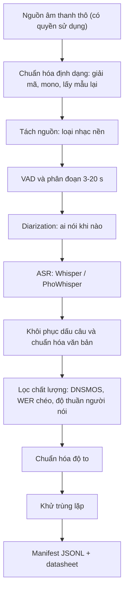

# Chương 36. Xây dựng dữ liệu TTS

!!! abstract "Mục tiêu học tập"
    Sau chương này, bạn có thể:

    - **Ước lượng** lượng và loại dữ liệu cần thiết cho từng họ mô hình TTS, từ mô hình một người nói thu trong phòng thu đến mô hình zero-shot huấn luyện trên dữ liệu "in-the-wild".
    - **Thiết kế** kịch bản thu âm tiếng Việt phủ vần, thanh điệu và cặp thanh bằng thuật toán phủ tập tham lam, đồng thời **suy ra** bảo đảm xấp xỉ của thuật toán này.
    - **Lập kế hoạch** một đợt thu âm studio: chọn người đọc, thiết bị, định dạng, tổ chức phiên thu và kiểm soát chất lượng.
    - **So sánh** các bộ dữ liệu công khai tiếng Anh và tiếng Việt theo quy mô, chất lượng, mục đích và giấy phép.
    - **Xây dựng** pipeline xử lý dữ liệu "in-the-wild": tách nguồn, VAD, phân đoạn, diarization, ASR, chuẩn hóa văn bản, lọc chất lượng, chuẩn hóa độ to, khử trùng lặp.
    - **Cài đặt** khung xử lý dữ liệu gồm cắt im lặng, lọc theo độ dài/độ to/băng thông, ghi manifest JSONL và chia tập theo nhóm.
    - **Chẩn đoán** các nguồn rò rỉ dữ liệu giữa tập huấn luyện và tập kiểm tra, và **viết** datasheet cho bộ dữ liệu.

!!! info "Kiến thức cần có"
    - [Chương 6 – PyTorch cho xử lý tiếng nói](../phan-1-nen-tang/ch06-pytorch-cho-tieng-noi.md): Dataset, DataLoader, padding, bucketing.
    - [Chương 14 – Xử lý tín hiệu số cho tiếng nói](../phan-3-tin-hieu-ngu-am/ch14-xu-ly-tin-hieu-so.md): tần số lấy mẫu, STFT, mel, LUFS.
    - [Chương 15 – Ngữ âm và âm vị học tiếng Việt](../phan-3-tin-hieu-ngu-am/ch15-ngu-am-tieng-viet.md): cấu trúc âm tiết, thanh điệu, phương ngữ.
    - [Chương 17 – Chuẩn hóa văn bản tiếng Việt](../phan-4-frontend/ch17-chuan-hoa-van-ban.md): số, ngày tháng, viết tắt, NFC.
    - [Chương 21 – Bài toán căn chỉnh](../phan-5-mo-hinh-am-hoc/ch21-alignment.md): forced alignment, CTC.

Các phần trước của giáo trình nói nhiều về kiến trúc. Chương này nói về thứ quyết định trần chất lượng của mọi kiến trúc: **dữ liệu**. Một kỹ sư TTS nhiều kinh nghiệm thường dành phần lớn thời gian của dự án cho dữ liệu chứ không phải cho mô hình, và lý do rất đơn giản: một mô hình sinh tốt sẽ học *trung thành* những gì có trong dữ liệu, kể cả những thứ bạn không muốn nó học.

## 36.1 Vì sao dữ liệu quyết định trần chất lượng

### Trực giác: mô hình sinh là chiếc gương

Hãy nhớ lại từ [Chương 7](../phan-2-mo-hinh-sinh/ch07-tong-quan-mo-hinh-sinh.md) rằng TTS là bài toán mô hình hóa phân phối có điều kiện $p(\mathbf{Y} \mid \mathbf{x})$. Huấn luyện theo hợp lý cực đại tương đương cực tiểu hóa

$$
\mathbb{E}_{\mathbf{x}}\Big[ D_{\mathrm{KL}}\big(p_{\text{data}}(\mathbf{Y} \mid \mathbf{x}) \,\Vert\, p_\theta(\mathbf{Y} \mid \mathbf{x})\big) \Big],
$$

tức là đẩy $p_\theta$ về phía $p_{\text{data}}$. Mục tiêu này *không có khái niệm "giọng đẹp"*: nếu $p_{\text{data}}$ chứa tiếng vang phòng, tiếng quạt, tiếng nhạc nền, lỗi phát âm hay bản ghi lời sai, thì mô hình lý tưởng — theo đúng nghĩa toán học — sẽ tái tạo chúng. Mô hình càng mạnh thì càng giống một chiếc gương trung thực.

Có thể tách $\mathbf{Y}$ quan sát được thành các thành phần (một mô hình tư duy, không phải đẳng thức chính xác):

$$
\mathbf{Y}_{\text{quan sát}} \approx \underbrace{\mathbf{Y}_{\text{giọng sạch}}(\mathbf{x}, \text{người nói}, \text{ngôn điệu})}_{\text{điều ta muốn học}} \;\oplus\; \underbrace{\text{kênh}(\text{mic, phòng, codec})}_{\text{nên cố định hoặc loại bỏ}} \;\oplus\; \underbrace{\text{nhiễu}}_{\text{nên loại bỏ}},
$$

trong đó $\oplus$ chỉ sự kết hợp (cộng, tích chập với đáp ứng xung của phòng…). Phía văn bản cũng có nhiễu: nếu bản ghi lời là $\mathbf{x}'$ thay vì nội dung thật $\mathbf{x}$, mô hình học $p(\mathbf{Y} \mid \mathbf{x}')$ — một ánh xạ sai giữa chữ và âm. Với các mô hình học căn chỉnh tự động (Tacotron, VITS, F5-TTS), nhãn sai còn làm hỏng chính quá trình căn chỉnh.

### Bốn trục của một bộ dữ liệu TTS

Khi đánh giá một bộ dữ liệu, hãy xét bốn trục độc lập:

1. **Chất lượng tín hiệu**: tỉ số tín hiệu trên nhiễu (SNR), độ vang, méo (clipping), băng thông hiệu dụng, tính nhất quán của kênh thu.
2. **Độ trung thực văn bản–âm thanh**: bản ghi lời có khớp *từng âm tiết* với những gì được nói không, kể cả cách đọc số, viết tắt, từ nước ngoài.
3. **Độ phủ**: phủ đơn vị ngữ âm (âm vị, vần, thanh, cặp thanh), phủ ngôn điệu (câu hỏi, câu cảm, liệt kê, câu dài), phủ lĩnh vực (tin tức, hội thoại, số liệu).
4. **Quy mô và đa dạng**: số giờ, số người nói, phương ngữ, phong cách.

Trục 1–2 thường mâu thuẫn với trục 4: dữ liệu càng lớn càng khó giữ sạch. Kiến trúc bạn chọn quyết định nên ưu tiên trục nào.

### Lượng dữ liệu theo loại mô hình

Bảng dưới đây là **kinh nghiệm thực tế của cộng đồng**, không phải định luật. Con số chính xác phụ thuộc kiến trúc, chất lượng dữ liệu và việc có khởi tạo từ mô hình tiền huấn luyện hay không.

| Kịch bản | Mô hình điển hình | Lượng dữ liệu thường gặp | Ưu tiên |
|---|---|---|---|
| Một người nói, huấn luyện từ đầu | Tacotron 2, FastSpeech 2, VITS | khoảng 10–25 giờ (LJSpeech ≈ 24 giờ là mốc tham chiếu kinh điển) | Rất sạch, rất nhất quán |
| Một người nói, khởi tạo từ mô hình tiền huấn luyện | VITS, FastSpeech 2 tinh chỉnh | khoảng 1–5 giờ | Sạch, nhất quán |
| Thích nghi người nói mới (*speaker adaptation*) | Mô hình đa người nói + fine-tune | vài phút đến khoảng một giờ | Sạch, đúng giọng mục tiêu |
| Đa người nói | VITS đa người nói, YourTTS | hàng chục đến hàng trăm giờ, mỗi người nói tối thiểu vài chục phút | Nhãn người nói đúng, cân bằng |
| Zero-shot quy mô lớn | VALL-E, F5-TTS, CosyVoice | hàng nghìn đến hàng trăm nghìn giờ | Đa dạng; lọc tự động mạnh tay |
| Vocoder | HiFi-GAN, BigVGAN, Vocos | vài chục giờ trở lên, **không cần bản ghi lời** | Dải tần đầy đủ, đa dạng người nói |

Hai nhận xét quan trọng:

- **Vocoder không cần văn bản.** Đây là điểm thường bị bỏ qua: bạn có thể huấn luyện vocoder trên mọi âm thanh tiếng nói sạch có băng thông đủ rộng, kể cả khi không có bản ghi lời. Điều này giúp tận dụng các nguồn dữ liệu mà mô hình âm học không dùng được.
- **Mô hình lớn chịu nhiễu tốt hơn, nhưng sẽ "sao chép môi trường".** Một mô hình zero-shot được huấn luyện trên dữ liệu đa dạng sẽ tiếp tục đúng môi trường âm học của đoạn gợi ý (*prompt*): đưa vào gợi ý có tiếng vang thì đầu ra cũng có tiếng vang. Đây không phải lỗi mà là hệ quả trực tiếp của mục tiêu hợp lý cực đại.

!!! note "Góc tiếng Việt"
    Tiếng Việt thuộc nhóm ngôn ngữ có tài nguyên hạn chế cho TTS. Tính đến thời điểm biên soạn (2026), lượng dữ liệu tiếng Việt công khai đã tăng đáng kể (xem Mục 36.3), nhưng phần lớn là dữ liệu thu từ Internet với điều khoản *chỉ dùng cho nghiên cứu*. Nếu dự án của bạn có mục đích thương mại, gần như chắc chắn bạn sẽ phải **tự thu âm** hoặc mua bản quyền dữ liệu. Vì vậy kỹ năng thiết kế kịch bản và tổ chức thu âm ở Mục 36.2 có giá trị thực tế rất lớn với cộng đồng Việt Nam.

## 36.2 Thu âm trong phòng thu

Với một giọng đọc thương mại một người nói, thu âm studio vẫn là con đường cho chất lượng cao nhất và rủi ro pháp lý thấp nhất. Quy trình gồm năm việc: thiết kế kịch bản, chọn người đọc, chuẩn bị thiết bị và phòng, tổ chức phiên thu, kiểm soát chất lượng.

### 36.2.1 Thiết kế kịch bản: bài toán phủ tập

**Trực giác.** Thời gian thu âm đắt (người đọc, phòng thu, người giám sát, hậu kỳ). Ta muốn với một số giờ cố định, kịch bản chứa *nhiều đơn vị ngữ âm khác nhau nhất*, để mô hình không gặp phải âm tiết hay tổ hợp thanh điệu "lạ" khi suy luận. Nếu chọn câu ngẫu nhiên từ báo chí, các vần phổ biến (như *-ông*, *-ang*, *-a*) bị lặp hàng trăm lần trong khi các vần hiếm (như *-oong*, *-uych*, *-oăn*) có thể không xuất hiện lần nào.

**Chọn đơn vị cần phủ.** Với tiếng Việt, cấu trúc âm tiết (âm đầu, âm đệm, âm chính, âm cuối, thanh điệu — xem [Chương 15](../phan-3-tin-hieu-ngu-am/ch15-ngu-am-tieng-viet.md)) gợi ý các họ đơn vị sau:

- **Vần không thanh** (ví dụ *-uyên*, *-oang*): quyết định phần lớn đặc trưng phổ.
- **Vần có thanh** (ví dụ *-uyên* + ngã): vì các vần tắc (kết thúc bằng *-p, -t, -c, -ch*) chỉ đi với thanh sắc và nặng, tổ hợp vần–thanh hợp lệ ít hơn tích Descartes, nhưng vẫn rất nhiều.
- **Cặp thanh liền kề** (6 × 6 = 36 cặp): F0 của một âm tiết chịu ảnh hưởng của âm tiết đứng trước và sau (hiện tượng đồng cấu âm về thanh điệu, *tonal coarticulation*), nên mô hình cần thấy đủ các chuyển tiếp như *ngã → nặng*, *hỏi → sắc*.
- **Âm đầu + vần**, **ranh giới âm tiết** (âm cuối của âm tiết trước gặp âm đầu của âm tiết sau, tương tự "diphone" xuyên âm tiết): hữu ích nhưng tạo ra không gian rất lớn, thường dùng làm mục tiêu phụ.
- **Đơn vị ngôn điệu**: câu hỏi có/không, câu hỏi có từ để hỏi, câu có tiểu từ tình thái cuối câu (*à, ạ, nhé, nhỉ, chứ* — xem [Chương 16](../phan-3-tin-hieu-ngu-am/ch16-ngon-dieu.md)), liệt kê, câu dài nhiều mệnh đề.

**Hình thức hóa.** Gọi $\mathcal{U}$ là tập đơn vị cần phủ, mỗi câu ứng viên $s$ phủ tập con $U(s) \subseteq \mathcal{U}$ và có chi phí $c(s) > 0$ (ví dụ số âm tiết, tỉ lệ với thời gian đọc). Bài toán **phủ tập có trọng số** (*weighted set cover*) là:

$$
\min_{S \subseteq \text{ứng viên}} \sum_{s \in S} c(s) \quad \text{sao cho} \quad \bigcup_{s \in S} U(s) = \mathcal{U}.
$$

Bài toán này là NP-khó. Thuật toán **tham lam** chọn ở mỗi bước câu có *chi phí trên mỗi đơn vị mới* nhỏ nhất, tức tỉ số

$$
\text{điểm}(s) = \frac{\lvert U(s) \setminus C \rvert}{c(s)}
$$

lớn nhất, với $C$ là tập đơn vị đã được phủ. Ý tưởng này đã được dùng để thiết kế các kho ngữ liệu TTS kinh điển, chẳng hạn CMU ARCTIC (Kominek và Black, 2004) và các nghiên cứu xem thiết kế kho ngữ liệu như bài toán phủ tập (François và Boëffard, 2001).

**Suy ra bảo đảm xấp xỉ.** Vì sao tham lam lại "đủ tốt"? Ta chứng minh chi phí của nó không vượt quá $H_n \cdot \mathrm{OPT}$, với $n = \lvert \mathcal{U} \rvert$, $H_n = 1 + \tfrac{1}{2} + \cdots + \tfrac{1}{n} \le \ln n + 1$ và $\mathrm{OPT}$ là chi phí tối ưu (Johnson, 1974; Chvátal, 1979).

1. *Gán giá cho đơn vị.* Khi tham lam chọn câu $s$ phủ thêm $k$ đơn vị mới, ta chia đều chi phí: mỗi đơn vị mới nhận giá $c(s)/k$. Tổng giá của mọi đơn vị đúng bằng tổng chi phí của tham lam.
2. *Chặn giá tại mỗi bước.* Giả sử tại một bước còn $m$ đơn vị chưa phủ. Lời giải tối ưu phủ toàn bộ $\mathcal{U}$, nên phủ cả $m$ đơn vị này, với tổng chi phí không quá $\mathrm{OPT}$. Do đó trong lời giải tối ưu phải có ít nhất một câu có chi phí trên mỗi đơn vị *mới* không quá $\mathrm{OPT}/m$ (nếu mọi câu đều đắt hơn, tổng chi phí để phủ $m$ đơn vị sẽ vượt $\mathrm{OPT}$). Tham lam chọn câu có tỉ số tốt nhất, nên mỗi đơn vị được phủ ở bước này có giá không quá $\mathrm{OPT}/m$.
3. *Cộng lại.* Sắp các đơn vị theo thứ tự được phủ $u_1, \ldots, u_n$. Khi $u_j$ được phủ thì còn ít nhất $n - j + 1$ đơn vị chưa phủ, nên giá của nó không quá $\mathrm{OPT}/(n - j + 1)$. Suy ra

$$
\text{Chi phí tham lam} = \sum_{j=1}^{n} \text{giá}(u_j) \le \mathrm{OPT} \sum_{j=1}^{n} \frac{1}{n - j + 1} = H_n \cdot \mathrm{OPT}.
$$

Feige (1998) đã chỉ ra rằng hệ số $\ln n$ về cơ bản là tốt nhất có thể đạt được trong thời gian đa thức (dưới giả thiết độ phức tạp chuẩn), nên tham lam là lựa chọn hợp lý chứ không chỉ là "mẹo nhanh". Trong thực tế, ta thường có **ngân sách** cố định (ví dụ 10 giờ đọc) và muốn *phủ nhiều nhất có thể* trong ngân sách đó: đó là bài toán phủ cực đại có ngân sách (*budgeted maximum coverage*). Hàm số đơn vị được phủ là hàm *submodular* (lợi ích giảm dần), và các biến thể tham lam cho bài toán này cũng có bảo đảm xấp xỉ theo hằng số (Nemhauser và cộng sự, 1978; Khuller và cộng sự, 1999).

**Những điều tham lam thuần túy không làm được.** Thuật toán tối ưu độ phủ chứ không tối ưu *độ tự nhiên*. Các câu có điểm cao thường là câu ngắn, dày đặc từ hiếm, khó đọc tự nhiên. Kinh nghiệm thực tế:

- Lọc trước kho câu ứng viên: độ dài khoảng 5–30 âm tiết, không có từ ngữ nhạy cảm, không lỗi chính tả, không chứa ký hiệu khó đọc (hoặc đã chuẩn hóa sang dạng đọc).
- Phạt câu quá hiếm: nhân điểm với một hệ số "độ tự nhiên", chẳng hạn xác suất câu theo một mô hình ngôn ngữ.
- Yêu cầu mỗi đơn vị xuất hiện **ít nhất $k$ lần** ($k = 2$ đến $5$) thay vì một lần, vì mô hình cần nhiều ngữ cảnh khác nhau cho cùng một đơn vị.
- Dành một phần kịch bản (ví dụ 20–40%) cho **văn bản đúng lĩnh vực mục tiêu** (tin tức, chăm sóc khách hàng, sách nói) chọn ngẫu nhiên, để phân phối ngôn điệu giống lúc dùng thật.

**Kịch bản phải ở dạng đọc.** Mọi số, ngày tháng, đơn vị, viết tắt trong kịch bản nên được viết ra đúng như cách bạn muốn người đọc đọc (*"ngày mùng hai tháng chín"* thay vì *"2/9"*), hoặc ít nhất có chú thích cách đọc. Nếu kịch bản ghi "2/9" và người đọc đọc "mùng hai tháng chín", bản ghi lời lưu trong bộ dữ liệu phải là dạng đã đọc. Đây là nguồn gốc của rất nhiều lỗi đọc số về sau (xem [Chương 17](../phan-4-frontend/ch17-chuan-hoa-van-ban.md) và bảng chẩn đoán ở [Chương 37](ch37-huan-luyen-va-debug.md)).

### 36.2.2 Chọn người đọc

Người đọc (*voice talent*) quyết định "linh hồn" của giọng tổng hợp. Một số tiêu chí:

- **Ổn định**: giữ được cao độ trung bình, tốc độ và âm sắc qua nhiều giờ và nhiều ngày. Một giọng hay nhưng dao động mạnh giữa các phiên sẽ cho mô hình kém hơn một giọng bình thường nhưng ổn định.
- **Phát âm rõ và đúng chuẩn phương ngữ mục tiêu.** Với tiếng Việt, hãy quyết định trước giọng Bắc, Trung hay Nam (xem [Chương 15](../phan-3-tin-hieu-ngu-am/ch15-ngu-am-tieng-viet.md)) và kiểm tra các đặc điểm như phân biệt *tr/ch*, *s/x*, *r/d/gi*, phân biệt *hỏi/ngã*, âm cuối *-n/-ng*, *-t/-c*. G2P và từ điển phát âm phải khớp với phương ngữ của người đọc.
- **Sức bền**: đọc vài giờ mỗi ngày trong nhiều tuần mà không khàn giọng.
- **Thu thử**: cho 2–3 ứng viên đọc cùng một đoạn khoảng 5–10 phút, nghe mù (không biết ai đọc) với vài người dùng mục tiêu, rồi chọn.
- **Thỏa thuận bằng văn bản**: phạm vi sử dụng giọng (huấn luyện mô hình, thương mại hay không, thời hạn, quyền rút lại), thù lao. Đây không chỉ là thủ tục: [Chương 40](ch40-dao-duc-an-toan.md) phân tích vì sao sự đồng ý có hiểu biết là nền tảng đạo đức và pháp lý của mọi giọng tổng hợp.

### 36.2.3 Thiết bị, phòng thu và định dạng

| Hạng mục | Khuyến nghị thực tế | Lý do |
|---|---|---|
| Micro | Micro condenser màng lớn hoặc dynamic chất lượng tốt, có lưới chắn hơi (*pop filter*) | Âm sắc trung thực, giảm tiếng bật hơi *p, b* |
| Khoảng cách | Cố định (thường khoảng 15–30 cm), đánh dấu vị trí ghế, micro; chụp ảnh lại cách bố trí | Khoảng cách thay đổi làm đổi âm sắc (hiệu ứng tiệm cận) và độ to |
| Phòng | Đã xử lý tiêu âm, thời gian vang ngắn, tắt điều hòa/quạt/máy tính ồn | Tiếng vang và nhiễu nền bị mô hình học theo |
| Định dạng | WAV PCM, mono, **48 kHz hoặc 44,1 kHz, 24 bit** | Thu cao hơn tần số huấn luyện, giảm mẫu (*downsample*) về 22,05/24 kHz sau |
| Mức thu | Đỉnh khoảng −12 đến −6 dBFS, **không bao giờ clipping** | Clipping không sửa được; 24 bit cho đủ dải động dù thu nhỏ |
| Nhiễu nền | Càng thấp càng tốt; đo trên đoạn im lặng (ví dụ dưới khoảng −60 dBFS) | Ước lượng SNR, phát hiện thiết bị lỗi |

Tỉ số tín hiệu trên nhiễu được ước lượng từ công suất trung bình của đoạn có tiếng $P_{\text{s+n}}$ và đoạn im lặng $P_{\text{n}}$:

$$
\mathrm{SNR}_{\text{dB}} \approx 10 \log_{10} \frac{P_{\text{s+n}} - P_{\text{n}}}{P_{\text{n}}}.
$$

Vì sao thu ở 48 kHz rồi mới giảm mẫu? Vì bạn không biết trước mô hình tương lai sẽ dùng tần số nào (nhiều vocoder hiện đại dùng 24 kHz, 44,1 kHz hoặc 48 kHz), và thông tin tần số cao đã mất thì không lấy lại được. Lưu bản gốc, xử lý trên bản sao.

### 36.2.4 Tổ chức phiên thu và giữ nhất quán

Giọng người thay đổi theo thời gian trong ngày, độ mệt, sức khỏe, thậm chí thời tiết. Mô hình sẽ học một giọng "trung bình" pha trộn các trạng thái này, và đầu ra có thể dao động khó đoán. Một số kinh nghiệm:

- Phiên thu khoảng 2–4 giờ, nghỉ ngắn định kỳ; nếu có thể, thu vào cùng khung giờ mỗi ngày.
- **Câu neo** (*anchor sentences*): đầu mỗi phiên, người đọc đọc lại cùng một bộ 5–10 câu. So sánh F0 trung bình, tốc độ nói, độ to và phổ trung bình của câu neo giữa các phiên để phát hiện trôi (*drift*); phiên lệch nhiều có thể cần thu lại hoặc gắn nhãn phiên để mô hình biết.
- Người giám sát (*director*) nghe trực tiếp, đánh dấu ngay những câu đọc sai, vấp, có tiếng động (*click* miệng, chạm micro, tiếng giấy) để thu lại trong phiên.
- Phần mềm thu nên hiển thị từng câu, tự đặt tên tệp theo mã câu, và lưu nhật ký (ngày, phiên, số lần thu lại).
- Phong cách đọc phải được *thống nhất bằng hướng dẫn viết*: đọc trung tính hay truyền cảm, tốc độ, cách ngắt ở dấu phẩy, cách đọc từ tiếng Anh.

### 36.2.5 Kiểm soát chất lượng (QA)

QA gồm hai lớp: tự động và con người.

**Kiểm tra tự động** (chạy trên mọi tệp):

- Clipping (tỉ lệ mẫu chạm ±1), độ lệch một chiều (*DC offset*).
- Ước lượng SNR và băng thông hiệu dụng (phát hiện tệp bị giảm mẫu/nén nhầm).
- Độ dài im lặng đầu và cuối (phải nhất quán; xem Mục 36.4).
- **Tốc độ nói** = số âm tiết / thời lượng phần có tiếng. Tiếng Việt viết tách âm tiết bằng khoảng trắng nên rất dễ tính. Câu có tốc độ lệch xa phân phối chung (ví dụ $\lvert z \rvert > 3$) thường là câu đọc thiếu, đọc thừa, hoặc bị cắt sai.
- **Kiểm tra bằng ASR**: nhận dạng lại từng câu và tính CER so với kịch bản. CER cao bất thường là dấu hiệu đọc sai, đọc khác kịch bản, hoặc ghép nhầm tệp.

**Kiểm tra bằng tai**: nghe toàn bộ (hoặc một mẫu ngẫu nhiên đủ lớn) với tai nghe tốt, đánh dấu phát âm sai, tiếng động, hơi thở bất thường. Danh sách này quay lại thành danh sách thu lại.

!!! tip "Một quy tắc đơn giản đáng giá"
    Đừng bao giờ sửa âm thanh gốc tại chỗ. Lưu bản gốc chỉ-đọc, mọi bước xử lý tạo bản mới kèm mã phiên bản của pipeline. Khi phát hiện lỗi ở bước xử lý ba tháng sau, bạn sẽ cảm ơn chính mình.

## 36.3 Các bộ dữ liệu công khai

!!! warning "Kiểm tra giấy phép tại nguồn"
    Thông tin dưới đây phản ánh hiểu biết của chúng tôi **tính đến thời điểm biên soạn (2026)**. Quy mô, phiên bản và đặc biệt là **giấy phép** của bộ dữ liệu có thể thay đổi, và một số bộ có điều khoản bổ sung ngoài nhãn giấy phép (ví dụ yêu cầu đăng ký, cấm phân phối lại). Luôn đọc trang chính thức và thẻ dữ liệu (*dataset card*) trước khi dùng, đặc biệt nếu mục đích có yếu tố thương mại.

### 36.3.1 Tiếng Anh

| Bộ dữ liệu | Loại | Quy mô (xấp xỉ, theo nguồn công bố) | Ghi chú | Giấy phép (cần kiểm tra) |
|---|---|---|---|---|
| LJSpeech (Ito và Johnson, 2017) | Một người nói, sách đọc | ≈ 24 giờ, 13 100 đoạn, 22,05 kHz | Chuẩn mực cho thử nghiệm một người nói | Public domain |
| VCTK (Yamagishi và cộng sự, 2019) | Đa người nói, đọc câu | khoảng 110 người nói, mỗi người khoảng 400 câu, 48 kHz | Nhiều giọng địa phương; nhiều người đọc *cùng một bộ câu* | CC BY 4.0 |
| LibriTTS (Zen và cộng sự, 2019) | Đa người nói, sách nói | ≈ 585 giờ, ≈ 2 456 người nói, 24 kHz | Tách từ LibriSpeech, giữ dấu câu và chữ hoa | CC BY 4.0 |
| LibriTTS-R (Koizumi và cộng sự, 2023) | Bản phục hồi chất lượng của LibriTTS | cùng quy mô LibriTTS | Âm thanh đã qua mô hình phục hồi tiếng nói | CC BY 4.0 |
| Hi-Fi TTS (Bakhturina và cộng sự, 2021) | Đa người nói, chất lượng cao | khoảng 290 giờ, 10 người nói, 44,1 kHz | Phù hợp cho vocoder và mô hình băng rộng | CC BY 4.0 |
| MLS (Pratap và cộng sự, 2020) | Sách nói đa ngôn ngữ | khoảng 50 nghìn giờ (phần lớn là tiếng Anh), 8 ngôn ngữ | Thiết kế cho ASR, 16 kHz | CC BY 4.0 |
| Libriheavy (Kang và cộng sự, 2024) | Sách nói, có dấu câu và chữ hoa | khoảng 50 nghìn giờ | Thiết kế cho ASR, hữu ích cho TTS quy mô lớn | Kiểm tra tại nguồn |
| Emilia (He và cộng sự, 2024) | In-the-wild, 6 ngôn ngữ | khoảng 101 nghìn giờ; bản mở rộng Emilia-Large hơn 200 nghìn giờ | Kèm pipeline xử lý Emilia-Pipe | Phần gốc CC BY-NC 4.0; phần mở rộng có điều khoản riêng |

Một số nhận xét chuyên môn:

- **LJSpeech** sạch và nhất quán, nhưng nội dung là các sách phi hư cấu cũ (xuất bản từ cuối thế kỷ 19 đến giữa thế kỷ 20) với lối đọc sách khá đều; mô hình huấn luyện trên nó thường đọc tốt văn bản trang trọng nhưng kém hội thoại.
- **VCTK** có tính chất đặc biệt: nhiều người nói đọc cùng một tập câu. Nếu chia tập theo câu mà không để ý, cùng một câu văn có thể xuất hiện ở cả tập huấn luyện và tập kiểm tra (Mục 36.6).
- **LibriTTS-R** cho thấy một xu hướng: dùng mô hình phục hồi tiếng nói để "làm sạch" dữ liệu cũ. Cách này cải thiện chất lượng cảm nhận, nhưng mô hình phục hồi có thể để lại dấu vết riêng hoặc làm thay đổi âm sắc; hãy nghe kỹ trước khi dùng cho mục đích của bạn.
- **Emilia** là ví dụ tiêu biểu của dữ liệu "in-the-wild" quy mô lớn dùng cho các mô hình zero-shot như F5-TTS ([Chương 33](../phan-8-mo-hinh-lon/ch33-nar-quy-mo-lon.md)); giấy phép phi thương mại của phần gốc ảnh hưởng trực tiếp đến giấy phép của các mô hình huấn luyện trên nó ([Chương 40](ch40-dao-duc-an-toan.md)).

### 36.3.2 Tiếng Việt

| Bộ dữ liệu | Loại | Quy mô (xấp xỉ, theo nguồn công bố) | Ghi chú | Giấy phép / điều khoản (cần kiểm tra) |
|---|---|---|---|---|
| VIVOS (Luong và Vu, 2016) | Đọc, đa người nói | khoảng 15 giờ | Thiết kế cho **ASR**, chất lượng thu không đồng đều cho TTS | CC BY-NC-SA 4.0 |
| InfoRe (bộ "25 giờ") | Một người nói đọc văn bản | khoảng 25 giờ, khoảng 14,9 nghìn đoạn | Được cộng đồng dùng nhiều cho TTS một người nói | Điều khoản phát hành gốc chưa rõ ràng; các bản sao trên mạng ghi giấy phép khác nhau — kiểm tra |
| Dữ liệu các cuộc thi VLSP về TTS | Một/đa người nói | khác nhau theo từng năm | Thường chỉ cấp cho đội tham gia, theo thỏa thuận của VLSP | Thường giới hạn nghiên cứu — kiểm tra |
| Common Voice (tiếng Việt) (Ardila và cộng sự, 2020) | Đọc, cộng đồng đóng góp | nhỏ (cỡ vài giờ đến vài chục giờ tùy phiên bản) | Nhiều người nói, thiết bị đa dạng, thiết kế cho ASR | CC0 |
| viVoice | In-the-wild, đa người nói | khoảng 1 000 giờ, từ khoảng 186 kênh YouTube, 24 kHz | Nhãn "người nói" thực chất là **kênh**; văn bản chưa chuẩn hóa | CC BY-NC-SA 4.0, chỉ cho nghiên cứu, cần đăng ký |
| PhoAudiobook (Vu và cộng sự, 2025) | Sách nói, đa người nói | khoảng 940 giờ âm thanh dài hơn 10 giây (cộng phần tăng cường thành khoảng 1 500 giờ), khoảng 710 người nói | Thiết kế cho TTS zero-shot; có tập kiểm tra người nói đã thấy/chưa thấy | Chỉ dùng cho nghiên cứu/giáo dục, cấm phân phối lại, cần đăng ký |

Ngoài ra có nhiều bộ dữ liệu ASR tiếng Việt khác (từ các cuộc thi, từ cộng đồng, từ dữ liệu y tế…). Dữ liệu ASR thường không sạch đủ cho mô hình âm học, nhưng hữu ích cho: huấn luyện aligner, tiền huấn luyện encoder, huấn luyện vocoder (sau khi lọc), và đánh giá ASR dùng trong vòng lọc dữ liệu. [Phụ lục C](../phu-luc/c-tai-nguyen.md) tổng hợp thêm tài nguyên.

!!! note "Góc tiếng Việt"
    Ba vấn đề lặp lại ở dữ liệu tiếng Việt công khai:

    1. **Trộn phương ngữ.** Dữ liệu từ YouTube hay sách nói thường trộn giọng Bắc, Trung, Nam. Nếu không gắn nhãn phương ngữ, mô hình có thể "nhảy" phương ngữ giữa câu, hoặc G2P theo giọng Bắc không khớp với âm thanh giọng Nam.
    2. **Văn bản chưa chuẩn hóa và không nhất quán Unicode.** Cùng một chữ có thể ở dạng NFC hoặc NFD, dấu đặt kiểu *hòa* hoặc *hoà*. Hãy chuẩn hóa NFC và thống nhất vị trí dấu (xem [Chương 17](../phan-4-frontend/ch17-chuan-hoa-van-ban.md)) trước khi xây dựng bộ ký hiệu, nếu không mô hình sẽ thấy hai "ký tự" khác nhau cho cùng một âm.
    3. **Nhãn người nói không đáng tin.** Một kênh YouTube có thể có nhiều người nói, và một người nói có thể xuất hiện trên nhiều kênh. Kiểm tra lại bằng embedding người nói ([Chương 28](../phan-7-e2e-bieu-cam/ch28-da-nguoi-noi-voice-cloning.md)) trước khi dùng nhãn này cho mô hình đa người nói.

## 36.4 Pipeline dữ liệu "in-the-wild"

Mô hình zero-shot cần hàng nghìn giờ dữ liệu đa dạng, và không ai thu âm studio được quy mô đó. Giải pháp là xây một **pipeline tự động** biến âm thanh thô (podcast, sách nói, video) thành các cặp (đoạn âm thanh, bản ghi lời) đủ sạch. Các pipeline công khai như Emilia-Pipe (He và cộng sự, 2024) thường theo một khung tương tự:



Chúng ta đi qua từng bước, tập trung vào *vì sao* và *cái bẫy*.

### 36.4.1 Nguồn và chuẩn hóa định dạng

Bước 0 luôn là câu hỏi pháp lý và đạo đức: bạn có quyền dùng nguồn này để huấn luyện không? "Công khai trên Internet" không có nghĩa là "được phép" ([Chương 40](ch40-dao-duc-an-toan.md)). Ghi lại nguồn và giấy phép cho *từng tệp* ngay từ đầu; thêm vào sau gần như không thể.

Sau đó giải mã mọi định dạng về WAV mono ở một tần số thống nhất. Hai cái bẫy:

- **Âm thanh "giả băng rộng".** Một tệp 48 kHz có thể chứa nội dung chỉ tới 4 kHz hoặc 8 kHz (thu qua điện thoại rồi được lấy mẫu lại), hoặc bị cắt ở khoảng 16 kHz do nén MP3/AAC tốc độ bit thấp. Nếu trộn những tệp này với dữ liệu băng rộng, mô hình (đặc biệt là vocoder) học được rằng "đôi khi không có tần số cao", và đầu ra bị đục. Hàm `estimate_bandwidth` ở Mục 36.5 ước lượng băng thông hiệu dụng để lọc hoặc gắn nhãn.
- **Lấy mẫu lại kém chất lượng.** Dùng bộ lọc chống chồng phổ (*anti-aliasing*) đúng chuẩn (xem [Chương 14](../phan-3-tin-hieu-ngu-am/ch14-xu-ly-tin-hieu-so.md)); lấy mẫu lại bằng nội suy tuyến tính đơn giản sẽ gây chồng phổ.

### 36.4.2 Tách nguồn

Nhạc nền là kẻ thù số một của dữ liệu từ video và podcast. Các mô hình tách nguồn nhạc như Demucs (Rouard và cộng sự, 2023) có thể tách phần lời nói (*vocals*) ra khỏi nhạc. Tuy nhiên tách nguồn để lại dấu vết (âm thanh "ướt", méo nhẹ ở tần số cao), và mô hình TTS cũng sẽ học những dấu vết đó. Chiến lược thường gặp: chỉ chạy tách nguồn trên đoạn có phát hiện nhạc, và sau đó lọc lại bằng chỉ số chất lượng; nếu có đủ dữ liệu, *loại bỏ* đoạn có nhạc thường tốt hơn *cứu* chúng.

### 36.4.3 VAD và phân đoạn

Bộ phát hiện tiếng nói (*voice activity detection*, VAD) đánh dấu vùng có tiếng. Có thể dùng bộ dựa trên năng lượng (đơn giản, như hàm `trim_silence` ở Mục 36.5), WebRTC VAD, Silero VAD hoặc mô-đun VAD của pyannote (Bredin và cộng sự, 2020). Sau VAD, ta cắt thành đoạn dài khoảng **3–20 giây**:

- Quá ngắn (dưới khoảng 1–2 giây): ít ngữ cảnh ngôn điệu, tỉ lệ im lặng/tiếng cao, và không dùng được làm gợi ý cho mô hình zero-shot.
- Quá dài (trên khoảng 20–30 giây): tốn bộ nhớ (độ phức tạp attention bậc hai theo độ dài, xem [Chương 5](../phan-1-nen-tang/ch05-transformer.md)), khó căn chỉnh, một lỗi nhãn ảnh hưởng nhiều khung.
- **Chỉ cắt ở khoảng lặng** (ví dụ dài hơn 0,2–0,3 giây), không bao giờ cắt giữa âm tiết. Một đoạn bị cắt cụt âm cuối sẽ dạy mô hình kết thúc câu đột ngột.
- **Nhất quán im lặng đầu/cuối**: giữ một lượng đệm cố định (ví dụ 0,1–0,2 giây) cho mọi đoạn. Nếu khoảng lặng đầu câu lúc dài lúc ngắn, mô hình tự hồi quy sẽ học "ngập ngừng" ngẫu nhiên và dự đoán điểm dừng kém.

### 36.4.4 Diarization và độ thuần người nói

Diarization trả lời "ai nói khi nào". Các công cụ như pyannote.audio cho kết quả tốt trên nhiều miền, nhưng vẫn mắc lỗi ở đoạn nói chồng và người nói có giọng giống nhau. Hai quy tắc an toàn:

- **Loại bỏ đoạn nói chồng** (*overlapped speech*): TTS gần như không bao giờ cần chúng.
- **Kiểm tra độ thuần người nói** của từng đoạn: tách đoạn làm hai nửa, tính embedding người nói (ECAPA-TDNN, WavLM — [Chương 28](../phan-7-e2e-bieu-cam/ch28-da-nguoi-noi-voice-cloning.md)) cho mỗi nửa; nếu độ tương đồng cosine thấp hơn ngưỡng, đoạn đó có thể chứa hai người nói.

Với mô hình zero-shot, nhãn người nói toàn cục không bắt buộc, nhưng **độ thuần trong từng đoạn** lại rất quan trọng: nếu đoạn gợi ý và phần mục tiêu trong lúc huấn luyện là hai người khác nhau, mô hình học sai khái niệm "tiếp tục giọng".

### 36.4.5 ASR, dấu câu và chuẩn hóa văn bản

Bản ghi lời tự động thường đến từ Whisper (Radford và cộng sự, 2023) hoặc các phiên bản tinh chỉnh cho tiếng Việt như PhoWhisper (Le và cộng sự, 2024). Những cái bẫy của ASR khi làm nhãn cho TTS:

- **Ảo giác (*hallucination*)**: trên đoạn im lặng, nhạc hoặc tiếng ồn, các mô hình kiểu Whisper đôi khi sinh ra câu không có thật hoặc lặp một cụm từ nhiều lần. Lọc các đoạn có tỉ lệ từ/giây bất thường hoặc có chuỗi lặp.
- **Mô hình ngôn ngữ "sửa" lời nói**: ASR có xu hướng viết ra câu đúng ngữ pháp thay vì đúng những gì được nói (bỏ từ đệm, sửa lỗi nói). Với TTS, ta muốn bản ghi *trung thực với âm thanh*.
- **Đồng thuận chéo**: chạy hai hệ ASR khác nhau và tính WER giữa hai bản ghi. Khi hai hệ bất đồng nhiều, nhãn không đáng tin; bỏ đoạn đó là cách rẻ nhất.
- **Dấu câu**: dấu câu mang thông tin ngôn điệu (ngắt nghỉ, ngữ điệu hỏi). Nếu ASR không sinh dấu câu, cân nhắc dùng mô hình khôi phục dấu câu; nhưng hãy nhớ dấu câu khôi phục tự động có thể sai.
- **Ranh giới thời gian**: dấu thời gian của ASR thường lệch; dùng forced alignment ([Chương 21](../phan-5-mo-hinh-am-hoc/ch21-alignment.md)) để tinh chỉnh ranh giới cắt đoạn.

**Nhất quán chuẩn hóa văn bản** là cái bẫy âm thầm nhất. ASR có thể viết "2024" bằng chữ số trong đoạn này và "hai nghìn không trăm hai mươi tư" trong đoạn khác. Nếu dữ liệu huấn luyện chứa chữ số còn lúc suy luận bạn đưa vào văn bản đã được chuẩn hóa bằng bộ TN của [Chương 17](../phan-4-frontend/ch17-chuan-hoa-van-ban.md) (hoặc ngược lại), mô hình sẽ đọc sai số. Nguyên tắc vàng: **văn bản huấn luyện và văn bản suy luận phải đi qua cùng một bộ chuẩn hóa**, và bộ chuẩn hóa đó phải được đóng băng phiên bản cùng với dữ liệu.

### 36.4.6 Lọc chất lượng

Sau các bước trên, mỗi đoạn có một vector chỉ số. Lọc là bài toán cân bằng giữa chất lượng và độ đa dạng. Các tín hiệu thường dùng:

| Tín hiệu | Đo cái gì | Ghi chú |
|---|---|---|
| DNSMOS (Reddy và cộng sự, 2021) | MOS ước lượng không cần tham chiếu (SIG, BAK, OVRL) | Thiết kế cho đánh giá khử nhiễu; dùng để xếp hạng/lọc, không phải để kết luận chất lượng tuyệt đối |
| WER chéo giữa hai ASR | Độ tin cậy của nhãn | Ngưỡng tùy ngôn ngữ và miền |
| Độ thuần người nói | Đoạn có một người nói không | Cosine giữa embedding hai nửa đoạn |
| Tốc độ nói | Đọc thiếu/thừa, ảo giác ASR | Theo âm tiết/giây với tiếng Việt |
| Băng thông hiệu dụng | Âm thanh bị lấy mẫu lại/nén | Lọc hoặc gắn nhãn |
| Clipping, SNR | Méo, nhiễu | Ngưỡng đơn giản, rẻ |

Ngưỡng cụ thể (ví dụ giữ đoạn có DNSMOS OVRL trên khoảng 3,0) phụ thuộc mạnh vào dữ liệu; cách làm thực tế là **vẽ phân phối từng chỉ số, nghe mẫu ở các phân vị khác nhau** (5%, 25%, 50%…), rồi đặt ngưỡng nơi chất lượng nghe được bắt đầu chấp nhận được.

!!! warning "Lọc mạnh tay cũng là một dạng thiên lệch"
    Các bộ dự đoán MOS tự động thường được huấn luyện chủ yếu trên tiếng Anh và một số ngôn ngữ khác; chúng có thể chấm điểm thấp có hệ thống cho một số giọng, phương ngữ, độ tuổi hoặc phong cách nói (giọng khàn, giọng người lớn tuổi, giọng nói cảm xúc mạnh). Lọc theo một ngưỡng cố định có thể vô tình loại bỏ cả một nhóm người nói. Sau khi lọc, hãy so sánh phân phối giới tính, phương ngữ, phong cách giữa trước và sau lọc.

### 36.4.7 Chuẩn hóa độ to

Các nguồn khác nhau có độ to rất khác nhau. Nếu không chuẩn hóa, mô hình học một "phân phối độ to" rộng và đầu ra lúc to lúc nhỏ. Thông thường ta đo độ to theo LUFS (ITU-R BS.1770; chuẩn phát sóng EBU R 128 dùng mục tiêu −23 LUFS) và áp dụng hệ số khuếch đại

$$
g = 10^{(L_{\text{mục tiêu}} - L_{\text{đo}})/20},
$$

trong đó $L$ tính bằng dB (LUFS). Phép chia cho 20 vì $g$ nhân vào biên độ, trong khi dB đo công suất ($10\log_{10}$ của bình phương biên độ). Sau khi khuếch đại phải kiểm tra lại đỉnh để không clipping. Lưu ý: khuếch đại một đoạn nhỏ tiếng cũng khuếch đại nhiễu nền của nó; đây là lý do lọc SNR nên đứng trước chuẩn hóa độ to.

### 36.4.8 Khử trùng lặp

Dữ liệu Internet chứa rất nhiều trùng lặp: đoạn giới thiệu kênh lặp ở mọi video, quảng cáo, cùng một cuốn sách nói được tải lên nhiều lần. Trùng lặp gây hai hại: (1) mô hình quá khớp vào vài câu, (2) **rò rỉ** khi bản sao rơi vào tập kiểm tra. Ba mức khử trùng lặp:

- **Chính xác**: băm (*hash*) nội dung tệp âm thanh đã giải mã.
- **Gần trùng âm thanh**: dấu vân tay âm thanh (*audio fingerprinting*, ví dụ Chromaprint) hoặc cosine giữa embedding âm thanh.
- **Trùng văn bản**: chuẩn hóa văn bản rồi so khớp; các câu giống hệt nhau từ nhiều đoạn khác nhau thường là nội dung lặp.

### 36.4.9 Manifest

Kết quả cuối cùng là một tệp **manifest** dạng JSONL, mỗi dòng mô tả một đoạn. Một manifest tốt chứa đủ thông tin để tái lập mọi quyết định lọc mà không phải chạy lại pipeline:

- Định danh và đường dẫn: `id`, `audio`, `sr`, `duration`.
- Văn bản: `text` (đã chuẩn hóa), và nếu có, `raw_text` (bản ghi gốc), `phonemes`.
- Người nói và nguồn: `speaker`, `source`, `license`, `dialect`.
- Chỉ số chất lượng: `dnsmos`, `cer_cross`, `syl_per_sec`, `bandwidth_hz`, `level_db`.
- Phân tập: `split`, cùng với phiên bản pipeline đã tạo ra dòng này.

## 36.5 Mã minh họa: khung xử lý dữ liệu

Phần này cài đặt các viên gạch nhỏ nhưng thiết yếu của pipeline. Mã chỉ dùng `numpy`/`scipy`, chạy trên CPU với tín hiệu giả, để bạn tập trung vào logic. Khi làm với dữ liệu thật, hãy thay các hàm đơn giản bằng công cụ chuyên dụng (Silero VAD, pyloudnorm cho LUFS…), nhưng giữ nguyên cấu trúc.

### 36.5.1 Cắt im lặng, băng thông hiệu dụng, clipping

Hàm `trim_silence` coi một khung là im lặng nếu năng lượng thấp hơn đỉnh của tệp quá `top_db` dB; đây chính là cách hoạt động của nhiều hàm cắt im lặng phổ biến. Lưu ý tham số `keep_ms`: luôn chừa một đoạn đệm cố định để không xén mất phụ âm cuối yếu (các âm cuối tắc *-p, -t, -c* của tiếng Việt không bật hơi ra, nên năng lượng rất thấp).

```python
import numpy as np

def frame_rms_db(s, frame=1024, hop=256, eps=1e-10):
    """RMS theo khung, tính bằng dBFS (0 dBFS = biên độ 1.0)."""
    n_frames = 1 + max(0, len(s) - frame) // hop
    idx = np.arange(frame)[None, :] + hop * np.arange(n_frames)[:, None]
    rms = np.sqrt(np.mean(s[idx] ** 2, axis=1) + eps)          # (n_frames,)
    return 20 * np.log10(rms + eps)

def trim_silence(s, sr, top_db=40.0, frame=1024, hop=256, keep_ms=100):
    """Cắt im lặng đầu/cuối: khung nào thấp hơn (đỉnh - top_db) coi là im lặng.
    Giữ lại keep_ms mili-giây đệm để không xén mất phụ âm cuối/hơi thở nhẹ."""
    db = frame_rms_db(s, frame, hop)
    voiced = np.where(db > db.max() - top_db)[0]
    if len(voiced) == 0:
        return s[:0]
    pad = int(sr * keep_ms / 1000)
    start = max(0, voiced[0] * hop - pad)
    end = min(len(s), voiced[-1] * hop + frame + pad)
    return s[start:end]

def estimate_bandwidth(s, sr, n_fft=2048, rel_db=-60.0):
    """Ước lượng băng thông hiệu dụng: tần số cao nhất mà phổ trung bình
    còn lớn hơn (đỉnh + rel_db). Dùng để phát hiện âm thanh bị upsample."""
    win = np.hanning(n_fft)
    hop = n_fft // 4
    n_frames = 1 + (len(s) - n_fft) // hop
    frames = np.stack([s[i * hop:i * hop + n_fft] * win for i in range(n_frames)])
    psd = np.mean(np.abs(np.fft.rfft(frames, axis=1)) ** 2, axis=0)  # (n_fft//2+1,)
    psd_db = 10 * np.log10(psd + 1e-20)
    above = np.where(psd_db > psd_db.max() + rel_db)[0]
    return above[-1] * sr / n_fft

def clipping_ratio(s, thr=0.999):
    """Tỉ lệ mẫu chạm ngưỡng ±1 (dấu hiệu bị méo do clipping)."""
    return float(np.mean(np.abs(s) >= thr))

# --- Kiểm thử trên tín hiệu giả: 0,5 s lặng + 1 s "tiếng nói" + 0,7 s lặng ---
rng = np.random.default_rng(0)
sr = 24000
t = np.arange(sr) / sr
voice = 0.3 * np.sin(2 * np.pi * 220 * t) * (1 + 0.5 * np.sin(2 * np.pi * 3 * t))
s = np.concatenate([np.zeros(sr // 2), voice, np.zeros(int(0.7 * sr))])
s = s + 1e-4 * rng.standard_normal(len(s))          # nền nhiễu khoảng -80 dBFS
trimmed = trim_silence(s, sr)
dur = len(trimmed) / sr
assert 1.0 <= dur <= 1.3, dur                         # còn ~1 s + phần đệm
print(f"trước: {len(s)/sr:.2f} s, sau khi cắt: {dur:.2f} s")

# Âm thanh "giả 24 kHz": nội dung chỉ tới 4 kHz (như được upsample từ 8 kHz)
from scipy.signal import butter, sosfiltfilt
noise = rng.standard_normal(2 * sr)
narrow = sosfiltfilt(butter(10, 4000, fs=sr, output="sos"), noise)
print(f"băng thông full-band ≈ {estimate_bandwidth(noise, sr):.0f} Hz, "
      f"bị lọc ≈ {estimate_bandwidth(narrow, sr):.0f} Hz")
assert estimate_bandwidth(narrow, sr) < 6000 < estimate_bandwidth(noise, sr)
assert clipping_ratio(np.clip(3 * voice, -1, 1)) > 0.1
```

Ở dòng cuối, tín hiệu nhiễu trắng bị lọc thông thấp ở 4 kHz được phát hiện là "băng hẹp" dù nằm trong vỏ 24 kHz. Trong dữ liệu thật, biểu đồ phân phối `bandwidth_hz` thường có nhiều đỉnh rõ rệt (quanh 4, 8, 11, 16 kHz…), ứng với các nguồn ghi âm và codec khác nhau.

### 36.5.2 Chuẩn hóa mức, lọc, ghi manifest và chia tập theo nhóm

Khối mã sau **dùng tiếp các hàm của khối trên**. Hàm `active_level_db` chỉ tính năng lượng trên các khung có tiếng, theo tinh thần "cổng" (*gating*) của chuẩn LUFS — nếu tính trên cả đoạn im lặng, một câu có khoảng lặng dài sẽ bị khuếch đại quá mức. Hàm `assign_split` chia tập bằng hàm băm của **định danh nhóm** (người nói, cuốn sách, video) chứ không phải của từng câu, lý do được phân tích ở Mục 36.6.

```python
import hashlib, json, unicodedata
import numpy as np

def active_level_db(s, frame=1024, hop=256, gate_db=-50.0):
    """Mức năng lượng trung bình (dBFS) chỉ trên các khung 'có tiếng'
    (cao hơn ngưỡng cổng) — tinh thần giống cổng (gating) của LUFS."""
    db = frame_rms_db(s, frame, hop)
    act = db[db > gate_db]
    if len(act) == 0:
        return -np.inf
    return 10 * np.log10(np.mean(10 ** (act / 10)))   # trung bình theo công suất

def normalize_level(s, target_db=-23.0, peak_limit=0.95):
    """Đưa mức hoạt động về target_db, rồi giới hạn đỉnh để không clipping."""
    g = 10 ** ((target_db - active_level_db(s)) / 20)
    out = s * g
    peak = np.max(np.abs(out))
    return out * (peak_limit / peak) if peak > peak_limit else out

def assign_split(group_id, val_pct=2, test_pct=2):
    """Chia tập ổn định theo NHÓM (người nói/cuốn sách/video), không theo câu:
    cùng một nhóm luôn rơi vào cùng một tập, kể cả khi chạy lại pipeline."""
    h = int(hashlib.md5(group_id.encode("utf-8")).hexdigest(), 16) % 100
    return "test" if h < test_pct else ("val" if h < test_pct + val_pct else "train")

def make_record(uid, path, s, sr, text, speaker, source, license_, min_dur=1.0, max_dur=20.0):
    """Trả về dict cho manifest, hoặc (None, lý do) nếu mẫu bị loại."""
    dur = len(s) / sr
    if not (min_dur <= dur <= max_dur):
        return None, f"độ dài {dur:.1f}s ngoài [{min_dur}, {max_dur}]"
    if clipping_ratio(s) > 1e-3:
        return None, "clipping"
    text = unicodedata.normalize("NFC", text).strip()
    n_syl = len(text.split())                    # tiếng Việt: âm tiết cách nhau bởi khoảng trắng
    rate = n_syl / dur
    if not (1.5 <= rate <= 9.0):                 # ngưỡng thô, cần chỉnh theo dữ liệu thật
        return None, f"tốc độ nói bất thường {rate:.1f} âm tiết/s"
    return {"id": uid, "audio": path, "text": text, "speaker": speaker,
            "duration": round(dur, 3), "sr": sr, "syl_per_sec": round(rate, 2),
            "level_db": round(active_level_db(s), 1),
            "bandwidth_hz": round(estimate_bandwidth(s, sr)),
            "source": source, "license": license_, "split": assign_split(speaker)}, None

# --- Chạy thử với vài mẫu giả ---
rng = np.random.default_rng(1)
sr, rows, rejected = 24000, [], []
texts = ["xin chào các bạn", "hôm nay trời đẹp quá", "một", "tôi đi học"]
for k, (txt, sec) in enumerate(zip(texts, [1.5, 2.0, 0.4, 25.0])):
    s = 0.05 * rng.standard_normal(int(sec * sr))
    s = normalize_level(s, -23.0)
    rec, why = make_record(f"utt{k:04d}", f"wavs/utt{k:04d}.wav", s, sr, txt,
                           speaker=f"spk{k % 2}", source="demo", license_="CC-BY-4.0")
    (rows.append(rec) if rec else rejected.append((f"utt{k:04d}", why)))

with open("manifest.jsonl", "w", encoding="utf-8") as f:
    for r in rows:
        f.write(json.dumps(r, ensure_ascii=False) + "\n")
print(len(rows), "mẫu giữ lại; bị loại:", rejected)
assert len(rows) == 2 and abs(rows[0]["level_db"] - (-23.0)) < 0.5
assert assign_split("spk0") == assign_split("spk0")      # tất định
```

Ngưỡng tốc độ nói 1,5–9 âm tiết/giây trong mã chỉ là một khoảng rất rộng để bắt lỗi thô; với dữ liệu thật, hãy tính phân phối tốc độ nói theo từng người nói rồi loại các điểm ngoại lai theo điểm $z$.

### 36.5.3 Chọn kịch bản tham lam phủ vần và thanh điệu

Khối mã cuối cài đặt thuật toán của Mục 36.2.1. Hàm `split_syllable` là bản rút gọn của bộ phân tích âm tiết ở [Chương 15](../phan-3-tin-hieu-ngu-am/ch15-ngu-am-tieng-viet.md): nó lấy thanh điệu từ dấu tổ hợp sau khi phân rã NFD, tách âm đầu theo khớp dài nhất, và xử lý trường hợp *gi* đứng trước phụ âm (*gì*, *gìn*). Ba họ đơn vị được phủ: vần (`R:`), vần có thanh (`RT:`), cặp thanh liền kề (`TT:`).

```python
import random, re, unicodedata

TONE_MARKS = {chr(0x300): "huyen", chr(0x301): "sac", chr(0x309): "hoi",   # dấu thanh
              chr(0x303): "nga", chr(0x323): "nang"}                     # dạng tổ hợp (NFD)
ONSETS = sorted("ngh ng nh ch gh gi kh ph th tr qu b c d đ g h k l m n p r s t v x".split(),
                key=len, reverse=True)
VOWELS = set("aăâeêioôơuưy")

def split_syllable(syl):
    """Tách âm tiết chữ viết thành (âm đầu, vần không dấu, thanh). Bản rút gọn —
    bộ phân tích đầy đủ ở Chương 15 xử lý thêm nhiều trường hợp đặc biệt."""
    nfd = unicodedata.normalize("NFD", syl.lower())
    tone = next((TONE_MARKS[c] for c in nfd if c in TONE_MARKS), "ngang")
    base = unicodedata.normalize("NFC", "".join(c for c in nfd if c not in TONE_MARKS))
    onset = next((o for o in ONSETS if base.startswith(o)), "")
    rhyme = base[len(onset):]
    if onset == "gi" and (not rhyme or rhyme[0] not in VOWELS):
        rhyme = "i" + rhyme                      # "gì" -> vần "i", "gìn" -> vần "in"
    return onset, rhyme, tone

def units_of(sentence):
    """Tập đơn vị cần phủ: vần, vần+thanh, và cặp thanh của hai âm tiết liền kề."""
    syls = re.findall(r"\w+", unicodedata.normalize("NFC", sentence.lower()))
    parts = [split_syllable(s) for s in syls]
    u = {f"R:{r}" for _, r, _ in parts} | {f"RT:{r}_{t}" for _, r, t in parts}
    u |= {f"TT:{a[2]}-{b[2]}" for a, b in zip(parts, parts[1:])}
    return u, len(syls)

def greedy_select(sentences, budget_syllables):
    """Phủ tập tham lam có chi phí: mỗi bước chọn câu có
    (số đơn vị MỚI) / (số âm tiết) lớn nhất, đến khi hết ngân sách."""
    info = [units_of(s) for s in sentences]
    covered, chosen, used = set(), [], 0
    remaining = set(range(len(sentences)))
    while True:
        fits = [i for i in remaining if used + info[i][1] <= budget_syllables]
        if not fits:
            break
        best = max(fits, key=lambda i: len(info[i][0] - covered) / info[i][1])
        if not info[best][0] - covered:          # không câu nào thêm đơn vị mới
            break
        chosen.append(best); covered |= info[best][0]
        used += info[best][1]; remaining.remove(best)
    return chosen, covered

corpus = [
    "Mẹ tôi mua một con cá rất to ở chợ.", "Ba ba bơi dưới ao.",
    "Những ngọn núi phủ tuyết trắng xóa.", "Anh ấy nghĩ rằng ngày mai sẽ mưa.",
    "Chúng ta học tiếng Việt mỗi buổi sáng.", "Quyển sách này khuyến khích sự sáng tạo.",
    "Người già thường dậy sớm tập thể dục.", "Cô giáo giảng bài rất kỹ lưỡng.",
    "Hoa huệ thơm ngát cả khu vườn nhỏ.", "Bạn đã ăn cơm chưa?",
    "Thuyền khuya lặng lẽ trôi trên sông.", "Gió mùa đông bắc tràn về đột ngột.",
]
chosen, covered = greedy_select(corpus, budget_syllables=40)
all_units = set().union(*(units_of(s)[0] for s in corpus))
print(f"chọn {len(chosen)} câu, phủ {len(covered)}/{len(all_units)} đơn vị")
for i in chosen:
    print("  -", corpus[i])

# So sánh với chọn ngẫu nhiên cùng ngân sách âm tiết
rng, rand_cov = random.Random(0), []
for _ in range(200):
    order, cov, used = rng.sample(range(len(corpus)), len(corpus)), set(), 0
    for i in order:
        u, n = units_of(corpus[i])
        if used + n <= 40:
            cov |= u; used += n
    rand_cov.append(len(cov))
print(f"ngẫu nhiên: trung bình {sum(rand_cov)/len(rand_cov):.1f} đơn vị")
assert split_syllable("Nguyễn") == ("ng", "uyên", "nga")
assert split_syllable("gì") == ("gi", "i", "huyen")
assert len(covered) >= sum(rand_cov) / len(rand_cov)
```

Với kho ngữ liệu nhỏ trong ví dụ, tham lam phủ 97 đơn vị so với trung bình khoảng 85 của chọn ngẫu nhiên với cùng ngân sách. Trên kho ứng viên thật hàng trăm nghìn câu, khoảng cách này lớn hơn nhiều, nhất là với các vần hiếm. Khi chạy ở quy mô lớn, hãy cài đặt bằng hàng đợi ưu tiên với cập nhật lười (*lazy greedy*): vì lợi ích biên chỉ giảm dần (tính submodular), điểm cũ của một câu là cận trên của điểm mới, nên chỉ cần tính lại câu đứng đầu hàng đợi.

## 36.6 Chia tập và rò rỉ dữ liệu

Rò rỉ (*leakage*) là khi thông tin của tập kiểm tra lọt vào tập huấn luyện, làm kết quả đánh giá đẹp hơn thực tế. Với TTS, các nguồn rò rỉ đặc thù gồm:

- **Cùng câu văn, khác người đọc** (như VCTK): mô hình đã thấy câu đó, nên đọc "dễ" hơn câu hoàn toàn mới.
- **Cùng nguồn gốc**: hai đoạn liền nhau của cùng một chương sách nói, cùng một video, rơi vào hai tập khác nhau. Chúng chia sẻ người nói, phòng thu, micro và cả ngữ cảnh nội dung.
- **Bản sao**: cùng một nội dung được tải lên nhiều lần (Mục 36.4.8).
- **Người nói của tập "chưa thấy"**: khi đánh giá zero-shot, người nói ở tập kiểm tra không được xuất hiện trong tập huấn luyện, kể cả dưới một nhãn khác (một người trên hai kênh YouTube).
- **Đoạn gợi ý**: khi đánh giá nhân bản giọng, đoạn gợi ý không được nằm trong dữ liệu huấn luyện.

**Hình thức hóa.** Gán mỗi mẫu $i$ một nhóm $g(i)$ (người nói, cuốn sách, video). Phép chia hợp lệ là phép chia mà mọi mẫu cùng nhóm thuộc cùng một tập:

$$
g(i) = g(j) \;\Rightarrow\; \text{split}(i) = \text{split}(j).
$$

Cách đơn giản và tất định là $\text{split}(i) = h\big(\text{băm}(g(i)) \bmod 100\big)$ với $h$ ánh xạ khoảng giá trị sang train/val/test, như hàm `assign_split` ở trên. Ưu điểm: chạy lại pipeline với dữ liệu mới thêm vào thì các nhóm cũ vẫn ở nguyên tập cũ, không bị "xáo" sang tập khác.

Việc chọn $g$ phụ thuộc câu hỏi đánh giá: muốn đo khả năng đọc **câu mới** của giọng đã biết, nhóm theo văn bản; muốn đo khả năng **nhân bản người nói mới**, nhóm theo người nói. Chi tiết về thiết kế tập đánh giá được bàn ở [Chương 38](ch38-danh-gia-tts.md).

## 36.7 Tài liệu hóa: datasheet cho bộ dữ liệu TTS

Gebru và cộng sự (2021) đề xuất mỗi bộ dữ liệu đi kèm một **datasheet** trả lời các câu hỏi về động cơ, thành phần, quy trình thu thập, tiền xử lý, mục đích sử dụng, phân phối và bảo trì. Với TTS, nên bổ sung các trường đặc thù. Một khung tối thiểu ở dạng YAML (chỉ là mẫu tham khảo, không phải mã chạy):

```yaml
name: vi-studio-female-north-v1
version: 1.2.0              # tăng phiên bản mỗi khi lọc/sửa nhãn
motivation: "Giọng đọc tin tức giọng Bắc cho ứng dụng hỗ trợ người khiếm thị"
speakers:
  - id: spk001
    gender: nu               # chỉ ghi khi người nói đồng ý công bố
    dialect: bac
    consent_form: "consent-v3, ký ngày 2026-03-01"
    allowed_uses: ["huấn luyện TTS", "thương mại nội bộ"]
recording:
  device: "condenser màng lớn, giao diện âm thanh USB"
  format: "WAV PCM 48 kHz 24 bit mono (bản gốc)"
  room: "phòng đã xử lý âm, nhiễu nền khoảng -65 dBFS"
text:
  normalization: "vn_frontend 0.4.1 (đóng băng phiên bản)"
  unicode: NFC
  tone_mark_style: "hòa (dấu trên nguyên âm thứ nhất)"
  phone_set: "ipa-north-v2"
processing:
  pipeline_commit: "a1b2c3d"
  trimming: "top_db=40, keep_ms=100"
  loudness: "-23 dB (mức hoạt động)"
splits: "chia theo câu văn; tập test gồm 300 câu không trùng văn bản"
known_issues:
  - "Phiên 7 giọng hơi khàn (đã gắn nhãn session=7)"
license: "Nội bộ; không phân phối lại"
```

Trường `known_issues` thường bị bỏ trống nhưng lại là trường có giá trị nhất cho người dùng sau này. Trường `consent_form` liên kết bộ dữ liệu với văn bản đồng ý cụ thể mà người nói đã ký; [Chương 40](ch40-dao-duc-an-toan.md) bàn về nội dung cần có của văn bản này.

## Lỗi thường gặp và mẹo thực hành

- **Kịch bản chưa chuẩn hóa sang dạng đọc.** Người đọc tự quyết cách đọc "2/9", "TP.HCM", "COVID-19", và bản ghi lời không phản ánh điều đó. Hãy chuẩn hóa kịch bản trước khi thu, và nếu người đọc đọc khác kịch bản, sửa *bản ghi lời* chứ đừng ép âm thanh khớp văn bản.
- **Trộn tần số lấy mẫu và âm thanh giả băng rộng.** Một vài phần trăm tệp băng hẹp có thể đủ làm vocoder tạo âm "đục" hoặc nhiễu xì ở tần số cao. Đo băng thông hiệu dụng cho mọi tệp.
- **Im lặng đầu/cuối không nhất quán.** Mô hình tự hồi quy học "ngập ngừng" ngẫu nhiên và khó dừng; mô hình dự đoán trường độ học sai trường độ của ký hiệu đầu/cuối câu.
- **Văn bản trộn NFC/NFD hoặc trộn kiểu đặt dấu.** Bộ ký hiệu phình ra với các "ký tự" trùng âm, mỗi biến thể có ít dữ liệu hơn. Chuẩn hóa NFC và thống nhất kiểu đặt dấu *trước* khi đếm ký hiệu.
- **Tin tuyệt đối vào ASR.** Ảo giác trên đoạn im lặng/nhạc, "sửa" lời nói, viết số không nhất quán. Dùng đồng thuận chéo và lọc theo tốc độ nói.
- **Đếm giờ dữ liệu bao gồm cả im lặng.** "100 giờ" sau khi cắt im lặng và lọc có thể chỉ còn 60–70 giờ tiếng nói thật. Luôn báo cáo số giờ *sau* xử lý.
- **Chuẩn hóa độ to trước khi lọc nhiễu.** Đoạn nhỏ tiếng được khuếch đại làm nhiễu nền to theo. Lọc SNR trước, chuẩn hóa sau.
- **Nhãn người nói theo kênh/nguồn.** Một kênh nhiều người nói, một người nói nhiều kênh. Kiểm tra bằng phân cụm embedding người nói.
- **Lọc quá tay gây thiên lệch.** Kiểm tra phân phối giới tính, phương ngữ, phong cách trước và sau lọc.
- **Không lưu nguồn gốc và giấy phép theo từng tệp.** Khi cần gỡ dữ liệu của một người nói (người đó rút lại sự đồng ý) hoặc một nguồn (thay đổi giấy phép), bạn phải tìm được chính xác các tệp liên quan. Ghi `source`, `license`, `speaker` ngay từ bước đầu.
- **Sửa dữ liệu gốc tại chỗ.** Giữ bản gốc chỉ-đọc; mọi bước xử lý tạo bản mới, gắn phiên bản pipeline.

## Tóm tắt

- Mô hình sinh tốt tái tạo trung thực phân phối dữ liệu, kể cả nhiễu, tiếng vang và nhãn sai; vì vậy dữ liệu quyết định trần chất lượng.
- Đánh giá dữ liệu theo bốn trục: chất lượng tín hiệu, độ trung thực văn bản–âm thanh, độ phủ, quy mô–đa dạng. Kiến trúc quyết định nên ưu tiên trục nào: mô hình nhỏ cần dữ liệu sạch, mô hình zero-shot cần đa dạng và lọc tự động.
- Thiết kế kịch bản là bài toán phủ tập; thuật toán tham lam theo tỉ số "đơn vị mới trên chi phí" có bảo đảm $H_n \cdot \mathrm{OPT}$ và gần như tốt nhất có thể. Với tiếng Việt, nên phủ vần, vần có thanh và cặp thanh liền kề.
- Thu âm studio: người đọc ổn định, đúng phương ngữ mục tiêu; WAV 48 kHz/24 bit mono; vị trí micro cố định; câu neo đầu mỗi phiên; QA tự động và bằng tai.
- Dữ liệu công khai tiếng Việt đã tăng (viVoice, PhoAudiobook…), nhưng phần lớn chỉ cho nghiên cứu; luôn kiểm tra giấy phép tại nguồn.
- Pipeline in-the-wild: chuẩn hóa định dạng → tách nguồn → VAD/phân đoạn 3–20 s → diarization → ASR → dấu câu/TN → lọc chất lượng → chuẩn hóa độ to → khử trùng lặp → manifest.
- Văn bản huấn luyện và văn bản suy luận phải đi qua cùng một bộ chuẩn hóa văn bản, được đóng băng phiên bản.
- Chia tập theo nhóm (người nói, nguồn, câu văn) để tránh rò rỉ; dùng hàm băm của nhóm để chia tất định.
- Viết datasheet với các trường đặc thù cho TTS: phương ngữ, sự đồng ý, chuẩn hóa văn bản, bộ ký hiệu, vấn đề đã biết.

## Bài tập

**Bài 1 [Cơ bản].** Giải thích vì sao một mô hình zero-shot được huấn luyện tốt lại sinh ra tiếng vang khi đoạn gợi ý có tiếng vang. Đây là lỗi của mô hình hay của dữ liệu? Đề xuất hai cách giảm hiện tượng này khi triển khai.

??? tip "Gợi ý"
    Viết lại mục tiêu hợp lý cực đại với điều kiện là đoạn gợi ý. Trong dữ liệu huấn luyện, đoạn gợi ý và phần tiếp theo luôn có *cùng* môi trường âm học.

??? success "Lời giải"
    Trong lúc huấn luyện, đoạn gợi ý và phần mục tiêu được cắt từ cùng một bản ghi, nên chúng chia sẻ phòng, micro, nhiễu nền. Mục tiêu hợp lý cực đại dạy mô hình rằng $p(\text{phần tiếp} \mid \text{gợi ý}, \mathbf{x})$ giữ nguyên môi trường âm học của gợi ý. Đó là hành vi *đúng* theo mục tiêu huấn luyện, không phải lỗi. Cách giảm: (1) làm sạch đoạn gợi ý bằng mô hình khử nhiễu/khử vang trước khi đưa vào; (2) chọn đoạn gợi ý sạch (lọc bằng DNSMOS); (3) nếu có điều kiện huấn luyện lại, có thể thêm dữ liệu mà gợi ý và mục tiêu đến từ các bản ghi khác nhau của cùng người nói trong điều kiện sạch, để mô hình tách bạch "giọng" và "phòng".

**Bài 2 [Cơ bản].** Một bộ dữ liệu có 120 người nói, mỗi người đọc cùng 400 câu. Bạn chia ngẫu nhiên 95% câu (theo mẫu) vào tập huấn luyện. Liệt kê các dạng rò rỉ có thể xảy ra và đề xuất cách chia phù hợp cho hai mục tiêu: (a) đánh giá khả năng đọc câu mới, (b) đánh giá zero-shot người nói mới.

??? success "Lời giải"
    Chia theo mẫu khiến cùng một câu văn (do người khác đọc) và cùng một người nói xuất hiện ở cả hai tập. (a) Nhóm theo câu văn: giữ riêng một tập câu (ví dụ 20 câu) cho kiểm tra, loại toàn bộ bản đọc của các câu đó khỏi tập huấn luyện. (b) Nhóm theo người nói: giữ riêng một nhóm người nói (ví dụ 10 người), loại toàn bộ dữ liệu của họ khỏi tập huấn luyện; tốt nhất kết hợp với tập câu giữ riêng để đánh giá đồng thời người mới và câu mới.

**Bài 3 [Nâng cao].** Chứng minh rằng hàm $f(S) = \lvert \bigcup_{s \in S} U(s) \rvert$ là submodular, tức $f(A \cup \{s\}) - f(A) \ge f(B \cup \{s\}) - f(B)$ với mọi $A \subseteq B$. Từ đó giải thích vì sao "cập nhật lười" (lazy greedy) cho kết quả giống hệt tham lam thông thường.

??? tip "Gợi ý"
    Lợi ích biên của $s$ đối với $A$ là $\lvert U(s) \setminus \bigcup_{a \in A} U(a) \rvert$. Khi tập đã phủ lớn lên, phần "mới" chỉ có thể co lại.

??? success "Lời giải"
    Đặt $C_A = \bigcup_{a \in A} U(a)$. Vì $A \subseteq B$ nên $C_A \subseteq C_B$, do đó $U(s) \setminus C_B \subseteq U(s) \setminus C_A$ và $f(A \cup \{s\}) - f(A) = \lvert U(s) \setminus C_A \rvert \ge \lvert U(s) \setminus C_B \rvert = f(B \cup \{s\}) - f(B)$. Trong lazy greedy, điểm đã tính của một câu ở bước trước là cận trên của điểm hiện tại (lợi ích chỉ giảm, chi phí không đổi). Nếu câu ở đầu hàng đợi sau khi được tính lại vẫn có điểm không nhỏ hơn cận trên của mọi câu khác, nó chắc chắn là câu tốt nhất hiện tại — đúng lựa chọn mà tham lam thông thường sẽ làm.

**Bài 4 [Nâng cao].** Một đội dùng DNSMOS OVRL ≥ 3,2 làm ngưỡng lọc cho 3 000 giờ dữ liệu tiếng Việt từ Internet và còn lại 1 100 giờ. Sau khi huấn luyện, mô hình nhân bản giọng nam lớn tuổi và giọng miền Trung kém hơn hẳn. Đưa ra giả thuyết và thiết kế một thí nghiệm kiểm tra.

??? success "Lời giải"
    Giả thuyết: bộ dự đoán MOS chấm thấp có hệ thống một số nhóm (giọng trầm, khàn, phương ngữ ít gặp trong dữ liệu huấn luyện của nó), nên bộ lọc loại bỏ không cân đối các nhóm này. Thí nghiệm: gắn nhãn (thủ công hoặc bằng bộ phân loại) giới tính/độ tuổi/phương ngữ cho một mẫu ngẫu nhiên trước và sau lọc, so sánh tỉ lệ; với từng nhóm, vẽ phân phối DNSMOS; nghe các đoạn bị loại có điểm gần ngưỡng để xem chúng thực sự kém hay chỉ "khác". Khắc phục: đặt ngưỡng theo phân vị *trong từng nhóm*, hoặc kết hợp nhiều tín hiệu (SNR, WER chéo) thay vì một bộ dự đoán MOS.

**Bài 5 [Lập trình].** Mở rộng `units_of` để thêm họ đơn vị "ranh giới âm tiết": cặp (âm cuối của âm tiết trước, âm đầu của âm tiết sau), ví dụ `B:t|ng`. Chạy lại `greedy_select` và so sánh số đơn vị cần phủ và số câu được chọn.

??? tip "Gợi ý"
    Âm cuối có thể lấy gần đúng từ chữ cái cuối của vần (*-p, -t, -c, -ch, -m, -n, -ng, -nh, -i/-y, -o/-u*), nhớ kiểm tra các phụ âm cuối hai chữ trước.

**Bài 6 [Lập trình].** Viết hàm `speaking_rate_outliers(records, z=3.0)` nhận danh sách bản ghi manifest (có `speaker` và `syl_per_sec`), tính trung bình và độ lệch chuẩn tốc độ nói *theo từng người nói*, và trả về danh sách `id` có $\lvert z \rvert$ vượt ngưỡng. Kiểm thử với dữ liệu giả có cài sẵn vài điểm ngoại lai.

**Bài 7 [Lập trình].** Dùng `estimate_bandwidth`, viết một hàm phân loại tệp vào các "giỏ" băng thông (≤ 4 kHz, ≤ 8 kHz, ≤ 11 kHz, ≤ 16 kHz, đầy đủ). Tạo tín hiệu thử bằng cách lọc thông thấp nhiễu trắng ở các tần số cắt khác nhau và kiểm tra hàm phân loại đúng.

## Tài liệu tham khảo

1. Ardila, R. và cộng sự (2020). *Common Voice: A Massively-Multilingual Speech Corpus*. LREC.
2. Bakhturina, E., Lavrukhin, V., Ginsburg, B. và Zhang, Y. (2021). *Hi-Fi Multi-Speaker English TTS Dataset*. Interspeech.
3. Bredin, H. và cộng sự (2020). *pyannote.audio: Neural Building Blocks for Speaker Diarization*. ICASSP.
4. Chvátal, V. (1979). *A Greedy Heuristic for the Set-Covering Problem*. Mathematics of Operations Research.
5. EBU (2011, sửa đổi về sau). *EBU R 128: Loudness Normalisation and Permitted Maximum Level of Audio Signals*. European Broadcasting Union.
6. Feige, U. (1998). *A Threshold of ln n for Approximating Set Cover*. Journal of the ACM.
7. François, H. và Boëffard, O. (2001). *Design of an Optimal Continuous Speech Database for Text-to-Speech Synthesis Considered as a Set Covering Problem*. Eurospeech.
8. Gebru, T. và cộng sự (2021). *Datasheets for Datasets*. Communications of the ACM.
9. He, H. và cộng sự (2024). *Emilia: An Extensive, Multilingual, and Diverse Speech Dataset for Large-Scale Speech Generation*. IEEE SLT.
10. Ito, K. và Johnson, L. (2017). *The LJ Speech Dataset*. Trang phát hành dữ liệu.
11. ITU-R (2011, các bản sửa đổi về sau). *Recommendation BS.1770: Algorithms to Measure Audio Programme Loudness and True-Peak Audio Level*.
12. Johnson, D. S. (1974). *Approximation Algorithms for Combinatorial Problems*. Journal of Computer and System Sciences.
13. Kang, W. và cộng sự (2024). *Libriheavy: A 50,000 Hours ASR Corpus with Punctuation, Casing and Context*. ICASSP.
14. Khuller, S., Moss, A. và Naor, J. (1999). *The Budgeted Maximum Coverage Problem*. Information Processing Letters.
15. Koizumi, Y. và cộng sự (2023). *LibriTTS-R: A Restored Multi-Speaker Text-to-Speech Corpus*. Interspeech.
16. Kominek, J. và Black, A. W. (2004). *The CMU Arctic Speech Databases*. ISCA Speech Synthesis Workshop (SSW5).
17. Le, T.-T., Nguyen, L. T. và Nguyen, D. Q. (2024). *PhoWhisper: Automatic Speech Recognition for Vietnamese*. ICLR Tiny Papers.
18. Luong, H.-T. và Vu, H.-Q. (2016). *A Non-Expert Kaldi Recipe for Vietnamese Speech Recognition System*. Workshop WLSI/OIAF4HLT, COLING.
19. Nemhauser, G. L., Wolsey, L. A. và Fisher, M. L. (1978). *An Analysis of Approximations for Maximizing Submodular Set Functions — I*. Mathematical Programming.
20. Pratap, V. và cộng sự (2020). *MLS: A Large-Scale Multilingual Dataset for Speech Research*. Interspeech.
21. Radford, A. và cộng sự (2023). *Robust Speech Recognition via Large-Scale Weak Supervision*. ICML.
22. Reddy, C. K. A., Gopal, V. và Cutler, R. (2021). *DNSMOS: A Non-Intrusive Perceptual Objective Speech Quality Metric to Evaluate Noise Suppressors*. ICASSP.
23. Rouard, S., Massa, F. và Défossez, A. (2023). *Hybrid Transformers for Music Source Separation*. ICASSP.
24. Vu, T., Nguyen, L. T. và Nguyen, D. Q. (2025). *Zero-Shot Text-to-Speech for Vietnamese*. ACL. (Giới thiệu bộ dữ liệu PhoAudiobook.)
25. Yamagishi, J., Veaux, C. và MacDonald, K. (2019). *CSTR VCTK Corpus: English Multi-speaker Corpus for CSTR Voice Cloning Toolkit (version 0.92)*. University of Edinburgh.
26. Zen, H. và cộng sự (2019). *LibriTTS: A Corpus Derived from LibriSpeech for Text-to-Speech*. Interspeech.
