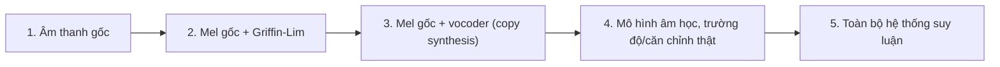

# Chương 37. Huấn luyện và gỡ lỗi

!!! abstract "Mục tiêu học tập"
    Sau chương này, bạn có thể:

    - **Thiết lập** quy trình thí nghiệm tái lập được: cấu hình, hạt giống ngẫu nhiên, ghi log, phiên bản mã và dữ liệu.
    - **Thực hiện** các kiểm tra tỉnh táo trước khi huấn luyện dài: nghe đầu vào, kiểm tra thống kê mel, kiểm tra mask, overfit một batch, **suy ra** giá trị loss ban đầu kỳ vọng.
    - **Giám sát** huấn luyện qua đường loss, ma trận căn chỉnh, mẫu âm thanh và chuẩn gradient; **cài đặt** các chỉ số chẩn đoán căn chỉnh và hook phát hiện NaN/Inf.
    - **Chẩn đoán** lỗi bằng bảng triệu chứng → nguyên nhân → cách sửa, bao gồm các lỗi đặc thù tiếng Việt (thanh điệu, đọc số).
    - **Chọn** siêu tham số cơ sở cho các công thức phổ biến và **giải thích** cách chuẩn hóa loss đúng khi tích lũy gradient với chuỗi dài ngắn khác nhau.
    - **So sánh** các chiến lược fine-tune (đóng băng, tốc độ học nhỏ, LoRA) và cách chống quên thảm họa; **áp dụng** EMA và trung bình checkpoint.
    - **Thiết kế** thí nghiệm loại bỏ (*ablation*) có kiểm soát.

!!! info "Kiến thức cần có"
    - [Chương 3 – Tối ưu hóa và kỹ thuật huấn luyện](../phan-1-nen-tang/ch03-toi-uu-va-ky-thuat-huan-luyen.md): AdamW, lịch tốc độ học, AMP, clipping, EMA.
    - [Chương 6 – PyTorch cho xử lý tiếng nói](../phan-1-nen-tang/ch06-pytorch-cho-tieng-noi.md): DataLoader, mask, bucketing, checkpoint, DDP.
    - [Chương 20 – Tacotron](../phan-5-mo-hinh-am-hoc/ch20-tacotron.md) và [Chương 21 – Căn chỉnh](../phan-5-mo-hinh-am-hoc/ch21-alignment.md): attention, các lỗi bỏ chữ/lặp chữ.
    - [Chương 25 – Vocoder dựa trên GAN](../phan-6-vocoder/ch25-gan-vocoder.md): loss đối kháng, feature matching.
    - [Chương 36 – Xây dựng dữ liệu TTS](ch36-du-lieu-tts.md): pipeline dữ liệu và manifest.

Huấn luyện một hệ thống TTS hiếm khi thất bại theo kiểu "chương trình báo lỗi rồi dừng". Thất bại điển hình là *im lặng*: mã chạy, loss giảm, nhưng âm thanh nghe như rô-bốt, bỏ chữ, đọc sai thanh, hay rè rè ở tần số cao. Chương này là một cẩm nang gỡ lỗi được đúc kết từ kinh nghiệm thực tế: cách tổ chức thí nghiệm để lỗi dễ lộ ra, các kiểm tra rẻ tiền bắt được phần lớn lỗi trước khi bạn tốn hàng trăm giờ GPU, và một bảng chẩn đoán lớn để tra cứu khi có sự cố.

## 37.1 Tư duy gỡ lỗi cho hệ thống nhiều tầng

### Một chuỗi dài, một triệu chứng chung

Một hệ thống TTS hai tầng gồm: dữ liệu → chuẩn hóa văn bản và G2P → trích đặc trưng (mel, F0, trường độ) → mô hình âm học → vocoder → đánh giá. Lỗi ở *bất kỳ* tầng nào đều biểu hiện ra cùng một triệu chứng: "âm thanh nghe tệ". Vì vậy chiến lược cốt lõi là **cô lập tầng**: chứng minh từng tầng hoạt động đúng trước khi nghi ngờ tầng sau.

Một công cụ đặc biệt hữu ích là **chuỗi cận trên** (*upper-bound ladder*): đo chất lượng ở từng mức, mỗi mức thay một thành phần thật bằng thành phần mô hình:



- Nếu mức 3 đã tệ, lỗi nằm ở vocoder hoặc ở *cấu hình mel* (tần số lấy mẫu, `fmax`, chuẩn hóa không khớp giữa mô hình âm học và vocoder — xem [Chương 14](../phan-3-tin-hieu-ngu-am/ch14-xu-ly-tin-hieu-so.md) và [Chương 26](../phan-6-vocoder/ch26-diffusion-vocoder-va-so-sanh.md)). Đừng mất công sửa mô hình âm học.
- Nếu mức 4 tốt nhưng mức 5 tệ, vấn đề nằm ở phần mô hình *tự dự đoán* lúc suy luận: trường độ, căn chỉnh, F0, hoặc sai khác giữa huấn luyện và suy luận (teacher forcing, dropout).
- Khoảng cách giữa các mức cho biết nên đầu tư công sức vào đâu.

### Các nguyên tắc chung

Karpathy (2019) tóm tắt kinh nghiệm huấn luyện mạng nơ-ron thành vài nguyên tắc, rất đúng với TTS:

1. **Bắt đầu đơn giản**: một người nói, một tập nhỏ, mô hình nhỏ, không có thủ thuật. Chỉ thêm độ phức tạp khi phiên bản đơn giản đã chạy đúng.
2. **Thay đổi một thứ mỗi lần** và ghi lại.
3. **Trực quan hóa mọi thứ**: dữ liệu, đầu vào sau tiền xử lý, ma trận attention, đầu ra.
4. **Tin vào tai**: loss là đại lượng thay thế; người nghe mới là thước đo thật. Nghe mẫu đều đặn.

## 37.2 Vệ sinh thí nghiệm

Một thí nghiệm tốt phải trả lời được câu hỏi "checkpoint này được tạo ra từ *chính xác* mã nào, dữ liệu nào, cấu hình nào?". Danh sách tối thiểu:

- **Tệp cấu hình** (YAML/JSON) là nguồn sự thật duy nhất; không có "hằng số ma thuật" rải rác trong mã. Lưu bản sao cấu hình *bên trong* checkpoint.
- **Phiên bản mã**: mã băm commit git; nếu có thay đổi chưa commit, lưu cả bản diff.
- **Phiên bản dữ liệu**: mã băm của tệp manifest ([Chương 36](ch36-du-lieu-tts.md)) và phiên bản bộ chuẩn hóa văn bản/G2P. Hai lần chạy với hai phiên bản G2P khác nhau là hai thí nghiệm khác nhau, dù cấu hình mô hình giống hệt.
- **Hạt giống ngẫu nhiên** cho `random`, `numpy`, `torch` và cho từng worker của DataLoader. Lưu ý chế độ tất định hoàn toàn trên GPU làm chậm và không phải lúc nào cũng khả thi (xem [Chương 3](../phan-1-nen-tang/ch03-toi-uu-va-ky-thuat-huan-luyen.md)); mục tiêu thực tế là *tái lập được về mặt thống kê*, và chạy vài hạt giống khi so sánh.
- **Checkpoint đầy đủ**: trọng số, trạng thái bộ tối ưu, bộ lập lịch tốc độ học, `GradScaler` (nếu dùng AMP), trọng số EMA, số bước, trạng thái sampler. Thiếu bất kỳ thứ nào, việc huấn luyện tiếp (*resume*) sẽ khác với huấn luyện liên tục.
- **Ghi log có cấu trúc** (TensorBoard, W&B hoặc tương đương): từng thành phần loss riêng biệt, tốc độ học, chuẩn gradient, thông lượng (khung/giây), bộ nhớ GPU, và **âm thanh** của một bộ câu kiểm tra cố định.

Bộ câu kiểm tra cố định nên gồm cả "câu khó": câu rất dài, câu có số và viết tắt, câu hỏi, câu có từ tiếng Anh, câu có nhiều thanh ngã/hỏi liên tiếp. Nghe cùng một bộ câu qua các checkpoint cho bạn cảm nhận rất rõ về tiến trình mà không chỉ số nào thay thế được.

## 37.3 Kiểm tra tỉnh táo trước khi huấn luyện dài

Các kiểm tra sau tốn vài phút nhưng bắt được phần lớn lỗi nghiêm trọng.

### 37.3.1 Nghe và nhìn đúng thứ mà mô hình nhìn thấy

Lấy ngẫu nhiên khoảng 10 mẫu **từ DataLoader** (không phải từ thư mục gốc), sau mọi phép biến đổi, padding và chuẩn hóa. Với mỗi mẫu:

- In văn bản đã chuẩn hóa và chuỗi ký hiệu/âm vị; kiểm tra không có ký hiệu lạ (`<unk>`), không mất dấu thanh.
- Đổi mel ngược về âm thanh (Griffin–Lim hoặc vocoder có sẵn) và **nghe**: có khớp với văn bản không? Lỗi kinh điển là sắp xếp danh sách âm thanh và danh sách văn bản theo hai thứ tự khác nhau, khiến mọi cặp lệch nhau một vị trí.
- Vẽ mel cùng mask: phần đệm có đúng bằng giá trị đệm và đúng vị trí không?

### 37.3.2 Kiểm tra thống kê đặc trưng

In trung bình, độ lệch chuẩn, min, max của log-mel trên vài trăm mẫu và so với cấu hình mà vocoder mong đợi:

- **Cơ số log** (tự nhiên hay thập phân) và **ngưỡng kẹp** (ví dụ $\ln(10^{-5}) \approx -11{,}5$). Mel của mô hình âm học và mel dùng huấn luyện vocoder phải dùng *cùng* công thức.
- **Chuẩn hóa** (trừ trung bình/chia độ lệch chuẩn theo kênh hay không): nếu có, phải lưu thống kê và dùng lại đúng lúc suy luận.
- Độ dài: $T \approx L / H$ với $H$ là bước nhảy; với mô hình dùng trường độ, kiểm tra $\sum_i d_i = T$ bằng `assert` cho *mọi* mẫu trước khi huấn luyện.

### 37.3.3 Loss ban đầu phải khớp với lý thuyết

Trước bước cập nhật đầu tiên, loss phải gần giá trị ta tính được bằng tay. Hai ví dụ:

- **Entropy chéo trên $V$ token** (mô hình ngôn ngữ codec, [Chương 32](../phan-8-mo-hinh-lon/ch32-codec-language-model.md)). Nếu logit ban đầu gần bằng nhau thì $p_\theta(\cdot) \approx 1/V$ cho mọi token, nên

$$
\mathcal{L}_{0} = -\ln \frac{1}{V} = \ln V.
$$

Với sổ mã $V = 1024$, $\mathcal{L}_0 \approx 6{,}93$. Nếu loss ban đầu là 50, có thể logit bị khởi tạo quá lớn; nếu là 0,1, nhiều khả năng nhãn bị rò vào đầu vào (ví dụ quên dịch nhãn một bước trong mô hình tự hồi quy).

- **L1 trên mel đã chuẩn hóa** về trung bình 0, độ lệch chuẩn 1, khi đầu ra ban đầu xấp xỉ 0. Với $y \sim \mathcal{N}(0, 1)$,

$$
\mathbb{E}\lvert y \rvert = 2\int_0^\infty y \,\frac{1}{\sqrt{2\pi}} e^{-y^2/2}\,dy = \frac{2}{\sqrt{2\pi}}\Big[-e^{-y^2/2}\Big]_0^\infty = \sqrt{\frac{2}{\pi}} \approx 0{,}80.
$$

Đây chính là loss ban đầu xấp xỉ 0,81 mà bạn sẽ thấy trong mã ở Mục 37.3.5.

### 37.3.4 Mask phải "kín"

Batch trong TTS luôn có padding. Một lỗi rất phổ biến là để vùng đệm rò vào kết quả: tích chập với kernel lớn hơn 1 kéo giá trị đệm vào các khung hợp lệ ở biên, attention không có mask chú ý vào vị trí đệm, loss lấy trung bình cả trên vùng đệm. Kiểm tra đơn giản và mạnh: **thay vùng đệm bằng rác** (số rất lớn, số ngẫu nhiên) cả ở đầu vào lẫn nhãn; loss và đầu ra tại các vị trí hợp lệ phải *không đổi*. Nếu thay đổi, có rò rỉ.

### 37.3.5 Overfit một batch

Đây là kiểm tra quan trọng nhất. Một mô hình và vòng lặp huấn luyện đúng phải "học thuộc" được một batch duy nhất, đưa loss huấn luyện xuống rất thấp sau vài trăm bước. Nếu không làm được, chắc chắn có lỗi: loss tính sai, mask sai, gradient bị chặn (quên `requires_grad`, `detach` nhầm chỗ), tốc độ học sai bậc, hoặc kiến trúc có "nút cổ chai" vô lý. Ngược lại, overfit được một batch *không* chứng minh mọi thứ đúng, nhưng loại bỏ cả một lớp lỗi lớn.

Mã dưới đây gói hai kiểm tra 37.3.4 và 37.3.5 cho một bộ giải mã đồ chơi kiểu FastSpeech (tích chập có nhân mask trước mỗi lớp).

```python
import torch
import torch.nn as nn

torch.manual_seed(0)

def masked_l1(pred, target, mask):
    """L1 chỉ tính trên khung hợp lệ. pred, target: (B, T, F); mask: (B, T) bool."""
    m = mask.unsqueeze(-1).float()                          # (B, T, 1)
    return (torch.abs(pred - target) * m).sum() / (m.sum() * pred.size(-1))

class TinyDecoder(nn.Module):
    """Mô hình đồ chơi: Conv1d có nhân mask trước mỗi lớp, như FastSpeech/VITS."""
    def __init__(self, f_in=16, c=128, f_out=80):
        super().__init__()
        self.convs = nn.ModuleList([nn.Conv1d(f_in, c, 3, padding=1),
                                    nn.Conv1d(c, c, 3, padding=1)])
        self.proj = nn.Conv1d(c, f_out, 1)

    def forward(self, x, mask):                             # x: (B, T, f_in)
        m = mask.unsqueeze(1).float()                       # (B, 1, T)
        h = x.transpose(1, 2)                               # (B, f_in, T)
        for conv in self.convs:
            h = torch.relu(conv(h * m))                     # nhân mask: chặn rò từ vùng đệm
        return (self.proj(h * m) * m).transpose(1, 2)       # (B, T, f_out)

def overfit_one_batch(model, batch, steps=500, lr=3e-3):
    """Một mô hình đúng phải 'học thuộc' được MỘT batch. Không làm được => có lỗi."""
    x, y, mask = batch
    opt = torch.optim.Adam(model.parameters(), lr=lr)
    losses = []
    for _ in range(steps):
        loss = masked_l1(model(x, mask), y, mask)
        opt.zero_grad(); loss.backward(); opt.step()
        losses.append(loss.item())
    return losses

def padding_invariance_test(model, batch):
    """Thay vùng đệm bằng rác: đầu ra ở khung hợp lệ và loss phải KHÔNG đổi."""
    x, y, mask = batch
    x2, y2 = x.clone(), y.clone()
    pad = ~mask
    x2[pad] = 1e3 * torch.randn_like(x2[pad])
    y2[pad] = -1e3
    with torch.no_grad():
        l1 = masked_l1(model(x, mask), y, mask)
        l2 = masked_l1(model(x2, mask), y2, mask)
    return torch.allclose(l1, l2, atol=1e-5)

# Batch giả: 4 câu dài khác nhau, đệm tới T_max = 50
B, T, lengths = 4, 50, torch.tensor([50, 37, 22, 9])
mask = torch.arange(T)[None, :] < lengths[:, None]          # (B, T)
x = torch.randn(B, T, 16) * mask.unsqueeze(-1)
y = torch.randn(B, T, 80) * mask.unsqueeze(-1)
batch = (x, y, mask)

model = TinyDecoder()
assert padding_invariance_test(model, batch), "rò rỉ từ vùng đệm!"
losses = overfit_one_batch(model, batch)
print(f"loss đầu {losses[0]:.3f} -> cuối {losses[-1]:.3f}")
assert losses[-1] < 0.1 * losses[0], "không overfit được một batch: kiểm tra lại!"
```

Loss ban đầu khoảng 0,81, khớp với $\sqrt{2/\pi}$ ở trên. Thử bỏ phép nhân `h * m` trong `forward` rồi chạy lại: `padding_invariance_test` sẽ thất bại, vì tích chập kernel 3 kéo giá trị rác ở vùng đệm vào khung hợp lệ cuối cùng của mỗi câu. Đây chính là loại lỗi làm âm cuối câu bị méo trong các mô hình thật.

## 37.4 Giám sát huấn luyện

### 37.4.1 Đường loss: đọc đúng cách

- **Tách từng thành phần.** Mô hình TTS hiện đại có nhiều loss: mel, trường độ, F0, năng lượng, KL, đối kháng, feature matching… (VITS là ví dụ điển hình — [Chương 27](../phan-7-e2e-bieu-cam/ch27-vits.md)). Một thành phần tăng vọt trong khi tổng vẫn giảm là dấu hiệu sớm của sự cố.
- **Loss đối kháng không có nghĩa "càng thấp càng tốt".** Trong GAN ([Chương 9](../phan-2-mo-hinh-sinh/ch09-gan.md), [Chương 25](../phan-6-vocoder/ch25-gan-vocoder.md)), loss của bộ sinh và bộ phân biệt dao động quanh một trạng thái cân bằng. Điều đáng theo dõi là loss mel/STFT trên tập kiểm định và *âm thanh*; nếu loss bộ phân biệt tiến về 0 và đứng yên, bộ phân biệt đã thắng áp đảo.
- **Loss của diffusion/flow matching rất nhiễu** vì mỗi bước lấy ngẫu nhiên thời điểm $t$. Hãy làm mượt (trung bình trượt) trước khi kết luận, và đánh giá bằng mẫu sinh ra.
- **Loss kiểm định thấp hơn loss huấn luyện** là bình thường khi có dropout hoặc tăng cường dữ liệu. Ngược lại, loss kiểm định tăng trong khi loss huấn luyện giảm là quá khớp — với dữ liệu nhỏ, hãy chọn checkpoint *bằng tai* và chỉ số khách quan ([Chương 38](ch38-danh-gia-tts.md)), không chỉ bằng loss.

### 37.4.2 Ma trận căn chỉnh và các chỉ số chẩn đoán

Với các mô hình học căn chỉnh (Tacotron 2, VITS với MAS, mô hình học căn chỉnh không giám sát), hình vẽ ma trận căn chỉnh $\mathbf{A} \in [0,1]^{N \times T}$ là công cụ chẩn đoán số một: căn chỉnh tốt là một dải chéo đơn điệu, sắc nét. Để theo dõi tự động trên nhiều mẫu, ta cần các chỉ số. Với $\mathbf{A}$ có mỗi cột (khung) tổng bằng 1:

- **Độ chéo** (*diagonality*): tỉ lệ khối lượng attention nằm trong dải $\lvert n/N - t/T \rvert \le b$ quanh đường chéo "tốc độ đều".
- **Độ tập trung** (*focus rate*, dùng trong FastSpeech để chọn đầu attention tốt nhất (Ren và cộng sự, 2019)):

$$
F = \frac{1}{T} \sum_{t=1}^{T} \max_{n} A_{n,t}.
$$

- **Tính đơn điệu**: tỉ lệ bước $t \to t+1$ mà token có trọng số lớn nhất không lùi lại.
- **Độ phủ**: tỉ lệ token từng là token có trọng số lớn nhất ở ít nhất một khung. Độ phủ thấp nghĩa là có token bị bỏ qua.
- **Bước nhảy lớn nhất** của token có trọng số lớn nhất giữa hai khung liên tiếp: nhảy nhiều token cùng lúc là dấu hiệu bỏ chữ.

Không chỉ số nào đủ một mình, như mã dưới đây cho thấy trên bốn ma trận tổng hợp (tốt, bỏ chữ, lặp, loang):

```python
import numpy as np

def alignment_report(A, band=0.15):
    """Chẩn đoán ma trận attention/căn chỉnh A: (N token, T khung), mỗi cột tổng = 1."""
    N, T = A.shape
    n = (np.arange(N)[:, None] + 0.5) / N                  # vị trí token chuẩn hóa
    t = (np.arange(T)[None, :] + 0.5) / T                  # vị trí khung chuẩn hóa
    in_band = np.abs(n - t) <= band
    peak = A.argmax(axis=0)                                 # token được chú ý nhất ở mỗi khung
    steps = np.diff(peak)
    return {
        "diagonal": float((A * in_band).sum() / A.sum()),  # khối lượng gần đường chéo
        "focus": float(A.max(axis=0).mean()),              # độ 'sắc' (focus rate, FastSpeech)
        "monotonic": float(np.mean(steps >= 0)),           # tỉ lệ bước không lùi
        "coverage": len(np.unique(peak)) / N,              # tỉ lệ token được 'đọc' tới
        "max_jump": int(np.abs(steps).max()),              # bước nhảy lớn nhất (bỏ chữ)
    }

def from_path(path, N, blur=0.6):
    """Dựng attention mềm từ đường đi token-theo-khung (để tạo ví dụ)."""
    idx = np.arange(N)[:, None]
    A = np.exp(-0.5 * ((idx - np.asarray(path)[None, :]) / blur) ** 2)
    return A / A.sum(axis=0, keepdims=True)

N, T = 20, 100
good = from_path(np.repeat(np.arange(N), T // N), N)        # mỗi token 5 khung
skip_path = np.repeat([i for i in range(N) if i not in (8, 9, 10, 11)], 6)[:T]
skip_path = np.pad(skip_path, (0, T - len(skip_path)), mode="edge")
skip = from_path(skip_path, N)                              # bỏ qua token 8–11
rep_path = np.concatenate([np.repeat(np.arange(12), 4), np.repeat(np.arange(6, 19), 4)])[:T]
rep_path = np.pad(rep_path, (0, T - len(rep_path)), mode="edge")
repeat = from_path(rep_path, N)                             # đọc lặp đoạn 6–11
diffuse = np.full((N, T), 1.0 / N)                          # attention chưa hình thành

for name, A in [("tốt", good), ("bỏ chữ", skip), ("lặp", repeat), ("loang", diffuse)]:
    r = alignment_report(A)
    print(f"{name:7s}", " ".join(f"{k}={v:.2f}" if isinstance(v, float) else f"{k}={v}"
                                 for k, v in r.items()))

r_good, r_skip, r_rep, r_diff = map(alignment_report, (good, skip, repeat, diffuse))
assert r_good["diagonal"] > 0.9 and r_good["coverage"] == 1.0
assert r_skip["coverage"] < 1.0 and r_skip["max_jump"] >= 4
assert r_rep["monotonic"] < 1.0
assert r_diff["focus"] < 0.1
```

Hãy để ý: trường hợp "bỏ chữ" vẫn có độ chéo 0,98 vì dải $b = 0{,}15$ khá rộng, nhưng độ phủ 0,80 và bước nhảy 5 token lộ ngay vấn đề. Trường hợp "loang" có tính đơn điệu bằng 1 một cách "tầm thường" vì token lớn nhất không bao giờ đổi. Trong thực tế, hãy ghi log cả năm chỉ số trên một bộ câu kiểm định cố định và đặt cảnh báo khi độ phủ giảm hoặc bước nhảy tăng.

### 37.4.3 Chuẩn gradient và phát hiện NaN/Inf

**Chuẩn gradient** (*gradient norm*) là "nhịp tim" của quá trình huấn luyện. Theo dõi chuẩn tổng và chuẩn theo từng module giúp:

- Thấy trước sự phân kỳ: các gai (*spike*) chuẩn gradient thường xuất hiện trước khi loss nổ hoặc thành NaN.
- Chọn ngưỡng clipping hợp lý: đặt ngưỡng quanh phân vị cao của chuẩn gradient lúc huấn luyện ổn định; nếu gần như mọi bước đều bị clip, ngưỡng quá thấp hoặc tốc độ học quá cao.
- Phát hiện module "chết" (gradient bằng 0, ví dụ do ReLU chết hoặc nhánh không được dùng) hoặc module chiếm áp đảo.

Khi NaN xuất hiện, câu hỏi là **ở đâu trước tiên**. `torch.autograd.set_detect_anomaly(True)` giúp tìm phép toán gây NaN trong lượt lan truyền ngược nhưng làm chậm đáng kể. Một cách rẻ hơn là gắn forward hook kiểm tra đầu ra của từng module và báo ngay module đầu tiên sinh giá trị không hữu hạn. Mã dưới đây cài đặt hook đó, hàm đo chuẩn gradient theo module, và vòng huấn luyện "bỏ qua bước không hữu hạn" (tương tự cách `GradScaler` bỏ qua bước khi phát hiện tràn số).

```python
import math
import torch
import torch.nn as nn

def register_nonfinite_hooks(model):
    """Gắn forward hook: báo NGAY module đầu tiên sinh ra NaN/Inf."""
    def make_hook(name):
        def hook(module, inputs, output):
            outs = output if isinstance(output, (tuple, list)) else (output,)
            for o in outs:
                if torch.is_tensor(o) and not torch.isfinite(o).all():
                    raise FloatingPointError(f"NaN/Inf xuất hiện tại đầu ra của '{name}'")
        return hook
    return [m.register_forward_hook(make_hook(n)) for n, m in model.named_modules() if n]

def grad_norms(model):
    """Chuẩn L2 của gradient theo từng module cấp một + tổng (để ghi log)."""
    out, total_sq = {}, 0.0
    for name, child in model.named_children():
        grads = [p.grad for p in child.parameters() if p.grad is not None]
        if not grads:
            continue                                         # module không có tham số
        sq = sum(g.detach().pow(2).sum().item() for g in grads)
        out[f"grad_norm/{name}"] = math.sqrt(sq)
        total_sq += sq
    out["grad_norm/total"] = math.sqrt(total_sq)
    return out

class LogEnergy(nn.Module):
    """Lớp log năng lượng; eps=None tái hiện lỗi kinh điển: log(0) = -inf."""
    def __init__(self, eps=None):
        super().__init__()
        self.eps = eps
    def forward(self, x):
        return torch.log(x if self.eps is None else torch.clamp(x, min=self.eps))

torch.manual_seed(0)
model = nn.Sequential()
model.add_module("encoder", nn.Linear(8, 8))
model.add_module("act", nn.ReLU())
model.add_module("log_energy", LogEnergy())
model.add_module("head", nn.Linear(8, 1))
opt = torch.optim.AdamW(model.parameters(), lr=1e-3)
hooks = register_nonfinite_hooks(model)

x = torch.randn(4, 8)                                        # (B, 8)
try:
    model(x).mean().backward()
except FloatingPointError as e:
    print("Bắt được:", e)                                    # chỉ đúng thủ phạm: log_energy

# Sửa lỗi: kẹp dưới trước khi lấy log; huấn luyện với 'bỏ qua bước không hữu hạn'
model.log_energy.eps = 1e-5
for step in range(3):
    opt.zero_grad()
    model(torch.randn(4, 8)).pow(2).mean().backward()
    stats = grad_norms(model)                                # đo TRƯỚC khi clip
    total = torch.nn.utils.clip_grad_norm_(model.parameters(), max_norm=1.0)
    if not torch.isfinite(total):
        print(f"step {step}: gradient không hữu hạn -> bỏ qua bước này")
        continue
    opt.step()
    print(step, {k: round(v, 3) for k, v in stats.items()})

for h in hooks:
    h.remove()
assert set(grad_norms(model)) >= {"grad_norm/encoder", "grad_norm/head", "grad_norm/total"}
```

Có một bài học ẩn trong kết quả: dù đã kẹp `eps=1e-5`, chuẩn gradient vẫn lên tới hàng trăm, trong khi một mạng nhỏ cỡ này bình thường chỉ có chuẩn gradient cỡ đơn vị. Lý do là đạo hàm của $\ln x$ bằng $1/x$, rất lớn khi $x$ nhỏ nhưng vẫn trên ngưỡng kẹp. Đây chính là loại gai gradient mà clipping bảo vệ bạn khỏi; giải pháp bền vững hơn là dùng $\ln(x + \epsilon)$ với $\epsilon$ hợp lý hoặc tính toán trong miền log ngay từ đầu.

## 37.5 Bảng chẩn đoán: triệu chứng → nguyên nhân → cách sửa

Bảng dưới đây là phần tra cứu của chương. Các dòng được nhóm theo tầng của hệ thống. Cột "nguyên nhân" xếp theo thứ tự *nên kiểm tra trước* — thường là nguyên nhân rẻ để kiểm tra và hay gặp nhất. Hãy nhớ: một triệu chứng có thể có nhiều nguyên nhân cùng lúc, và cách sửa đúng luôn bắt đầu bằng việc *xác nhận* nguyên nhân (nghe, vẽ, đo) chứ không phải đoán.

### 37.5.1 Dữ liệu và front-end

| Triệu chứng | Nguyên nhân thường gặp | Kiểm tra và khắc phục |
|---|---|---|
| Căn chỉnh không bao giờ hình thành; mô hình "lẩm bẩm" vô nghĩa | Cặp văn bản–âm thanh lệch nhau (sắp xếp sai thứ tự, ghép nhầm tệp); bản ghi lời sai nhiều; im lặng đầu/cuối dài | Nghe mẫu *từ DataLoader*; tính CER bằng ASR trên một mẫu ngẫu nhiên; cắt im lặng nhất quán ([Chương 36](ch36-du-lieu-tts.md)) |
| Đọc sai số, ngày tháng, viết tắt dù câu thường đọc tốt | Chuẩn hóa văn bản lúc huấn luyện khác lúc suy luận (dữ liệu còn chữ số, suy luận đưa vào chữ đã chuẩn hóa, hoặc ngược lại) | Đưa văn bản huấn luyện và suy luận qua *cùng* bộ TN đã đóng băng phiên bản ([Chương 17](../phan-4-frontend/ch17-chuan-hoa-van-ban.md)); thêm câu chứa số vào bộ câu kiểm tra cố định |
| Một số từ luôn đọc sai theo cùng một cách | Lỗi từ điển phát âm/G2P; từ mượn không có trong từ điển; ký hiệu không có trong bộ ký hiệu bị bỏ âm thầm | Viết test đơn vị cho G2P ([Chương 18](../phan-4-frontend/ch18-g2p-bieu-dien-dau-vao.md)); đếm và in mọi ký hiệu `<unk>` hoặc bị lọc bỏ |
| Hai "ký tự" trông giống hệt nhau nhưng mô hình xử lý khác nhau | Trộn NFC/NFD, trộn kiểu đặt dấu (*hòa*/*hoà*), ký tự trông giống nhau từ bảng mã khác | Chuẩn hóa NFC và thống nhất vị trí dấu trước khi xây bộ ký hiệu; in bảng ký hiệu kèm mã Unicode |
| Phát âm từ tiếng Anh lúc kiểu Việt lúc kiểu Anh | Dữ liệu không nhất quán về chính sách đọc từ mượn | Quyết định chính sách và từ điển từ mượn ([Chương 30](../phan-7-e2e-bieu-cam/ch30-da-ngon-ngu-code-switching.md)); làm sạch bản ghi lời theo chính sách đó |
| Tiếng thở, tiếng chép miệng xuất hiện ngẫu nhiên | Dữ liệu có tiếng thở không được đánh dấu, lúc có lúc không | Hoặc cắt bỏ tiếng thở khỏi dữ liệu, hoặc thêm ký hiệu `<breath>` để mô hình biết khi nào nên thở |
| Âm lượng đầu ra lúc to lúc nhỏ giữa các câu | Dữ liệu không chuẩn hóa độ to; trộn nhiều nguồn | Chuẩn hóa mức trong pipeline dữ liệu; kiểm tra phân phối `level_db` trong manifest |

### 37.5.2 Căn chỉnh và mô hình âm học

| Triệu chứng | Nguyên nhân thường gặp | Kiểm tra và khắc phục |
|---|---|---|
| Attention (Tacotron) không thành đường chéo sau nhiều nghìn bước | Câu quá dài lúc đầu; tốc độ học không phù hợp; hệ số rút gọn $r$ quá nhỏ; dữ liệu ít; mel chuẩn hóa sai | Bắt đầu với câu ngắn (học theo chương trình); thêm guided attention loss ([Chương 21](../phan-5-mo-hinh-am-hoc/ch21-alignment.md)); tăng $r$ lên 2–3; khởi tạo từ mô hình đã hội tụ trên dữ liệu khác |
| Căn chỉnh đã hình thành rồi lại sụp đổ | Tốc độ học quá cao, không giảm dần; batch có câu cực dài; tràn số fp16 trong attention | Giảm tốc độ học, bật clipping, lọc ngoại lai về độ dài, tính softmax attention trong fp32; quay lại checkpoint trước khi sụp |
| Bỏ chữ, lặp chữ lúc suy luận nhưng teacher forcing thì tốt | Sai lệch phơi nhiễm (*exposure bias*); attention không bảo đảm đơn điệu | Giữ dropout của pre-net lúc suy luận như Tacotron 2 ([Chương 20](../phan-5-mo-hinh-am-hoc/ch20-tacotron.md)); dùng attention đơn điệu/DCA; hoặc chuyển sang kiến trúc dùng trường độ ([Chương 22](../phan-5-mo-hinh-am-hoc/ch22-fastspeech.md)) |
| Không dừng được, lẩm bẩm ở cuối câu | Mất cân bằng lớp của stop token; im lặng cuối câu không nhất quán | Đặt `pos_weight` cho loss stop token; cắt im lặng nhất quán; giới hạn số bước giải mã theo độ dài văn bản |
| Mel bị nhòe, giọng đều đều như rô-bốt (FastSpeech-like) | Bài toán một-nhiều với loss L1/L2 nên mô hình dự đoán trung bình ([Chương 7](../phan-2-mo-hinh-sinh/ch07-tong-quan-mo-hinh-sinh.md)); thiếu thông tin phương sai | Thêm bộ dự đoán F0/năng lượng; dùng bộ giải mã sinh (flow, diffusion, flow matching — [Chương 23](../phan-5-mo-hinh-am-hoc/ch23-glow-grad-matcha.md)); thêm post-net hoặc fine-tune đối kháng |
| Tốc độ nói sai, một số âm bị nuốt hoặc kéo dài | Trường độ từ aligner sai (từ điển không khớp, từ ngoài từ điển); làm tròn trường độ; dự đoán trường độ trên thang tuyến tính | Vẽ căn chỉnh của aligner lên mel; dự đoán $\ln(d+1)$ thay vì $d$; kiểm tra $\sum_i d_i = T$ |
| Câu dài bị "trôi": cuối câu nhòe, sai ngữ điệu | Phân phối độ dài huấn luyện chủ yếu là câu ngắn; mã hóa vị trí không ngoại suy được | Thêm câu dài vào dữ liệu; tách câu dài thành cụm ở dấu câu lúc suy luận; dùng mã hóa vị trí tương đối |

### 37.5.3 Vocoder và GAN

| Triệu chứng | Nguyên nhân thường gặp | Kiểm tra và khắc phục |
|---|---|---|
| Âm "kim loại", rè (*metallic/buzzy*) khi ghép với mô hình âm học, nhưng copy synthesis thì tốt | Vocoder chỉ thấy mel thật, chưa thấy mel dự đoán (nhòe hơn) | Fine-tune vocoder trên mel ground-truth-aligned (GTA) sinh bởi mô hình âm học ([Chương 25](../phan-6-vocoder/ch25-gan-vocoder.md)) |
| Copy synthesis đã tệ | Cấu hình mel không khớp (tần số lấy mẫu, `fmax`, `center`, cơ số log, chuẩn hóa); vocoder huấn luyện chưa đủ | So sánh từng tham số mel giữa hai mô hình; tính mel của cùng một tệp bằng hai đoạn mã và so sánh từng phần tử |
| Tiếng xì/nhiễu ở tần số cao | Dữ liệu trộn băng hẹp và băng rộng; `fmax` khác nhau giữa huấn luyện và suy luận | Lọc dữ liệu theo băng thông hiệu dụng ([Chương 36](ch36-du-lieu-tts.md)); thống nhất `fmax` |
| Âm ù tuần hoàn ở tần số bằng bội của tần số khung | Hiệu ứng bàn cờ của tích chập chuyển vị (*checkerboard*) | Chọn kernel là bội của stride; dùng upsample + conv, khử răng cưa (BigVGAN), hoặc đầu iSTFT kiểu Vocos |
| Tiếng "tách" ở đầu/cuối câu | Độ lệch DC; cắt cụt không có fade; kiểu padding | Loại DC; fade-in/fade-out vài mili-giây; dùng padding phản xạ |
| Tiếng "tách" ở ranh giới khối khi streaming | Mỗi khối được sinh độc lập, không có trạng thái hoặc chồng lấn; chuẩn hóa theo từng khối | Chồng lấn và crossfade; tích chập nhân quả có bộ nhớ đệm trạng thái ([Chương 35](../phan-8-mo-hinh-lon/ch35-streaming-speech-llm.md)) |
| Loss bộ phân biệt về gần 0, loss bộ sinh tăng dần, âm thanh nhiễu | Bộ phân biệt quá mạnh | Giảm tốc độ học của bộ phân biệt, tăng trọng số loss mel, kiểm tra spectral/weight norm, quay lại checkpoint trước khi mất cân bằng |
| Bộ sinh ra im lặng hoặc một âm cố định | Sụp đổ do tốc độ học quá cao hoặc khởi tạo xấu; loss mel bị tắt nhầm | Kiểm tra trọng số loss trong cấu hình; giảm tốc độ học; huấn luyện vài nghìn bước chỉ với loss mel trước khi bật loss đối kháng |

### 37.5.4 Số học và hạ tầng huấn luyện

| Triệu chứng | Nguyên nhân thường gặp | Kiểm tra và khắc phục |
|---|---|---|
| NaN/Inf khi bật fp16 | Tràn số trong softmax/exp/attention; $\ln 0$; $\sqrt{0}$ trong lan truyền ngược; chia cho phương sai bằng 0 trong chuẩn hóa | Chuyển sang bf16 nếu phần cứng hỗ trợ; dùng `GradScaler`; thêm $\epsilon$; tính loss và softmax trong fp32; dùng hook ở Mục 37.4.3 để tìm module đầu tiên |
| NaN đột ngột sau hàng chục nghìn bước | Gai gradient từ batch ngoại lai (âm thanh rất dài/rất ngắn, văn bản rỗng) | Lọc ngoại lai; clipping; bỏ qua bước có gradient không hữu hạn; ghi lại định danh mẫu trong batch gây NaN |
| Loss giảm nhưng âm thanh lúc suy luận tệ | Khác biệt huấn luyện–suy luận: quên `model.eval()`, dùng nhầm trọng số không EMA, thống kê chuẩn hóa mel khác, teacher forcing | Viết một hàm suy luận duy nhất dùng cho cả kiểm định lẫn triển khai; kiểm tra checkpoint và trọng số EMA được nạp |
| Huấn luyện tiếp (*resume*) thì loss nhảy vọt | Không khôi phục trạng thái bộ tối ưu, bộ lập lịch, `GradScaler`, EMA; warmup chạy lại từ đầu | Lưu và nạp đầy đủ trạng thái (Mục 37.2); kiểm tra tốc độ học ngay sau khi nạp |
| GPU dùng thấp, huấn luyện chậm | Giải mã MP3/trích mel ngay trong DataLoader; `num_workers` quá ít; lãng phí padding | Tính trước đặc trưng; tăng worker; batch động theo số khung (Mục 37.7) |
| Hết bộ nhớ GPU (OOM) ngẫu nhiên | Batch chứa câu cực dài | Batch theo tổng số khung thay vì số câu; đặt độ dài tối đa |
| Kết quả nhiều GPU khác một GPU, hoặc mỗi epoch dữ liệu theo cùng thứ tự | Quên `sampler.set_epoch`; BatchNorm không đồng bộ; tích lũy gradient không dùng `no_sync` | Xem Mục 37.7 |

### 37.5.5 Đặc thù tiếng Việt

| Triệu chứng | Nguyên nhân thường gặp | Kiểm tra và khắc phục |
|---|---|---|
| Sai thanh: nhầm hỏi/ngã, sắc/hỏi, nặng/huyền | Dấu thanh bị mất ở front-end (lọc ký tự tổ hợp sau khi NFD, tokenizer tách dấu); dữ liệu ít thanh ngã; trích F0 lỗi ở thanh có thanh quản hóa (ngã, nặng) bị coi là vô thanh; tăng cường dữ liệu bằng đổi cao độ làm méo đường nét thanh | Kiểm tra vòng: văn bản → ký hiệu → văn bản phải giữ nguyên dấu; đo tỉ lệ lỗi thanh bằng bộ cặp tối thiểu ([Chương 38](ch38-danh-gia-tts.md)); dùng bộ trích F0 tốt hơn và nội suy F0 qua đoạn thanh quản hóa; tránh đổi cao độ mạnh |
| Giọng "nhảy" phương ngữ giữa câu | Dữ liệu trộn phương ngữ dưới cùng một nhãn người nói; G2P theo phương ngữ Bắc áp dụng cho giọng Nam | Gắn nhãn phương ngữ, dùng embedding phương ngữ hoặc lọc theo phương ngữ; dùng G2P khớp phương ngữ ([Chương 15](../phan-3-tin-hieu-ngu-am/ch15-ngu-am-tieng-viet.md)) |
| Điều khiển cao độ (nâng/hạ F0) làm sai thanh | Dịch F0 cộng tính trên thang Hz làm méo hình dạng đường nét; nén biên độ F0 làm thanh sắc/hỏi "phẳng" | Điều khiển trên thang log-F0 (nhân thay vì cộng), giữ biên độ dao động trong âm tiết ([Chương 29](../phan-7-e2e-bieu-cam/ch29-prosody-cam-xuc-phong-cach.md)) |
| Mô hình LLM-TTS fine-tune cho tiếng Việt sinh chữ/âm méo ở âm tiết có dấu | Tokenizer gốc tách chữ có dấu thành nhiều byte/token hiếm; dữ liệu ở dạng NFD | Chuẩn hóa NFC; kiểm tra tokenizer trên văn bản tiếng Việt (số token/âm tiết); cân nhắc mở rộng từ vựng ([Chương 34](../phan-8-mo-hinh-lon/ch34-he-thong-lai-hien-dai.md)) |
| Ước lượng tổng thời lượng sai trong mô hình kiểu E2/F5 (nói quá nhanh hoặc kéo dài) | Ước lượng thời lượng theo số ký tự; chữ tiếng Việt có dấu và độ dài âm tiết theo ký tự rất khác nhau | Ước lượng theo số âm tiết và tốc độ nói của đoạn gợi ý; cho phép người dùng chỉnh tốc độ ([Chương 33](../phan-8-mo-hinh-lon/ch33-nar-quy-mo-lon.md)) |

### 37.5.6 Đa người nói, zero-shot và mô hình lớn

| Triệu chứng | Nguyên nhân thường gặp | Kiểm tra và khắc phục |
|---|---|---|
| Giọng người nói A "lẫn" sang người nói B (*speaker leakage*) | Nhãn người nói sai (theo kênh/nguồn); embedding người nói yếu nên bộ mã hóa văn bản mang thông tin người nói; dữ liệu mất cân bằng | Kiểm tra nhãn bằng phân cụm embedding; lấy mẫu cân bằng theo người nói; thêm bộ phân loại người nói đối kháng ([Chương 28](../phan-7-e2e-bieu-cam/ch28-da-nguoi-noi-voice-cloning.md)) |
| Nhân bản giọng sao chép cả tiếng vang/nhiễu của đoạn gợi ý | Hành vi đúng theo mục tiêu huấn luyện ([Chương 36](ch36-du-lieu-tts.md), Bài tập 1) | Làm sạch hoặc chọn đoạn gợi ý sạch |
| Độ giống người nói thấp | Đoạn gợi ý quá ngắn; bản ghi lời của gợi ý sai (các mô hình kiểu F5-TTS cần văn bản gợi ý chính xác); lệch tần số lấy mẫu | Dùng gợi ý vài giây, sạch, có văn bản chính xác; kiểm tra lấy mẫu lại |
| Văn bản dài: lặp cụm từ, sinh từ không có, giọng/ngôn điệu trôi dần | Mô hình tự hồi quy mất ổn định với chuỗi dài; lấy mẫu với nhiệt độ cao | Chia văn bản theo câu và nối; dùng lấy mẫu có phạt lặp ([Chương 32](../phan-8-mo-hinh-lon/ch32-codec-language-model.md)); hạ nhiệt độ; giới hạn số token theo độ dài văn bản; sinh nhiều ứng viên và chọn bằng WER của ASR |
| Không sinh token kết thúc, sinh mãi | Dữ liệu huấn luyện thiếu token kết thúc ở một số mẫu; top-p quá cao | Kiểm tra dữ liệu; đặt độ dài tối đa tỉ lệ với văn bản |
| Fine-tune làm mất khả năng cũ (quên thảm họa) | Tốc độ học quá lớn, quá nhiều bước, fine-tune toàn bộ trên dữ liệu nhỏ | Giảm tốc độ học, đóng băng một phần, LoRA, trộn lại dữ liệu cũ (Mục 37.8) |

## 37.6 Siêu tham số cơ sở

Bảng sau tóm tắt cấu hình được báo cáo trong các bài báo gốc hoặc mã nguồn chính thức của một số công thức phổ biến. Đây là **điểm khởi đầu tham khảo**; luôn đối chiếu với cấu hình của đúng phiên bản mã bạn dùng, vì các bản cài đặt khác nhau có thể đổi giá trị.

| Công thức | Bộ tối ưu | Tốc độ học và lịch | Ghi chú |
|---|---|---|---|
| Tacotron 2 (Shen và cộng sự, 2018) | Adam, $\beta = (0{,}9;\ 0{,}999)$, $\epsilon = 10^{-6}$ | $10^{-3}$, giảm theo hàm mũ về $10^{-5}$ | Batch 64 theo báo cáo gốc; điều chuẩn L2 nhỏ; các bản cài đặt phổ biến clip gradient ở chuẩn 1 |
| FastSpeech 2 (Ren và cộng sự, 2021) | Adam, $\beta = (0{,}9;\ 0{,}98)$, $\epsilon = 10^{-9}$ | Lịch warmup kiểu Transformer (Noam) | Cần trường độ từ aligner; batch theo số câu cỡ vài chục |
| HiFi-GAN (Kong và cộng sự, 2020) | AdamW, $\beta = (0{,}8;\ 0{,}99)$, weight decay 0,01 | $2 \times 10^{-4}$, nhân 0,999 sau mỗi epoch | Batch 16, đoạn 8 192 mẫu; $\lambda_{\text{fm}} = 2$, $\lambda_{\text{mel}} = 45$ |
| VITS (Kim và cộng sự, 2021) | AdamW, $\beta = (0{,}8;\ 0{,}99)$, $\epsilon = 10^{-9}$ | $2 \times 10^{-4}$, nhân $0{,}999^{1/8}$ sau mỗi epoch | Cấu hình công khai dùng fp16, đoạn ngẫu nhiên 32 khung (8 192 mẫu với hop 256), trọng số mel 45 |
| Fine-tune mô hình zero-shot lớn | AdamW | Thường nhỏ hơn tốc độ học tiền huấn luyện một đến hai bậc độ lớn, có warmup | Giữ EMA; theo dõi WER/SIM trên tập kiểm định trong suốt quá trình |

Một vài quy tắc kinh nghiệm thêm:

- **$\beta_1 = 0{,}8$ trong GAN vocoder** (thay vì 0,9 mặc định) làm động lượng ngắn hơn, giúp hai mạng thích ứng nhanh với nhau.
- **Tốc độ học và batch đi cùng nhau.** Khi tăng batch hiệu dụng $k$ lần, quy tắc tỉ lệ tuyến tính (Goyal và cộng sự, 2017) gợi ý nhân tốc độ học với $k$ kèm warmup; với Adam, mức tăng thường cần thận trọng hơn. Đừng coi đây là định luật: hãy quét vài giá trị.
- **Warmup** gần như luôn có ích cho Transformer và mô hình lớn; thiếu warmup là một nguyên nhân phổ biến của phân kỳ sớm.

## 37.7 Batch động, nhiều GPU và tích lũy gradient

### 37.7.1 Batch theo số khung

Câu tiếng nói dài ngắn rất khác nhau. Nếu batch gồm $B$ câu với độ dài $T_1, \ldots, T_B$ được đệm tới $\max_b T_b$, tỉ lệ lãng phí là

$$
\rho = 1 - \frac{\sum_{b=1}^{B} T_b}{B \cdot \max_b T_b}.
$$

Gom các câu có độ dài gần nhau (*bucketing*) giảm $\rho$, và **batch động theo tổng số khung** (thay vì số câu cố định) giữ lượng bộ nhớ mỗi batch gần như không đổi, tránh OOM ngẫu nhiên. Cài đặt chi tiết có trong [Chương 6](../phan-1-nen-tang/ch06-pytorch-cho-tieng-noi.md).

### 37.7.2 Chuẩn hóa loss khi tích lũy gradient

Khi batch thật quá lớn so với bộ nhớ, ta chia thành $M$ micro-batch và cộng dồn gradient. Có một cái bẫy tinh tế với dữ liệu độ dài thay đổi. Gọi $\ell_{m,k}$ là lỗi của phần tử hợp lệ thứ $k$ trong micro-batch $m$, có $n_m$ phần tử hợp lệ. Loss "chuẩn" của cả batch lớn là trung bình theo phần tử:

$$
\mathcal{L}_{\text{chuẩn}} = \frac{\sum_{m=1}^{M} \sum_{k=1}^{n_m} \ell_{m,k}}{\sum_{m=1}^{M} n_m}.
$$

Cách làm ngây thơ là lấy trung bình trong từng micro-batch rồi chia cho $M$:

$$
\mathcal{L}_{\text{ngây thơ}} = \frac{1}{M} \sum_{m=1}^{M} \frac{1}{n_m} \sum_{k=1}^{n_m} \ell_{m,k} = \sum_{m=1}^{M} \sum_{k=1}^{n_m} \frac{1}{M n_m}\, \ell_{m,k}.
$$

So sánh hệ số: mỗi phần tử trong micro-batch $m$ nhận trọng số $1/(M n_m)$ thay vì $1/\sum_j n_j$. Hai cách chỉ trùng nhau khi mọi $n_m$ bằng nhau. Khi micro-batch chứa câu ngắn ($n_m$ nhỏ), từng khung của nó bị đếm *quá nặng*. Cách đúng: cộng tổng lỗi (không chia) trong từng micro-batch, và chia cho tổng số phần tử hợp lệ của cả bước tích lũy (cần biết trước, hoặc đếm trong một lượt duyệt nhanh). Với DDP, mẫu số phải là tổng trên *mọi* GPU (dùng `all_reduce`).

```python
import copy
import torch
import torch.nn as nn

torch.manual_seed(0)
lin = nn.Linear(4, 2)
# Hai micro-batch có số khung hợp lệ rất khác nhau: 100 khung và 10 khung
mb = [(torch.randn(100, 4), torch.randn(100, 2)), (torch.randn(10, 4), torch.randn(10, 2))]

def grad_of(loss_fn):
    lin.zero_grad(); loss_fn().backward()
    return lin.weight.grad.clone()

# (1) Chuẩn: gộp cả 110 khung thành một batch, trung bình theo khung
x_all = torch.cat([x for x, _ in mb]); y_all = torch.cat([y for _, y in mb])
g_full = grad_of(lambda: (lin(x_all) - y_all).abs().mean())

# (2) Sai: mỗi micro-batch lấy trung bình riêng rồi chia cho số micro-batch
g_naive = grad_of(lambda: sum((lin(x) - y).abs().mean() for x, y in mb) / len(mb))

# (3) Đúng: cộng tổng lỗi, chia cho TỔNG số phần tử hợp lệ của cả bước tích lũy
n_total = sum(y.numel() for _, y in mb)
g_right = grad_of(lambda: sum((lin(x) - y).abs().sum() for x, y in mb) / n_total)

print("sai lệch (2):", (g_naive - g_full).norm().item())
print("sai lệch (3):", (g_right - g_full).norm().item())
assert torch.allclose(g_right, g_full, atol=1e-6)

def average_checkpoints(state_dicts):
    """Trung bình tham số của k checkpoint cuối (cùng kiến trúc, cùng 'thung lũng')."""
    avg = copy.deepcopy(state_dicts[0])
    for k in avg:
        if avg[k].is_floating_point():
            avg[k] = sum(sd[k] for sd in state_dicts) / len(state_dicts)
        # tensor số nguyên (vd. num_batches_tracked của BatchNorm): giữ bản cuối
    return avg

# Mô phỏng: các checkpoint là cực tiểu w* cộng nhiễu SGD độc lập
w_star = torch.randn(2, 4)
ckpts = [{"weight": w_star + 0.1 * torch.randn(2, 4), "bias": torch.zeros(2)}
         for _ in range(8)]
err_single = (ckpts[-1]["weight"] - w_star).norm().item()
err_avg = (average_checkpoints(ckpts)["weight"] - w_star).norm().item()
print(f"lỗi checkpoint cuối {err_single:.3f}, lỗi sau khi trung bình 8 checkpoint {err_avg:.3f}")
assert err_avg < err_single
```

Nửa sau của khối mã minh họa **trung bình checkpoint** (Mục 37.9): khi các checkpoint là cực tiểu cộng với nhiễu độc lập, lấy trung bình 8 checkpoint giảm sai số đáng kể so với chỉ dùng checkpoint cuối.

### 37.7.3 Những cái bẫy của huấn luyện nhiều GPU

Khái niệm và khung mã DDP với `torchrun` có ở [Chương 6](../phan-1-nen-tang/ch06-pytorch-cho-tieng-noi.md). Các lỗi hay gặp trong dự án TTS:

- **Quên `sampler.set_epoch(epoch)`**: mọi epoch duyệt dữ liệu theo cùng thứ tự.
- **Tích lũy gradient không dùng `no_sync()`** ở các micro-batch trung gian: đồng bộ gradient thừa, chậm đi nhiều.
- **GAN với hai bộ tối ưu**: một số tham số không nhận gradient ở một số bước, cần cấu hình DDP phù hợp (ví dụ `find_unused_parameters`) hoặc tách mô hình thành hai đối tượng DDP riêng.
- **Hạt giống giống nhau trên mọi GPU** khi cắt đoạn ngẫu nhiên (VITS, vocoder): mọi GPU cắt cùng vị trí, giảm đa dạng. Cộng thêm rank vào hạt giống.
- **Ghi log và lưu checkpoint trên mọi rank**: chỉ làm trên rank 0, và nhớ rằng loss in ra từ rank 0 chỉ là loss của một phần dữ liệu.

## 37.8 Fine-tune: các chiến lược và cái bẫy

Fine-tune là kịch bản phổ biến nhất với tiếng Việt: lấy một mô hình đã tiền huấn luyện (thường trên tiếng Anh/Trung hoặc đa ngôn ngữ) và thích nghi cho tiếng Việt hoặc cho một giọng mới.

**Ba câu hỏi cần trả lời trước:**

1. *Cái gì mới?* Giọng mới cùng ngôn ngữ (thay đổi nhỏ), ngôn ngữ mới (thay đổi lớn ở front-end và bộ mã hóa văn bản), hay phong cách mới?
2. *Có bao nhiêu dữ liệu?* Vài phút, vài giờ, hay hàng trăm giờ?
3. *Có cần giữ khả năng cũ không?* Ví dụ vẫn phải đọc tốt tiếng Anh xen trong câu tiếng Việt.

**Các chiến lược, từ nhẹ đến nặng:**

- **Chỉ thay embedding/điều kiện**: học embedding người nói mới, đóng băng mọi thứ khác. Rẻ nhất, đủ cho giọng gần với phân phối huấn luyện.
- **Đóng băng một phần**: đóng băng vocoder và các tầng thấp, chỉ huấn luyện bộ giải mã hoặc các tầng trên. Khi đổi ngôn ngữ, thường phải mở bộ mã hóa văn bản và embedding ký hiệu.
- **Adapter và LoRA** (Hu và cộng sự, 2022): giữ trọng số gốc $\mathbf{W}_0 \in \mathbb{R}^{d_{\text{out}} \times d_{\text{in}}}$ cố định và học một hiệu chỉnh hạng thấp

$$
\mathbf{W} = \mathbf{W}_0 + \frac{\alpha}{r}\, \mathbf{B}\mathbf{A}, \qquad \mathbf{B} \in \mathbb{R}^{d_{\text{out}} \times r},\ \mathbf{A} \in \mathbb{R}^{r \times d_{\text{in}}},\ r \ll \min(d_{\text{in}}, d_{\text{out}}).
$$

  Số tham số học được là $r(d_{\text{in}} + d_{\text{out}})$ thay vì $d_{\text{in}} d_{\text{out}}$; $\mathbf{B}$ khởi tạo bằng 0 nên ban đầu mô hình *đúng bằng* mô hình gốc. Với TTS dựa trên LLM ([Chương 34](../phan-8-mo-hinh-lon/ch34-he-thong-lai-hien-dai.md)), LoRA thường gắn vào các ma trận chiếu của attention và MLP. Lợi ích phụ đáng giá: mỗi giọng là một tệp LoRA nhỏ, có thể **xóa riêng** khi người nói rút lại sự đồng ý ([Chương 40](ch40-dao-duc-an-toan.md)).
- **Fine-tune toàn bộ** với tốc độ học nhỏ: mạnh nhất khi có đủ dữ liệu, nhưng rủi ro quên thảm họa cao nhất.

**Quên thảm họa** (*catastrophic forgetting*) xảy ra vì gradient trên dữ liệu mới không "biết" gì về dữ liệu cũ (McCloskey và Cohen, 1989; Kirkpatrick và cộng sự, 2017). Các biện pháp: tốc độ học nhỏ và ít bước; trộn lại (*replay*) một phần dữ liệu cũ trong mỗi batch; điều chuẩn kéo trọng số về gần trọng số tiền huấn luyện (ví dụ L2-SP, Li và cộng sự, 2018); đánh giá định kỳ trên một bộ kiểm tra *của khả năng cũ* chứ không chỉ khả năng mới.

**Ký hiệu mới khi đổi ngôn ngữ.** Khi thêm ký tự/âm vị tiếng Việt chưa có trong bộ ký hiệu gốc, cách khởi tạo embedding của chúng ảnh hưởng đến tốc độ hội tụ: khởi tạo bằng trung bình các embedding hiện có, hoặc bằng embedding của âm gần nhất (ví dụ /ɗ/ từ /d/), thường tốt hơn khởi tạo ngẫu nhiên. Với TTS dựa trên LLM, kiểm tra tokenizer: nếu một âm tiết tiếng Việt bị cắt thành nhiều token byte hiếm, mô hình phải học lại cách ghép chúng.

**Vocoder** cũng nên được fine-tune trên mel GTA của mô hình âm học đã fine-tune, như ở bảng chẩn đoán 37.5.3.

## 37.9 EMA và trung bình checkpoint

**EMA trọng số.** Thay vì dùng trọng số $\theta_t$ ở bước cuối, ta duy trì trung bình trượt hàm mũ

$$
\bar{\theta}_t = \beta\, \bar{\theta}_{t-1} + (1 - \beta)\, \theta_t = (1-\beta) \sum_{k \ge 0} \beta^{k}\, \theta_{t-k} \quad (\text{bỏ qua số hạng khởi tạo}).
$$

Trọng số $(1-\beta)\beta^k$ có tổng bằng 1, và "tuổi" trung bình của các trọng số được lấy trung bình là $\sum_k k(1-\beta)\beta^k = \beta/(1-\beta) \approx 1/(1-\beta)$ bước. Với $\beta = 0{,}999$, EMA trung bình hóa khoảng một nghìn bước gần nhất. EMA được dùng rất rộng rãi cho mô hình diffusion và flow matching vì loss của chúng nhiễu; nhớ **dùng trọng số EMA cho đánh giá và suy luận**, và lưu nó trong checkpoint. Cài đặt có ở [Chương 3](../phan-1-nen-tang/ch03-toi-uu-va-ky-thuat-huan-luyen.md).

**Trung bình checkpoint.** Một cách "offline" tương tự: lấy trung bình tham số của $K$ checkpoint cuối (Vaswani và cộng sự (2017) dùng cách này cho Transformer). Trực giác: ở cuối quá trình huấn luyện, SGD dao động quanh một cực tiểu; nếu coi $\theta_k = \theta^\star + \boldsymbol{\epsilon}_k$ với nhiễu có phương sai $\sigma^2$, thì trung bình của $K$ checkpoint có phương sai $\sigma^2/K$ khi nhiễu độc lập (Polyak và Juditsky, 1992). Trên thực tế các checkpoint liên tiếp tương quan với nhau, nên mức giảm nhỏ hơn. Hai điều kiện để trung bình có ý nghĩa: các checkpoint cùng kiến trúc, và cùng nằm trong một "thung lũng" của hàm mất mát (cùng một quỹ đạo huấn luyện, sau khi tốc độ học đã nhỏ). Với GAN, chỉ lấy trung bình bộ sinh; với BatchNorm, có thể cần tính lại thống kê sau khi lấy trung bình.

## 37.10 Thí nghiệm loại bỏ và theo dõi thí nghiệm

Một thí nghiệm loại bỏ (*ablation*) tốt trả lời câu hỏi "thành phần X đóng góp bao nhiêu?" một cách công bằng:

- **Chỉ thay đổi một yếu tố**, giữ nguyên dữ liệu, số bước, ngân sách tính toán, hạt giống.
- **Chạy nhiều hạt giống** khi khác biệt nhỏ; độ biến thiên giữa các lần chạy với hạt giống khác nhau có thể lớn hơn hiệu ứng bạn đang đo.
- **Cùng bộ đánh giá**: cùng tập câu kiểm tra, cùng ASR, cùng mô hình embedding người nói, cùng bộ dự đoán MOS; thêm một bài nghe nhỏ cho các khác biệt quan trọng. Phương pháp thống kê để kết luận "khác biệt có ý nghĩa" có ở [Chương 38](ch38-danh-gia-tts.md).
- **Không chọn mẫu đẹp** (*cherry-picking*): mẫu nghe trình bày nên được chọn ngẫu nhiên theo một quy tắc định trước.
- **Ghi lại cả kết quả âm tính**: "thêm X không giúp gì" là thông tin quý cho người sau.

Một bảng theo dõi thí nghiệm tối thiểu gồm: mã thí nghiệm, commit, mã băm manifest, thay đổi so với cơ sở, số bước, các chỉ số (CER, SIM, UTMOS, RTF), ghi chú nghe, và kết luận.

## Lỗi thường gặp và mẹo thực hành

- **Huấn luyện dài trước khi overfit được một batch.** Mười phút kiểm tra tiết kiệm hàng ngày GPU.
- **Chỉ nhìn loss tổng.** Ghi log từng thành phần, chuẩn gradient, tốc độ học, và nghe mẫu đều đặn.
- **Không có chuỗi cận trên.** Khi kết quả tệ, bạn không biết lỗi ở tầng nào. Luôn có copy synthesis bằng vocoder làm mốc.
- **Khác biệt huấn luyện–suy luận.** Hai đường mã khác nhau cho kiểm định và triển khai là nguồn lỗi kinh điển; dùng chung một hàm suy luận.
- **Resume không đầy đủ.** Thiếu trạng thái bộ tối ưu, bộ lập lịch, `GradScaler`, EMA khiến loss nhảy vọt sau khi huấn luyện tiếp.
- **Lấy trung bình loss sai khi tích lũy gradient** với chuỗi dài ngắn khác nhau (Mục 37.7.2).
- **Kết luận từ một lần chạy.** Khác biệt nhỏ giữa hai cấu hình thường nằm trong độ biến thiên do hạt giống.
- **Đổ lỗi cho mô hình trong khi lỗi nằm ở dữ liệu.** Phần lớn sự cố "mô hình không học" bắt nguồn từ cặp văn bản–âm thanh sai, chuẩn hóa văn bản không nhất quán, hoặc mel cấu hình sai.
- **Với tiếng Việt, kiểm tra vòng dấu thanh** (văn bản → ký hiệu → văn bản) ngay từ ngày đầu; mất dấu thanh ở front-end là lỗi im lặng nhưng tai hại nhất.
- **Chọn checkpoint chỉ bằng loss kiểm định** khi dữ liệu nhỏ. Hãy kết hợp chỉ số khách quan và nghe.

## Tóm tắt

- Lỗi trong TTS thường "im lặng": mã chạy, loss giảm, nhưng âm thanh tệ. Cô lập tầng bằng chuỗi cận trên (âm thanh gốc → copy synthesis → căn chỉnh thật → suy luận đầy đủ).
- Vệ sinh thí nghiệm: cấu hình là nguồn sự thật duy nhất, lưu commit và mã băm dữ liệu, checkpoint đầy đủ trạng thái, log từng thành phần loss và âm thanh của bộ câu cố định.
- Kiểm tra tỉnh táo: nghe dữ liệu từ DataLoader, kiểm tra thống kê mel, so loss ban đầu với lý thuyết ($\ln V$ cho entropy chéo, $\sqrt{2/\pi}$ cho L1 trên mel chuẩn hóa), kiểm tra mask kín, overfit một batch.
- Giám sát căn chỉnh bằng nhiều chỉ số (độ chéo, độ tập trung, tính đơn điệu, độ phủ, bước nhảy); mỗi chỉ số đơn lẻ đều có thể đánh lừa.
- Theo dõi chuẩn gradient theo module; dùng hook để tìm module đầu tiên sinh NaN/Inf; bỏ qua bước có gradient không hữu hạn.
- Bảng chẩn đoán 37.5 bao quát dữ liệu, căn chỉnh, vocoder/GAN, số học, đặc thù tiếng Việt và mô hình lớn.
- Khi tích lũy gradient với chuỗi độ dài thay đổi, chia tổng lỗi cho tổng số phần tử hợp lệ của cả bước, không lấy trung bình của các trung bình.
- Fine-tune: chọn mức can thiệp theo lượng dữ liệu và yêu cầu giữ khả năng cũ; LoRA vừa tiết kiệm vừa cho phép xóa riêng từng giọng; chống quên thảm họa bằng tốc độ học nhỏ, replay, điều chuẩn.
- EMA và trung bình checkpoint giảm nhiễu của trọng số; dùng trọng số EMA khi đánh giá và suy luận.

## Bài tập

**Bài 1 [Cơ bản].** Một mô hình ngôn ngữ codec dự đoán token từ sổ mã kích thước $V = 4096$. Loss entropy chéo ở bước 0 là 8,3. Giá trị này có hợp lý không? Nếu loss ban đầu là 0,02 thì bạn nghi ngờ điều gì?

??? success "Lời giải"
    $\ln 4096 = 12 \ln 2 \approx 8{,}32$, nên 8,3 rất hợp lý (logit ban đầu gần đều). Loss 0,02 ngay từ đầu nghĩa là mô hình gần như biết chắc đáp án: rất có thể nhãn bị rò vào đầu vào, chẳng hạn quên dịch chuỗi mục tiêu một bước so với chuỗi đầu vào trong huấn luyện tự hồi quy, hoặc mask nhân quả bị tắt khiến mỗi vị trí nhìn thấy chính token cần dự đoán.

**Bài 2 [Cơ bản].** Vì sao chỉ số độ chéo (diagonality) đơn lẻ không đủ để phát hiện lỗi bỏ chữ? Chỉ số nào bổ sung tốt nhất cho nó?

??? success "Lời giải"
    Bỏ một vài token chỉ làm đường căn chỉnh lệch khỏi đường chéo một khoảng nhỏ, vẫn nằm trong dải $b$ nên độ chéo gần như không đổi (0,98 trong ví dụ ở Mục 37.4.2). Độ phủ (tỉ lệ token từng được chú ý nhiều nhất) và bước nhảy lớn nhất phát hiện trực tiếp việc có token bị "nhảy qua".

**Bài 3 [Nâng cao].** Với EMA hệ số $\beta$ khởi tạo $\bar{\theta}_0 = \mathbf{0}$, chứng minh rằng $\bar{\theta}_t / (1 - \beta^t)$ là trung bình có trọng số (tổng trọng số bằng 1) của $\theta_1, \ldots, \theta_t$. Vì sao hiệu chỉnh này quan trọng ở đầu quá trình huấn luyện?

??? tip "Gợi ý"
    Khai triển đệ quy: $\bar{\theta}_t = (1-\beta)\sum_{k=0}^{t-1} \beta^k \theta_{t-k}$, rồi tính tổng các hệ số bằng công thức cấp số nhân.

??? success "Lời giải"
    Tổng hệ số là $(1-\beta)\sum_{k=0}^{t-1}\beta^k = 1 - \beta^t$. Chia cho $1-\beta^t$ ta được các trọng số không âm có tổng bằng 1. Không hiệu chỉnh thì ở bước nhỏ (ví dụ $t = 10$, $\beta = 0{,}999$, $1 - \beta^t \approx 0{,}01$), $\bar{\theta}_t$ bị kéo về $\mathbf{0}$ gần 100 lần, mô hình EMA cho đầu ra vô nghĩa. Cách thông dụng khác trong thực tế là khởi tạo $\bar{\theta}_0 = \theta_0$ thay vì $\mathbf{0}$, hoặc chỉ bắt đầu EMA sau một số bước khởi động.

**Bài 4 [Nâng cao].** Một đội fine-tune một mô hình zero-shot đa ngôn ngữ trên 50 giờ tiếng Việt. Sau 20 nghìn bước, CER tiếng Việt giảm mạnh nhưng câu trộn mã Việt–Anh đọc từ tiếng Anh rất tệ, trong khi mô hình gốc đọc tốt. Đề xuất ba thay đổi trong quy trình fine-tune và một cách đo để xác nhận cải thiện.

??? success "Lời giải"
    Đây là quên thảm họa. (1) Trộn lại một tỉ lệ dữ liệu tiếng Anh (hoặc đa ngôn ngữ) gốc vào mỗi batch. (2) Giảm tốc độ học và số bước, hoặc dùng LoRA/đóng băng các tầng thấp để giới hạn mức thay đổi. (3) Thêm điều chuẩn kéo trọng số về trọng số gốc (L2-SP). Đo: duy trì hai tập kiểm định — tiếng Việt thuần và câu trộn mã — tính CER tách theo ngôn ngữ ([Chương 30](../phan-7-e2e-bieu-cam/ch30-da-ngon-ngu-code-switching.md)) ở mỗi checkpoint, chọn checkpoint cân bằng hai mục tiêu.

**Bài 5 [Lập trình].** Sửa `TinyDecoder` ở Mục 37.3.5 bằng cách bỏ mọi phép nhân mask (`h * m`), chạy lại `padding_invariance_test` để thấy nó thất bại. Sau đó tìm *vị trí khung* nào của mỗi câu có đầu ra bị thay đổi, và giải thích bằng kích thước kernel và số lớp tích chập.

??? tip "Gợi ý"
    So sánh `model(x, mask)` và `model(x2, mask)` trên từng khung hợp lệ. Với hai lớp tích chập kernel 3, trường tiếp nhận là 5 khung, nên tối đa 2 khung cuối của mỗi câu bị ảnh hưởng.

**Bài 6 [Lập trình].** Viết hàm `stop_token_report(gate_logits, lengths)` cho một mô hình kiểu Tacotron: với mỗi câu, tìm khung đầu tiên mà xác suất dừng vượt 0,5, và báo cáo sai số (số khung) so với độ dài thật; đếm số câu "không bao giờ dừng". Kiểm thử với logit giả.

**Bài 7 [Lập trình].** Mở rộng `alignment_report` thêm chỉ số "số lần quay lui": số lần token có trọng số lớn nhất giảm so với khung trước *và* sau đó tăng trở lại vượt mức cũ (dấu hiệu lặp đoạn). Kiểm thử với ma trận `repeat` trong ví dụ.

## Tài liệu tham khảo

1. Goyal, P. và cộng sự (2017). *Accurate, Large Minibatch SGD: Training ImageNet in 1 Hour*. arXiv preprint.
2. Hu, E. J. và cộng sự (2022). *LoRA: Low-Rank Adaptation of Large Language Models*. ICLR.
3. Karpathy, A. (2019). *A Recipe for Training Neural Networks*. Bài viết blog.
4. Kim, J., Kong, J. và Son, J. (2021). *Conditional Variational Autoencoder with Adversarial Learning for End-to-End Text-to-Speech*. ICML.
5. Kirkpatrick, J. và cộng sự (2017). *Overcoming Catastrophic Forgetting in Neural Networks*. PNAS.
6. Kong, J., Kim, J. và Bae, J. (2020). *HiFi-GAN: Generative Adversarial Networks for Efficient and High Fidelity Speech Synthesis*. NeurIPS.
7. Li, X., Grandvalet, Y. và Davoine, F. (2018). *Explicit Inductive Bias for Transfer Learning with Convolutional Networks*. ICML.
8. McCloskey, M. và Cohen, N. J. (1989). *Catastrophic Interference in Connectionist Networks: The Sequential Learning Problem*. Psychology of Learning and Motivation.
9. Micikevicius, P. và cộng sự (2018). *Mixed Precision Training*. ICLR.
10. Polyak, B. T. và Juditsky, A. B. (1992). *Acceleration of Stochastic Approximation by Averaging*. SIAM Journal on Control and Optimization.
11. Ren, Y. và cộng sự (2019). *FastSpeech: Fast, Robust and Controllable Text to Speech*. NeurIPS.
12. Ren, Y. và cộng sự (2021). *FastSpeech 2: Fast and High-Quality End-to-End Text to Speech*. ICLR.
13. Shen, J. và cộng sự (2018). *Natural TTS Synthesis by Conditioning WaveNet on Mel Spectrogram Predictions*. ICASSP.
14. Tachibana, H., Uenoyama, K. và Aihara, S. (2018). *Efficiently Trainable Text-to-Speech System Based on Deep Convolutional Networks with Guided Attention*. ICASSP.
15. Badlani, R. và cộng sự (2022). *One TTS Alignment to Rule Them All*. ICASSP.
16. Vaswani, A. và cộng sự (2017). *Attention Is All You Need*. NeurIPS.
