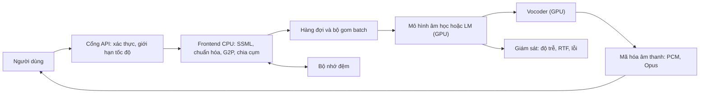

# Chương 39. Tối ưu suy luận và triển khai

!!! abstract "Mục tiêu học tập"
    - Phân tích yêu cầu triển khai (độ trễ, thông lượng, chi phí, bộ nhớ, quyền riêng tư) và chọn mục tiêu phù hợp: máy chủ GPU, máy chủ CPU, thiết bị di động/biên, trình duyệt.
    - Xuất một mô hình PyTorch sang ONNX với trục thời gian động, kiểm chứng số học bằng ONNX Runtime và nhận diện các thành phần khó xuất trong mô hình TTS.
    - Suy ra sai số lượng tử hóa (quy tắc khoảng 6 dB mỗi bit), so sánh lượng tử hóa theo tensor và theo kênh, động và tĩnh, chỉ-trọng-số; đánh giá tác động lên chất lượng âm thanh.
    - Đo RTF và độ trễ đúng phương pháp (khởi động, phân vị, đồng bộ GPU) và dùng định luật Amdahl để chọn chỗ cần tối ưu.
    - Thiết kế một dịch vụ TTS: batching động, continuous batching cho phần LM, giao thức truyền (HTTP chunked, WebSocket, gRPC, WebRTC), mã hóa âm thanh, bộ nhớ đệm, SSML.
    - Cài đặt một endpoint streaming bằng FastAPI và đo độ trễ đến byte đầu tiên từ phía người dùng.
    - Lập kế hoạch giám sát, ước lượng chi phí và năng lực (định luật Little), và chọn bộ công cụ cho thiết bị biên.

!!! info "Kiến thức cần có"
    - PyTorch, `torch.compile` và vòng huấn luyện: [Chương 6](../phan-1-nen-tang/ch06-pytorch-cho-tieng-noi.md).
    - Các họ vocoder và hàm đo RTF: [Chương 25](../phan-6-vocoder/ch25-gan-vocoder.md), [Chương 26](../phan-6-vocoder/ch26-diffusion-vocoder-va-so-sanh.md).
    - TTS dựa trên LM và flow matching: [Chương 34](../phan-8-mo-hinh-lon/ch34-he-thong-lai-hien-dai.md); streaming và độ trễ: [Chương 35](../phan-8-mo-hinh-lon/ch35-streaming-speech-llm.md).
    - Chuẩn hóa văn bản: [Chương 17](../phan-4-frontend/ch17-chuan-hoa-van-ban.md); đánh giá chất lượng: [Chương 38](../phan-9-thuc-tien/ch38-danh-gia-tts.md).

Một mô hình TTS cho điểm MOS cao trong bài báo mới chỉ là một nửa câu chuyện. Nửa còn lại là đưa nó đến người dùng: trả lời trong vài trăm mili-giây, phục vụ hàng trăm luồng đồng thời trên một số GPU hữu hạn, chạy trên điện thoại không có mạng, không đọc sai khi gặp một chuỗi SSML lạ, và báo động khi chất lượng âm thanh âm thầm giảm sút sau một lần cập nhật. Chương này trình bày bộ công cụ kỹ thuật cho nửa thứ hai: xuất mô hình, lượng tử hóa, đo hiệu năng, kiến trúc phục vụ, giám sát và triển khai trên thiết bị biên.

Nguyên tắc xuyên suốt chương là **đo trước, tối ưu sau, và kiểm tra lại chất lượng sau mỗi lần tối ưu**. Nhiều kỹ thuật "tăng tốc" không tăng tốc trong hoàn cảnh cụ thể của bạn, và một số làm giảm chất lượng theo cách mà các thước đo số học không phát hiện được. Các đoạn mã trong chương đã được chạy trên CPU; các con số thời gian in ra chỉ minh họa cho một lần chạy trên máy của người biên soạn và sẽ khác trên máy của bạn.

## 39.1 Bức tranh triển khai

### Mục tiêu triển khai

| Mục tiêu | Điểm mạnh | Ràng buộc | Công cụ thường dùng |
|---|---|---|---|
| Máy chủ GPU | Thông lượng cao, chạy được mô hình lớn (LM vài trăm triệu đến vài tỉ tham số) | Chi phí, độ trễ mạng, cần quản lý batching | PyTorch, TensorRT, ONNX Runtime (CUDA), máy chủ phục vụ LLM, Triton |
| Máy chủ CPU | Rẻ, dễ mở rộng, sẵn có | Chỉ phù hợp mô hình nhỏ/vừa (VITS, Matcha + vocoder nhẹ) | ONNX Runtime, OpenVINO, PyTorch |
| Di động / thiết bị biên | Không cần mạng, quyền riêng tư, độ trễ mạng bằng 0 | Bộ nhớ, pin, nhiệt, kích thước ứng dụng | ONNX Runtime Mobile, sherpa-onnx, ExecuTorch, Core ML |
| Trình duyệt | Không cần cài đặt, chạy phía người dùng | Hiệu năng WebAssembly/WebGPU, kích thước tải về | ONNX Runtime Web, các thư viện JavaScript chạy mô hình ONNX |

Lựa chọn mục tiêu quyết định gần như mọi thứ phía sau. Một hệ thống lai LM + flow matching cỡ 0,5 tỉ tham số ([Chương 34](../phan-8-mo-hinh-lon/ch34-he-thong-lai-hien-dai.md)) hầu như chỉ hợp lý trên GPU; một mô hình VITS ([Chương 27](../phan-7-e2e-bieu-cam/ch27-vits.md)) có thể chạy thời gian thực trên CPU của điện thoại.

### Đo trước, tối ưu sau: định luật Amdahl

Giả sử một đường ống TTS gồm các khâu với tỉ lệ thời gian $p_1, p_2, \ldots$ ($\sum p_i = 1$). Nếu ta tăng tốc khâu chiếm tỉ lệ $p$ lên $s$ lần, tốc độ tổng thể tăng

$$
S = \frac{1}{(1 - p) + p/s}.
$$

Đây là định luật Amdahl (Amdahl, 1967). Ví dụ minh họa: frontend chiếm 5% thời gian, mô hình âm học 25%, vocoder 70%. Tăng tốc vocoder 4 lần cho $S = 1/(0.30 + 0.175) \approx 2.1$ lần; tăng tốc mô hình âm học 10 lần chỉ cho $S = 1/(0.75 + 0.025) \approx 1.29$ lần. Kể cả khi tăng tốc vô hạn một khâu, $S$ không vượt quá $1/(1 - p)$. Bài học: hãy **đo phân bố thời gian** (bằng `torch.profiler`, một trình profile lấy mẫu như py-spy, hoặc Nsight Systems trên GPU) trước khi quyết định tối ưu ở đâu. Với TTS, kết quả thường bất ngờ: chuẩn hóa văn bản viết bằng Python thuần, sao chép dữ liệu giữa CPU và GPU, hay mã hóa âm thanh đầu ra có thể chiếm tỉ lệ đáng kể.

## 39.2 Xuất mô hình: torch.export, ONNX, TensorRT

### Vì sao cần xuất mô hình?

Chạy trực tiếp mã PyTorch ở chế độ eager rất tiện khi phát triển, nhưng khi triển khai có ba bất lợi: chi phí của trình thông dịch Python trên mỗi phép toán (đáng kể với mô hình nhỏ hoặc với bước giải mã tự hồi quy), không có cơ hội tối ưu toàn đồ thị (gộp phép toán, gấp hằng số), và phụ thuộc vào toàn bộ PyTorch, thứ không thể mang lên điện thoại hay trình duyệt. **Xuất mô hình** (*export*) là chụp lại đồ thị tính toán thành một dạng biểu diễn độc lập, để một môi trường chạy (*runtime*) chuyên dụng thực thi.

### Các con đường chính

- **TorchScript**: cơ chế cũ của PyTorch. Tính đến thời điểm biên soạn (2026), PyTorch khuyến nghị dùng `torch.export` cho các dự án mới; bạn vẫn sẽ gặp TorchScript trong mã cũ.
- **`torch.export`**: chụp toàn bộ đồ thị thành một `ExportedProgram`, không cho phép "ngắt đồ thị" (*graph break*). Trục động được khai báo tường minh bằng `torch.export.Dim`. Đây là nền tảng cho bộ xuất ONNX mới, ExecuTorch và biên dịch trước (AOT).
- **ONNX + ONNX Runtime**: ONNX là định dạng trao đổi mô hình mở; ONNX Runtime là môi trường chạy với nhiều *execution provider* (CPU, CUDA, TensorRT, DirectML, Core ML, NNAPI, WebAssembly, WebGPU…). Đây là con đường phổ biến nhất để chạy TTS trên CPU, di động và trình duyệt.
- **TensorRT**: trình biên dịch và môi trường chạy của NVIDIA, thường nhận đầu vào ONNX, tối ưu mạnh cho một dòng GPU cụ thể (fp16, int8, gộp nhân). Hai ràng buộc cần nhớ: bản biên dịch (*engine*) gắn với phiên bản TensorRT và kiến trúc GPU; trục động phải khai báo qua "hồ sơ tối ưu" (*optimization profile*) gồm kích thước nhỏ nhất, thường gặp nhất và lớn nhất.

### Thực hành: xuất một vocoder đồ chơi sang ONNX

Đoạn mã sau định nghĩa một vocoder đồ chơi theo tinh thần HiFi-GAN (tích chập, tích chập chuyển vị để tăng mẫu, một khối dư), xuất sang ONNX với trục thời gian động, rồi so sánh đầu ra của ONNX Runtime với PyTorch ở ba độ dài khác nhau, kể cả độ dài khác với lúc xuất.

```python
import numpy as np
import torch
import torch.nn as nn
import onnxruntime as ort

torch.manual_seed(0)
torch.set_num_threads(2)

class TinyVocoder(nn.Module):
    """Vocoder đồ chơi kiểu HiFi-GAN thu nhỏ: mel (B, F, T) -> dạng sóng (B, 1, T*hop)."""
    def __init__(self, n_mels=80, ch=128, rates=(8, 8)):
        super().__init__()
        self.hop = int(np.prod(rates))
        self.pre = nn.Conv1d(n_mels, ch, kernel_size=7, padding=3)
        layers, c = [], ch
        for r in rates:                        # mỗi tầng tăng mẫu r lần
            layers += [nn.LeakyReLU(0.1),
                       nn.ConvTranspose1d(c, c // 2, 2 * r, stride=r, padding=r // 2)]
            c //= 2
        self.ups = nn.Sequential(*layers)
        self.res = nn.Conv1d(c, c, kernel_size=3, padding=3, dilation=3)
        self.post = nn.Conv1d(c, 1, kernel_size=7, padding=3)

    def forward(self, mel):                    # mel: (B, F, T)
        h = self.ups(self.pre(mel))            # (B, C/4, T*hop)
        h = h + self.res(nn.functional.leaky_relu(h, 0.1))
        return torch.tanh(self.post(h))        # (B, 1, T*hop)

model = TinyVocoder().eval()
mel = torch.randn(1, 80, 50)                   # (B, F, T)
assert model(mel).shape == (1, 1, 50 * model.hop)

# Xuất ONNX với trục thời gian động (exporter dựa trên torch.export)
T = torch.export.Dim("T", min=4, max=8192)
onnx_prog = torch.onnx.export(model, (mel,), dynamo=True,
                              input_names=["mel"], output_names=["wav"],
                              dynamic_shapes={"mel": {2: T}})
onnx_prog.save("tiny_vocoder.onnx")

# Chạy bằng ONNX Runtime, so sánh với PyTorch ở nhiều độ dài
opts = ort.SessionOptions()
opts.intra_op_num_threads = 2
sess = ort.InferenceSession("tiny_vocoder.onnx", opts,
                            providers=["CPUExecutionProvider"])
for t in (8, 50, 333):
    x = torch.randn(1, 80, t)
    with torch.inference_mode():
        ref = model(x).numpy()                 # (1, 1, t*hop)
    out = sess.run(["wav"], {"mel": x.numpy()})[0]
    err = np.abs(out - ref).max()
    print(f"T={t:4d}  out={out.shape}  max|diff|={err:.1e}")
    assert out.shape == ref.shape and err < 1e-4
```

Vài điểm cần giải thích:

- Trong các phiên bản PyTorch gần đây, `torch.onnx.export` mặc định dùng bộ xuất dựa trên `torch.export` (tham số `dynamo=True`); trục động được khai báo bằng `dynamic_shapes` với `Dim`. Các phiên bản cũ hơn dùng tham số `dynamic_axes`. API này thay đổi khá nhanh, hãy kiểm tra tài liệu của phiên bản bạn dùng.
- Với tích chập chuyển vị có `kernel_size = 2r`, `stride = r`, `padding = r/2` (với $r$ chẵn), độ dài đầu ra đúng bằng $r$ lần đầu vào: $(T-1)r - 2 \cdot \tfrac{r}{2} + 2r = rT$. Nhờ vậy dạng sóng luôn dài đúng $T \times$ `hop` mẫu, điều kiện để vocoder khớp với mel ([Chương 26](../phan-6-vocoder/ch26-diffusion-vocoder-va-so-sanh.md)).
- Sai số giữa hai môi trường chạy ở mức $10^{-7}$, tức sai số làm tròn số thực dấu phẩy động 32 bit. Nếu bạn thấy sai số cỡ $10^{-2}$ trở lên, gần như chắc chắn có lỗi xuất (một phép toán bị dịch sai, một nhánh điều kiện bị "đóng băng" theo giá trị lúc xuất).
- **Luôn kiểm thử ở nhiều độ dài**, kể cả độ dài rất ngắn và độ dài khác hẳn lúc xuất. Lỗi phổ biến nhất là một kích thước bị ghi cứng thành hằng số trong đồ thị.

### Những thành phần khó xuất trong mô hình TTS

Mô hình TTS có vài đặc điểm làm việc xuất khó hơn mô hình phân loại ảnh:

- **Kích thước phụ thuộc dữ liệu.** Bộ điều chỉnh độ dài (*length regulator*) của FastSpeech ([Chương 22](../phan-5-mo-hinh-am-hoc/ch22-fastspeech.md)) lặp mỗi véc-tơ âm vị theo trường độ *dự đoán*, nên độ dài đầu ra phụ thuộc vào giá trị chứ không chỉ kích thước đầu vào. Các bộ xuất hiện đại có hỗ trợ một phần cho kích thước như vậy, nhưng cách an toàn và phổ biến là **tách mô hình thành hai đồ thị**: (1) bộ mã hóa văn bản + bộ dự đoán trường độ; (2) bộ giải mã nhận đặc trưng đã được mở rộng. Phép mở rộng ở giữa viết lại bằng các phép toán có kích thước tường minh (ví dụ dùng chỉ số tích lũy và phép `gather`) hoặc thực hiện ngoài đồ thị.
- **Vòng lặp.** Giải mã tự hồi quy (Tacotron, LM token) và các bước giải ODE của flow matching là vòng lặp có số lần lặp thay đổi. Cách làm chuẩn là **xuất một bước** (một bước giải mã với KV cache là đầu vào/đầu ra tường minh, hoặc một lần đánh giá trường vận tốc) và viết vòng lặp ở mã chủ.
- **Tính ngẫu nhiên.** Nhiễu khởi đầu của flow matching hay nhiễu trong VITS nên được truyền vào như một **đầu vào** của đồ thị thay vì sinh bên trong. Như vậy đầu ra tất định với cùng đầu vào, dễ kiểm thử và dễ tái lập lỗi.
- **STFT và iSTFT.** Tính đến thời điểm biên soạn, ONNX có toán tử STFT (từ opset 17) nhưng chưa có toán tử iSTFT chuẩn. Các vocoder dạng Vocos/iSTFTNet thường cài iSTFT bằng nhân ma trận với cơ sở DFT ngược cộng tích chập chuyển vị để chồng cộng (*overlap-add*), hoặc để iSTFT ngoài đồ thị.
- **Weight normalization.** Các vocoder GAN dùng weight norm khi huấn luyện ([Chương 25](../phan-6-vocoder/ch25-gan-vocoder.md)). Hãy gỡ bỏ nó (gộp vào trọng số thường) trước khi xuất để đồ thị gọn và nhanh hơn.
- **Dropout "cố ý" khi suy luận.** Pre-net của Tacotron 2 giữ dropout cả khi suy luận ([Chương 20](../phan-5-mo-hinh-am-hoc/ch20-tacotron.md)). Gọi `model.eval()` trước khi xuất sẽ tắt nó và làm thay đổi hành vi mô hình; phải cài dropout tường minh, luôn bật, nếu muốn giữ nguyên.

## 39.3 Lượng tử hóa

### Hình thức hóa

**Lượng tử hóa** (*quantization*) biểu diễn số thực bằng số nguyên ít bit để giảm bộ nhớ và tận dụng các phép toán số nguyên nhanh. Lượng tử hóa affine với $b$ bit ánh xạ số thực $x$ thành số nguyên

$$
q = \operatorname{clamp}\Big(\operatorname{round}\big(x / s\big) + z,\; q_{\min},\; q_{\max}\Big),
\qquad
\hat{x} = s\,(q - z),
$$

với **thang đo** $s > 0$ và **điểm không** $z$. Dạng **đối xứng** dùng $z = 0$, $q \in [-(2^{b-1} - 1),\, 2^{b-1} - 1]$ và $s = \max \lvert x \rvert / (2^{b-1} - 1)$; đây là lựa chọn phổ biến cho trọng số.

**Sai số lượng tử hóa.** Bỏ qua phần bị cắt (*clamp*), sai số làm tròn $e = \hat{x} - x$ nằm trong $[-s/2, s/2]$. Với giả định chuẩn rằng $e$ phân phối đều trên khoảng đó, phương sai là

$$
\operatorname{Var}(e) = \frac{1}{s} \int_{-s/2}^{s/2} e^2\, de = \frac{s^2}{12}.
$$

Giả sử $x$ phân phối đều trên $[-A, A]$ (phương sai $A^2/3$) và ta dùng toàn bộ $2^b$ mức cho khoảng đó, tức $s = 2A / 2^b$. Tỉ số tín hiệu trên nhiễu lượng tử hóa là

$$
\text{SQNR} = 10 \log_{10} \frac{A^2/3}{s^2/12} = 10 \log_{10} \frac{A^2/3}{A^2 / (3 \cdot 2^{2b})} = 10 \log_{10} 2^{2b} \approx 6.02\, b \;\text{dB}.
$$

Mỗi bit thêm vào cho khoảng 6 dB: int8 cho khoảng 48 dB, int4 chỉ còn khoảng 24 dB. Công thức cũng cho thấy điểm yếu chí mạng của lượng tử hóa: $s$ tỉ lệ với **giá trị lớn nhất**. Nếu có một giá trị ngoại lai lớn gấp 10 lần phần còn lại, $s$ tăng 10 lần và SQNR của phần còn lại giảm 20 dB. Mọi kỹ thuật lượng tử hóa nâng cao về cơ bản đều là cách đối phó với giá trị ngoại lai. Mục 39.5 có thêm một ví dụ cho thấy lượng tử hóa không phải lúc nào cũng làm mô hình chạy nhanh hơn.

### Theo tensor hay theo kênh

Dùng một thang đo cho cả tensor trọng số (*per-tensor*) thì kênh có biên độ nhỏ bị lượng tử hóa rất thô. Dùng một thang đo cho mỗi kênh đầu ra (*per-channel*) khắc phục điều này với chi phí lưu thêm một số thực mỗi kênh. Đoạn mã sau (tiếp nối khối mã trước, dùng lại `model`) kiểm chứng quy tắc 6 dB/bit, rồi so sánh hai cách lượng tử hóa trên vocoder đồ chơi. Để mô phỏng mạng đã huấn luyện, ta nhân trọng số từng kênh của lớp đầu với một hệ số $s_c$ và chia đầu vào tương ứng của lớp sau cho $s_c$: vì LeakyReLU thuần nhất dương ($\operatorname{LReLU}(s_c u) = s_c \operatorname{LReLU}(u)$ với $s_c > 0$), hàm của mạng không đổi, nhưng biên độ trọng số giữa các kênh chênh lệch tới khoảng 100 lần.

```python
import copy

def fake_quant(w, n_bits=8, per_channel=False, ch_axis=0):
    """Lượng tử hóa đối xứng rồi giải lượng tử ngay (fake-quant) để đo sai số."""
    qmax = 2 ** (n_bits - 1) - 1                          # 127 với int8
    if per_channel:                                       # một thang đo cho mỗi kênh ra
        dims = [d for d in range(w.dim()) if d != ch_axis]
        amax = w.abs().amax(dim=dims, keepdim=True)
    else:                                                 # một thang đo cho cả tensor
        amax = w.abs().max()
    scale = amax.clamp(min=1e-12) / qmax
    q = torch.clamp(torch.round(w / scale), -qmax, qmax)  # số nguyên trong [-127, 127]
    return q * scale

def snr_db(ref, est):
    return 10 * torch.log10(ref.pow(2).sum() / (ref - est).pow(2).sum()).item()

# (a) Kiểm chứng quy tắc "khoảng 6 dB mỗi bit" trên dữ liệu phân phối đều
u = torch.rand(200_000) * 2 - 1
for b in (4, 6, 8):
    print(f"{b} bit: SQNR = {snr_db(u, fake_quant(u, b)):5.1f} dB "
          f"(6.02*b = {6.02 * b:5.1f})")

# (b) Lượng tử hóa trọng số của vocoder đồ chơi, đo SNR của dạng sóng đầu ra
torch.manual_seed(1)
base = copy.deepcopy(model)
with torch.no_grad():
    # Nhân kênh c của lớp đầu với s_c và chia đầu vào tương ứng của lớp sau cho s_c.
    # LeakyReLU thuần nhất dương nên hàm của mạng KHÔNG đổi, nhưng biên độ trọng số
    # giữa các kênh chênh lệch tới ~100 lần (hay gặp ở mạng đã huấn luyện).
    s = 10 ** torch.empty(base.pre.out_channels).uniform_(-2.0, 0.0)
    base.pre.weight.mul_(s[:, None, None]); base.pre.bias.mul_(s)
    base.ups[1].weight.div_(s[:, None, None])  # ConvTranspose1d: (C_in, C_out, k)
assert torch.allclose(base(torch.ones(1, 80, 9)), model(torch.ones(1, 80, 9)), atol=1e-5)

def quantize_pre(m, per_channel):
    """Chỉ lượng tử hóa lớp đầu (Conv1d, trọng số (C_out, C_in, k)) để cô lập hiệu ứng."""
    m = copy.deepcopy(m)
    with torch.no_grad():
        m.pre.weight.copy_(fake_quant(m.pre.weight, 8, per_channel, ch_axis=0))
    return m

x = torch.randn(1, 80, 200)
with torch.inference_mode():
    y_ref = base(x)
    for pc in (False, True):
        y_q = quantize_pre(base, pc)(x)
        print(f"int8 per-{'channel' if pc else 'tensor '}: SNR đầu ra = "
              f"{snr_db(y_ref, y_q):5.1f} dB")
```

Trong lần chạy của chúng tôi, phần (a) cho 22,9 / 35,8 / 48,1 dB với 4 / 6 / 8 bit, rất sát công thức $6.02\,b$. Sai lệch nhỏ ở 4 bit là do dạng đối xứng có bước lượng tử $2A/(2^b - 2)$ thay vì $2A/2^b$, làm SQNR giảm $20 \log_{10} \frac{2^b}{2^b - 2}$ dB, khoảng 1,2 dB khi $b = 4$ và không đáng kể khi $b = 8$. Phần (b) cho SNR đầu ra khoảng 32 dB với per-tensor so với khoảng 62 dB với per-channel: chênh lệch tới 30 dB, chỉ vì một lớp. Lý do: các kênh biên độ nhỏ bị lượng tử hóa thô, rồi lớp sau *khuếch đại* chúng lên gấp $1/s_c$ lần.

Hai chi tiết đáng chú ý. Thứ nhất, trục kênh đầu ra của `ConvTranspose1d` là **trục 1** (trọng số có dạng `(C_in, C_out, k)`), khác với `Conv1d` (trục 0); nhầm trục là lỗi thường gặp khi tự viết lượng tử hóa. Thứ hai, nếu bạn lượng tử hóa cả lớp `ConvTranspose1d` phía sau, per-channel theo trục ra không cứu được, vì sự chênh lệch giờ nằm ở **trục vào** của lớp đó. Trường hợp này cần cân bằng lại biên độ giữa hai lớp liên tiếp trước khi lượng tử hóa (*cross-layer equalization*; Nagel và cộng sự, 2019), hoặc chuyển bớt độ khó từ activation sang trọng số như SmoothQuant (Xiao và cộng sự, 2023) làm với Transformer (Bài tập 4).

### Động, tĩnh, huấn luyện có lượng tử hóa

- **Lượng tử hóa động** (*dynamic*): trọng số lượng tử hóa sẵn; activation được lượng tử hóa lúc chạy, thang đo tính trên từng batch. Không cần dữ liệu hiệu chỉnh. Hiệu quả nhất với mô hình nặng về nhân ma trận (Transformer, LSTM) trên CPU.
- **Lượng tử hóa tĩnh** (*static*, hay sau huấn luyện, PTQ): thang đo của activation được ước lượng trước trên một tập **hiệu chỉnh** (*calibration*) vài trăm mẫu. Nhanh hơn lượng tử hóa động vì không phải tính thang đo lúc chạy, phù hợp mạng tích chập; nhưng chất lượng phụ thuộc tập hiệu chỉnh có đại diện cho dữ liệu thật hay không.
- **Huấn luyện có lượng tử hóa** (*quantization-aware training*, QAT; Jacob và cộng sự, 2018): chèn phép lượng tử hóa giả vào lượt truyền thẳng khi fine-tune, dùng straight-through estimator cho gradient. Tốn công nhất, chất lượng tốt nhất, cần thiết khi xuống 4 bit hoặc với các lớp nhạy cảm.
- **Số thực 16 bit**: fp16 và bf16 trên GPU thường gần như không mất chất lượng và là bước đầu tiên nên thử. fp16 có miền giá trị hẹp (giá trị lớn nhất khoảng 65 504), nên một số vocoder có activation lớn bị tràn thành `inf`/`NaN`; bf16 có cùng miền mũ với fp32 nên an toàn hơn về tràn số, đổi lại độ chính xác phần định trị thấp hơn.
- **Chỉ lượng tử hóa trọng số cho phần LM**: với LM vài trăm triệu đến vài tỉ tham số trong TTS dựa trên LLM, giải mã từng token bị giới hạn bởi **băng thông bộ nhớ** (mỗi bước phải đọc toàn bộ trọng số) chứ không phải tính toán. Lượng tử hóa trọng số xuống int8 hoặc int4 (các phương pháp như LLM.int8(), GPTQ, AWQ; Dettmers và cộng sự, 2022; Frantar và cộng sự, 2023; Lin và cộng sự, 2024) giảm lượng dữ liệu phải đọc, nên tăng tốc gần tỉ lệ thuận, trong khi activation vẫn giữ 16 bit.

Tính đến thời điểm biên soạn (2026), các API lượng tử hóa cũ trong `torch.ao.quantization` của PyTorch đã bị đánh dấu sắp loại bỏ và PyTorch khuyến nghị chuyển sang thư viện `torchao`; ONNX Runtime và TensorRT có công cụ lượng tử hóa riêng.

### Lượng tử hóa và chất lượng âm thanh

SNR là thước đo số học, không phải thước đo cảm nhận. Với TTS, một số lưu ý thực tế:

- **Vocoder nhạy cảm nhất.** Sai số ở vocoder biến thành nhiễu tần số cao, tiếng rè hoặc tiếng "kim loại" nghe rõ ngay cả khi SNR có vẻ cao. Lớp đầu và lớp cuối của vocoder thường nên giữ độ chính xác cao.
- **Các tham số nhỏ đặc biệt** như tham số của hàm kích hoạt Snake trong BigVGAN, các lớp chuẩn hóa, hay embedding người nói nên giữ ở số thực.
- **Bộ giải ODE cộng dồn sai số** qua nhiều bước; lượng tử hóa trường vận tốc có thể ảnh hưởng nhiều hơn một lần gọi mạng đơn lẻ.
- **Kiểm tra lại toàn bộ bộ đánh giá** sau lượng tử hóa: CER bằng ASR, độ giống giọng, và với tiếng Việt, bộ câu kiểm tra thanh điệu ([Chương 38](../phan-9-thuc-tien/ch38-danh-gia-tts.md)). Cuối cùng là một bài nghe so sánh AB với phiên bản gốc.

## 39.4 Các kỹ thuật tăng tốc khác

### Giảm số bước sinh

Với các mô hình dùng khuếch tán hoặc flow matching, chi phí tỉ lệ thuận với **số lần đánh giá mạng** (NFE): giảm từ 32 xuống 8 bước Euler là tăng tốc khoảng 4 lần cho khâu đó, không cần đụng tới phần cứng. Hướng dẫn không cần bộ phân loại (CFG) nhân đôi NFE mỗi bước (một lần có điều kiện, một lần không), nên cách cài CFG hiệu quả là gộp hai lần gọi vào cùng một batch. Khi muốn giảm sâu hơn (một đến vài bước), cần các kỹ thuật chưng cất bước như consistency model hay flow matching ít bước ([Chương 11](../phan-2-mo-hinh-sinh/ch11-diffusion.md), [Chương 12](../phan-2-mo-hinh-sinh/ch12-flow-matching.md)). Luôn vẽ đường cong chất lượng (CER, SIM, MOS dự đoán) theo số bước trên tập kiểm định trước khi chọn.

### Chưng cất và mô hình nhỏ hơn

**Chưng cất kiến thức** (*knowledge distillation*; Hinton và cộng sự, 2015) huấn luyện một mô hình "học trò" nhỏ bắt chước đầu ra của mô hình "thầy" lớn. Trong TTS, dạng phổ biến nhất là dùng mô hình lớn để **tạo dữ liệu**: sinh hàng nghìn giờ âm thanh chất lượng cao cho một giọng cố định, rồi huấn luyện một mô hình nhỏ (VITS, Matcha-TTS) trên dữ liệu đó. Với vocoder, các biến thể nhỏ như HiFi-GAN V2/V3 hay các vocoder dự đoán phổ rồi dùng iSTFT như Vocos (Siuzdak, 2024) có tỉ lệ chất lượng trên chi phí rất tốt ([Chương 25](../phan-6-vocoder/ch25-gan-vocoder.md)).

### Cắt tỉa

**Cắt tỉa** (*pruning*) loại bỏ trọng số hoặc cả kênh ít quan trọng (Han và cộng sự, 2016). Cần phân biệt: cắt tỉa **không cấu trúc** (đặt các trọng số riêng lẻ về 0) giảm kích thước khi nén nhưng hầu như không tăng tốc trên phần cứng thông thường, trừ khi có nhân tính toán thưa chuyên dụng (như WaveRNN đã làm với ma trận thưa theo khối; Kalchbrenner và cộng sự, 2018). Cắt tỉa **có cấu trúc** (bỏ cả kênh, cả đầu attention, cả lớp) cho mô hình nhỏ hơn thực sự và tăng tốc trực tiếp, nhưng thường cần fine-tune lại để phục hồi chất lượng.

### Biên dịch: torch.compile và CUDA graphs

`torch.compile` chụp các đoạn đồ thị từ mã PyTorch và sinh nhân tính toán tối ưu (gộp các phép toán theo từng phần tử, giảm đọc ghi bộ nhớ). Vài điều cần biết khi dùng cho TTS:

- **Lần gọi đầu rất chậm** vì phải biên dịch; phải khởi động trước khi phục vụ.
- **Kích thước động**: mỗi độ dài đầu vào mới có thể gây biên dịch lại. Đánh dấu trục động (`dynamic=True` hoặc `torch._dynamo.mark_dynamic`) hoặc gom độ dài vào một số "thùng" (*bucket*) cố định.
- **Các chế độ**: `"default"`, `"reduce-overhead"` (dùng CUDA graphs để giảm chi phí khởi chạy nhân trên GPU) và `"max-autotune"` (dò cấu hình nhân lâu hơn để chạy nhanh hơn).

```python
import time

compiled = torch.compile(model, dynamic=True)   # đánh dấu trục thời gian là động
with torch.inference_mode():
    t0 = time.perf_counter()
    y = compiled(torch.ones(1, 80, 120))        # lần gọi đầu: biên dịch (chậm)
    print(f"lần đầu (gồm biên dịch): {time.perf_counter() - t0:.1f} s")
    for t in (64, 200, 500):                    # các độ dài khác: không biên dịch lại
        mel_t = torch.randn(1, 80, t)
        assert torch.allclose(compiled(mel_t), model(mel_t), atol=1e-4)
    assert torch.allclose(y, model(torch.ones(1, 80, 120)), atol=1e-4)
```

Đoạn mã trên (dùng lại `model` của Mục 39.2) đã được chạy trên CPU. Với vocoder đồ chơi nhỏ này trên CPU, chúng tôi không thấy `torch.compile` nhanh hơn chế độ eager một cách đáng kể; lợi ích thường rõ hơn trên GPU và với mô hình có nhiều phép toán theo từng phần tử. Một lần nữa: hãy đo.

**CUDA graphs** ghi lại một chuỗi lệnh khởi chạy nhân GPU và phát lại chúng bằng một lệnh duy nhất, loại bỏ chi phí của CPU khi khởi chạy từng nhân. Kỹ thuật này đặc biệt hữu ích cho bước giải mã tự hồi quy của LM (mỗi bước gồm rất nhiều nhân nhỏ) nhưng đòi hỏi **kích thước tĩnh và địa chỉ bộ nhớ cố định**: KV cache phải được cấp phát trước với độ dài tối đa, và các độ dài khác nhau phải được gom vào các thùng, mỗi thùng một đồ thị.

### Tối ưu đường ống

Ngoài bản thân mô hình, nhiều cải thiện đến từ cách nối các khâu: chạy frontend (chuẩn hóa văn bản, G2P) trên CPU song song với mô hình trên GPU; tránh sao chép qua lại giữa CPU và GPU; gom các yêu cầu vocoder của nhiều luồng vào một batch; và tính sẵn những gì có thể tính sẵn (embedding người nói, token của prompt; xem Mục 39.6).

## 39.5 Đo hiệu năng đúng cách

Một con số RTF không kèm điều kiện đo gần như vô nghĩa. Danh sách kiểm tra khi đo:

1. **Khởi động** (*warm-up*): bỏ vài lần chạy đầu (cấp phát bộ nhớ, biên dịch, nạp bộ nhớ đệm).
2. **Đồng bộ GPU**: các lệnh GPU chạy bất đồng bộ; phải gọi `torch.cuda.synchronize()` trước khi bấm giờ kết thúc, nếu không bạn chỉ đo thời gian *gửi* lệnh.
3. **Chế độ suy luận**: `model.eval()` và `torch.inference_mode()`.
4. **Số luồng CPU**: cố định `torch.set_num_threads` và số luồng của ONNX Runtime; ghi lại trong báo cáo.
5. **Phân phối độ dài đầu vào**: đo trên phân phối câu thực tế, không chỉ một câu; RTF của câu ngắn thường tệ hơn vì chi phí cố định.
6. **Báo cáo phân vị**: p50 và p95 (hoặc p99), không chỉ trung bình. Người dùng nhớ những lần chậm.
7. **Tải đồng thời**: một yêu cầu đơn lẻ trên máy rảnh khác xa 50 yêu cầu đồng thời; đo cả hai.
8. **Ghi lại môi trường**: phần cứng, phiên bản thư viện, kiểu dữ liệu, kích thước batch.

Hàm sau cài các nguyên tắc 1, 6 và quy đổi ra RTF; nó được dùng để so sánh PyTorch với ONNX Runtime trên vocoder đồ chơi (tiếp nối khối mã ở Mục 39.2).

```python
import time

def benchmark_rtf(run_fn, audio_seconds, n_warmup=3, n_runs=20):
    """Đo thời gian chạy run_fn() và quy ra RTF = thời gian xử lý / thời lượng audio.
    Với GPU: gọi torch.cuda.synchronize() bên trong run_fn trước khi trả về."""
    times = []
    for i in range(n_warmup + n_runs):
        t0 = time.perf_counter()
        run_fn()
        dt = time.perf_counter() - t0
        if i >= n_warmup:                      # bỏ các lần khởi động (warm-up)
            times.append(dt)
    times.sort()
    pct = lambda p: times[min(len(times) - 1, int(round(p * (len(times) - 1))))]
    return {"p50_ms": 1e3 * pct(0.50), "p95_ms": 1e3 * pct(0.95),
            "rtf_p50": pct(0.50) / audio_seconds}

sr, n_frames = 16_000, 500                     # 500 khung * hop 64 = 2 giây audio
x = torch.randn(1, 80, n_frames)
audio_sec = n_frames * model.hop / sr

def run_torch():
    with torch.inference_mode():
        model(x)

def run_ort():
    sess.run(["wav"], {"mel": x.numpy()})

for name, fn in [("PyTorch eager", run_torch), ("ONNX Runtime", run_ort)]:
    r = benchmark_rtf(fn, audio_sec)
    print(f"{name:14s} p50={r['p50_ms']:6.1f} ms  p95={r['p95_ms']:6.1f} ms  "
          f"RTF={r['rtf_p50']:.3f}")
```

Trong các lần chạy của chúng tôi (CPU, 2 luồng), ONNX Runtime nhanh hơn PyTorch eager khoảng 1,5–2 lần trên mô hình này, với RTF cỡ phần nghìn. Đừng tổng quát hóa con số này: tỉ lệ phụ thuộc mô hình, phần cứng và phiên bản thư viện.

### Ví dụ: lượng tử hóa không tự động nhanh hơn

Đoạn mã sau (tiếp nối các khối mã ở trên) dùng công cụ lượng tử hóa động của ONNX Runtime trên vocoder đồ chơi rồi đo lại.

```python
from onnxruntime.quantization import QuantType, quantize_dynamic

# Lượng tử hóa động: trọng số int8 lưu sẵn, activation lượng tử hóa lúc chạy
quantize_dynamic("tiny_vocoder.onnx", "tiny_vocoder_int8.onnx", weight_type=QuantType.QInt8)
sess8 = ort.InferenceSession("tiny_vocoder_int8.onnx", opts, providers=["CPUExecutionProvider"])

feed = {"mel": x.numpy()}                         # x, audio_sec: từ khối mã đo RTF ở trên
a, b = sess.run(["wav"], feed)[0], sess8.run(["wav"], feed)[0]
print(f"SNR fp32 so với int8: {10 * np.log10((a**2).sum() / ((a - b)**2).sum()):.1f} dB")
for name, s in [("ORT fp32", sess), ("ORT int8 động", sess8)]:
    r = benchmark_rtf(lambda: s.run(["wav"], feed), audio_sec)
    print(f"{name:14s} p50={r['p50_ms']:6.1f} ms  RTF={r['rtf_p50']:.3f}")
```

Trên máy của chúng tôi, SNR giữa hai phiên bản khoảng 44 dB (chấp nhận được), nhưng phiên bản int8 **chậm hơn khoảng hai lần** phiên bản fp32, nhất quán qua nhiều lần chạy. Nhìn vào đồ thị sau lượng tử hóa sẽ thấy lý do: các lớp `Conv` được thay bằng `ConvInteger` cộng các phép lượng tử hóa activation chạy liên tục, trong khi nhân tích chập số nguyên trên CPU này không đủ nhanh để bù lại, và lớp `ConvTranspose` vẫn ở fp32. Bài học: **lượng tử hóa động được thiết kế cho mô hình nặng về nhân ma trận; với mạng tích chập, hãy thử lượng tử hóa tĩnh dạng QDQ với dữ liệu hiệu chỉnh, và luôn đo**. ONNX Runtime cũng khuyến nghị chạy bước tiền xử lý mô hình (`python -m onnxruntime.quantization.preprocess`) trước khi lượng tử hóa.

## 39.6 Kiến trúc phục vụ

### Các thành phần

Một dịch vụ TTS điển hình có các khối sau. Frontend (chuẩn hóa văn bản, G2P, phân tích SSML) chạy trên CPU; mô hình âm học hoặc LM và vocoder chạy trên GPU; âm thanh được mã hóa và truyền theo luồng về người dùng; bộ nhớ đệm và hệ thống giám sát bao quanh tất cả.



### Gom batch

GPU hiệu quả nhất khi xử lý nhiều chuỗi cùng lúc. Có ba mức gom batch:

- **Batch tĩnh**: gom đủ $B$ yêu cầu rồi chạy. Đơn giản nhưng yêu cầu đến sớm phải chờ.
- **Batch động** (*dynamic batching*): hàng đợi gom yêu cầu cho đến khi đủ kích thước tối đa **hoặc** hết thời gian chờ tối đa (vài mili-giây), rồi chạy. Đánh đổi trực tiếp: thời gian chờ tối đa cộng thẳng vào độ trễ, đổi lại thông lượng cao hơn.
- **Batch liên tục** (*continuous batching*; Yu và cộng sự, 2022) cho phần giải mã tự hồi quy: thay vì chờ chuỗi dài nhất trong batch kết thúc, bộ lập lịch cho chuỗi đã xong rời batch và chuỗi mới vào batch **ở mỗi bước giải mã**. Kết hợp với quản lý KV cache theo trang (*PagedAttention*; Kwon và cộng sự, 2023), GPU luôn được lấp đầy và số chuỗi đồng thời tăng mạnh.

Với các mô hình không tự hồi quy, phần đệm (*padding*) là nguồn lãng phí chính. Nếu batch có các chuỗi độ dài $\ell_1, \ldots, \ell_B$ được đệm tới độ dài lớn nhất, **hiệu suất** của batch là

$$
\eta = \frac{\sum_{i=1}^{B} \ell_i}{B \cdot \max_i \ell_i}.
$$

Ví dụ ba câu dài 2, 3 và 10 giây cho $\eta = 15/30 = 50\%$: một nửa tính toán bị lãng phí cho phần đệm. Gom các yêu cầu có độ dài gần nhau vào cùng batch (*bucketing*) đưa $\eta$ về gần 1; [Chương 6](../phan-1-nen-tang/ch06-pytorch-cho-tieng-noi.md) dùng cùng ý tưởng cho huấn luyện.

Với TTS dựa trên LLM ([Chương 34](../phan-8-mo-hinh-lon/ch34-he-thong-lai-hien-dai.md)), phần LM có cấu trúc giống hệt một LLM văn bản, nên có thể tận dụng các máy chủ phục vụ LLM chuyên dụng (như vLLM) để có sẵn batch liên tục, KV cache theo trang và lượng tử hóa trọng số. Điều kiện là máy chủ đó hỗ trợ bảng từ vựng mở rộng (token tiếng nói), chiến lược lấy mẫu riêng của TTS và trả về được chuỗi token. Tính đến thời điểm biên soạn (2026), một số dự án TTS mã nguồn mở đã có hướng dẫn tích hợp như vậy; hãy kiểm tra kho mã của mô hình bạn dùng. Phần bộ giải mã flow matching và vocoder thường được gom batch riêng.

**Triton Inference Server** của NVIDIA là một lựa chọn phổ biến để phục vụ nhiều mô hình trên GPU: có sẵn bộ gom batch động, bộ gom batch cho mô hình có trạng thái (*sequence batcher*, hữu ích cho streaming), khả năng nối nhiều mô hình thành một đường ống (*ensemble*), và hỗ trợ nhiều backend (ONNX Runtime, TensorRT, PyTorch, Python).

### Giao thức truyền

| Giao thức | Khi nào dùng | Ưu điểm | Nhược điểm |
|---|---|---|---|
| HTTP, trả về cả tệp | Tạo sách nói, tạo dữ liệu, tác vụ ngoại tuyến | Đơn giản nhất, dễ cache | Phải chờ sinh xong |
| HTTP streaming (chunked) | Đọc văn bản có sẵn với độ trễ thấp | Đơn giản, đi qua hầu hết hạ tầng mạng | Một chiều: văn bản phải gửi hết từ đầu |
| WebSocket | Văn bản đến dần (từ LLM), điều khiển hai chiều (hủy, đổi giọng) | Hai chiều, độ trễ thấp | Kết nối có trạng thái, khó cân bằng tải hơn |
| gRPC streaming | Giao tiếp giữa các dịch vụ nội bộ | Có kiểu dữ liệu chặt, hiệu quả | Ít thân thiện với trình duyệt |
| WebRTC | Trợ lý giọng nói thời gian thực trong trình duyệt/ứng dụng | Thiết kế cho âm thanh thời gian thực: bộ đệm chống giật, Opus, khử tiếng vọng phía người dùng | Phức tạp nhất |

### Mã hóa âm thanh

- **PCM 16 bit** (*s16le*): không nén, không thêm độ trễ. Bitrate bằng $f_s \times 16$ bit/s cho một kênh: 256 kbit/s ở 16 kHz, 384 kbit/s ở 24 kHz. Với 1 000 luồng đồng thời ở 24 kHz, riêng băng thông đã là 384 Mbit/s.
- **G.711** (μ-law hoặc A-law, 8 kHz, 64 kbit/s): chuẩn của mạng điện thoại; cần lấy mẫu lại xuống 8 kHz nếu hệ thống chạy qua tổng đài.
- **Opus** (Valin và cộng sự, 2012): codec mở, độ trễ thấp, khung từ 2,5 đến 60 ms (20 ms là lựa chọn phổ biến), bitrate từ 6 đến 510 kbit/s; với tiếng nói, vài chục kbit/s thường đã cho chất lượng tốt. Đây là lựa chọn mặc định cho streaming qua mạng.
- **MP3/AAC**: phù hợp tệp tải về, không lý tưởng cho hội thoại vì độ trễ mã hóa và đặc điểm khung.

Hai cái bẫy định dạng: (1) tệp WAV có trường kích thước dữ liệu ở phần đầu, mà khi streaming ta chưa biết kích thước; một số máy chủ ghi giá trị lớn nhất có thể vào đó, nhưng cách người dùng xử lý không thống nhất. Gửi PCM thô kèm khai báo định dạng, hoặc dùng định dạng chứa thiết kế cho streaming (Ogg, WebM), sẽ an toàn hơn. (2) Kiểu MIME `audio/L16` (RFC 2586) quy định thứ tự byte **big-endian**, trong khi PCM mà hầu hết thư viện sinh ra là little-endian; ghi nhãn sai sẽ cho ra tiếng rè.

### Thực hành: endpoint streaming với FastAPI

Đoạn mã sau dựng một dịch vụ tối giản với hai endpoint: HTTP streaming (gửi cả văn bản, nhận PCM theo luồng) và WebSocket (gửi văn bản theo từng tin nhắn, nhận PCM và sự kiện kết thúc). Bộ tổng hợp ở đây là một hàm giả sinh tiếng bíp; trong hệ thống thật bạn thay nó bằng mô hình. Phần cuối tệp dùng `TestClient` để kiểm thử mà không cần mở cổng mạng. [Dự án 5](../phan-10-du-an/du-an-5-tts-service-streaming.md) phát triển ý tưởng này thành một dịch vụ hoàn chỉnh.

```python
import asyncio
import re
import time
import numpy as np
from fastapi import FastAPI, WebSocket, WebSocketDisconnect
from fastapi.responses import StreamingResponse
from pydantic import BaseModel, Field

SR = 16_000
app = FastAPI()

class TTSRequest(BaseModel):
    text: str = Field(min_length=1, max_length=5000)
    voice: str = "default"

def split_phrases(text: str) -> list[str]:
    """Cắt theo dấu câu (bản rút gọn; xem bộ chia cụm ở Chương 35)."""
    return [p.strip() for p in re.split(r"(?<=[.!?,;:])\s+", text) if p.strip()]

def synthesize(phrase: str, voice: str) -> np.ndarray:
    """Bộ tổng hợp GIẢ: mỗi âm tiết là 120 ms tiếng bíp. Thay bằng mô hình thật."""
    n = int(SR * 0.12 * len(phrase.split()))
    t = np.arange(n) / SR
    return (0.3 * np.sin(2 * np.pi * 440 * t)).astype(np.float32)   # (L,)

def to_pcm16(wav: np.ndarray) -> bytes:
    return (np.clip(wav, -1, 1) * 32767).astype("<i2").tobytes()     # little-endian

async def pcm_stream(text: str, voice: str):
    for phrase in split_phrases(text):
        # Chạy mô hình trong thread riêng để không chặn event loop của server
        wav = await asyncio.to_thread(synthesize, phrase, voice)
        yield to_pcm16(wav)

@app.post("/v1/tts/stream")
async def tts_stream(req: TTSRequest):
    headers = {"X-Audio-Format": f"pcm_s16le; rate={SR}; channels=1"}
    return StreamingResponse(pcm_stream(req.text, req.voice),
                             media_type="application/octet-stream", headers=headers)

@app.websocket("/v1/tts/ws")
async def tts_ws(ws: WebSocket):
    await ws.accept()
    try:
        while True:                       # mỗi tin nhắn JSON: {"text": ...}
            msg = await ws.receive_json()
            async for chunk in pcm_stream(msg["text"], msg.get("voice", "default")):
                await ws.send_bytes(chunk)
            await ws.send_json({"event": "done"})
    except WebSocketDisconnect:
        pass                              # khách ngắt kết nối: dọn dẹp tài nguyên ở đây

if __name__ == "__main__":                # kiểm thử nhanh, không cần mở cổng mạng
    from fastapi.testclient import TestClient
    client = TestClient(app)
    text = "Xin chào. Hôm nay trời đẹp, mình đi dạo nhé!"
    t0 = time.perf_counter()
    with client.stream("POST", "/v1/tts/stream", json={"text": text}) as r:
        assert r.status_code == 200
        chunks = list(r.iter_bytes())
    total = sum(len(c) for c in chunks)
    assert total == 2 * int(SR * 0.12) * len(text.split())          # 2 byte/mẫu
    print(f"HTTP: {len(chunks)} chunk, {total} byte, {time.perf_counter() - t0:.3f} s")
    with client.websocket_connect("/v1/tts/ws") as ws:
        ws.send_json({"text": text})
        n_bytes = 0
        while (m := ws.receive()).get("bytes") is not None:
            n_bytes += len(m["bytes"])
        assert n_bytes == total and '"done"' in m["text"]
    print("WebSocket: OK", n_bytes, "byte")
```

Lưu tệp với tên `tts_app.py` và chạy trực tiếp để kiểm thử, hoặc khởi động máy chủ thật bằng uvicorn:

```bash
python tts_app.py                                   # kiểm thử bằng TestClient
uvicorn tts_app:app --host 127.0.0.1 --port 8765    # chạy máy chủ thật
```

Phía người dùng, độ trễ đến byte đầu tiên (TTFB) và RTF đo như sau. Chúng tôi đã chạy đoạn mã này với máy chủ uvicorn ở trên.

```python
import time
import httpx

def measure(url: str, text: str, sr: int = 16_000):
    """Đo TTFB (byte audio đầu tiên) và RTF phía khách cho endpoint streaming PCM16."""
    t0 = time.perf_counter()
    ttfb, n_bytes = None, 0
    with httpx.stream("POST", url, json={"text": text}, timeout=30) as r:
        r.raise_for_status()
        for chunk in r.iter_bytes():
            if ttfb is None:
                ttfb = time.perf_counter() - t0
            n_bytes += len(chunk)
    total = time.perf_counter() - t0
    audio_sec = n_bytes / 2 / sr                 # PCM 16 bit mono: 2 byte mỗi mẫu
    return {"ttfb_ms": 1e3 * ttfb, "total_ms": 1e3 * total, "rtf": total / audio_sec}

# Nếu môi trường có biến HTTP(S)_PROXY, đặt NO_PROXY=127.0.0.1 để không đi qua proxy
print(measure("http://127.0.0.1:8765/v1/tts/stream",
              "Xin chào. Hôm nay trời đẹp, mình đi dạo nhé!"))
```

Vài lưu ý khi biến khung xương này thành dịch vụ thật:

- `asyncio.to_thread` giữ cho vòng lặp sự kiện không bị chặn, nhưng **không** giải quyết việc nhiều luồng cùng gọi một mô hình GPU. Trong hệ thống thật, các yêu cầu nên đi qua một hàng đợi và một bộ gom batch duy nhất cho mỗi bản sao mô hình.
- Xử lý **hủy**: khi người dùng ngắt kết nối hoặc gửi lệnh hủy (bị ngắt lời, [Chương 35](../phan-8-mo-hinh-lon/ch35-streaming-speech-llm.md)), phải dừng sinh ngay để giải phóng GPU.
- Giới hạn độ dài văn bản, số kết nối đồng thời mỗi người dùng, và thời gian chờ; kiểm tra đầu vào ở biên dịch vụ.

### Bộ nhớ đệm

TTS có nhiều cơ hội dùng bộ nhớ đệm:

- **Đệm đầu ra**: khóa là băm của (văn bản *đã chuẩn hóa*, giọng, tham số, phiên bản mô hình). Rất hiệu quả cho các câu lặp lại như lời chào của tổng đài, menu IVR, thông báo cố định. Nhớ đưa phiên bản mô hình vào khóa, nếu không sau khi cập nhật mô hình bạn vẫn phát âm thanh cũ.
- **Đệm đặc trưng giọng**: với mô hình zero-shot, embedding người nói, token và mel của prompt chỉ cần tính một lần cho mỗi giọng.
- **Đệm tiền tố trong LM**: với TTS dựa trên LLM, phần đầu chuỗi (prompt) giống nhau giữa các yêu cầu cùng giọng; các máy chủ LLM có thể tái sử dụng KV cache của tiền tố chung.
- **Đệm frontend**: kết quả chuẩn hóa văn bản và G2P cho các câu, từ thường gặp.

### SSML: ngôn ngữ đánh dấu cho tổng hợp tiếng nói

**SSML** (*Speech Synthesis Markup Language*; W3C, 2010) là chuẩn XML cho phép người dùng điều khiển cách đọc. Hầu hết dịch vụ TTS thương mại hỗ trợ một tập con của SSML, và mỗi nhà cung cấp mở rộng theo cách riêng. Điều quan trọng với người xây dựng hệ thống là hiểu **mỗi thẻ ánh xạ xuống frontend và mô hình như thế nào**:

| Thẻ SSML | Ý nghĩa | Ánh xạ xuống hệ thống |
|---|---|---|
| `<break time="300ms"/>` | Chèn khoảng lặng | Token ngắt nghỉ (nếu mô hình có, [Chương 18](../phan-4-frontend/ch18-g2p-bieu-dien-dau-vao.md)) hoặc chèn mẫu im lặng giữa hai đoạn |
| `<say-as interpret-as="date">` | Chỉ định cách đọc | Ép loại chuẩn hóa trong frontend ([Chương 17](../phan-4-frontend/ch17-chuan-hoa-van-ban.md)) |
| `<sub alias="...">` | Đọc chữ thay thế | Thay chuỗi trước khi chuẩn hóa |
| `<phoneme alphabet="ipa" ph="...">` | Chỉ định phát âm | Bỏ qua G2P cho đoạn này |
| `<prosody rate pitch volume>` | Điều khiển ngôn điệu | Nhân trường độ; dịch F0; nhân biên độ |
| `<emphasis>` | Nhấn mạnh | Tăng trường độ, F0 cục bộ, hoặc token phong cách |
| `<voice>`, `<lang>` | Đổi giọng, ngôn ngữ | Chọn embedding người nói, ngôn ngữ |
| `<mark name="..."/>` | Đánh dấu vị trí | Trả về thời điểm tương ứng để đồng bộ phụ đề, hình ảnh |

Các giá trị của `interpret-as` không được chuẩn SSML 1.1 quy định đầy đủ, nên mỗi hệ thống tự định nghĩa tập giá trị mình hỗ trợ. Với mô hình dựa trên LM không có bộ dự đoán trường độ hay F0 tường minh, nhiều thẻ chỉ có thể xấp xỉ: `break` thực hiện bằng cách tổng hợp hai đoạn riêng rồi chèn im lặng (đánh đổi ngữ điệu liền mạch), `rate` bằng tham số tốc độ của mô hình (nếu có) hoặc kéo giãn thời gian sau khi sinh, các thẻ phong cách bằng chỉ dẫn ngôn ngữ tự nhiên (với mô hình hỗ trợ).

Đoạn mã sau phân tích một tập con SSML thành danh sách đoạn văn bản kèm điều khiển, sẵn sàng đưa xuống frontend. Lưu ý cách xử lý phần **đuôi** (`tail`) của mỗi phần tử XML: văn bản nằm sau thẻ đóng thuộc về ngữ cảnh của phần tử *cha*, một chi tiết dễ làm sai.

```python
import re
import xml.etree.ElementTree as ET   # production: dùng defusedxml cho đầu vào không tin cậy
from dataclasses import dataclass, field

RATE_WORDS = {"x-slow": 0.6, "slow": 0.8, "medium": 1.0, "fast": 1.2, "x-fast": 1.4}  # tự chọn
BREAK_STRENGTH_MS = {"none": 0, "x-weak": 50, "weak": 150, "medium": 300,
                     "strong": 600, "x-strong": 1000}                              # tự chọn

@dataclass
class Segment:
    kind: str                                  # "text" hoặc "break"
    text: str = ""
    ctrl: dict = field(default_factory=dict)   # điều khiển gửi xuống frontend/mô hình

def parse_time_ms(s: str) -> int:
    m = re.fullmatch(r"\s*([\d.]+)\s*(ms|s)\s*", s)
    if not m:
        raise ValueError(f"time không hợp lệ: {s!r}")
    return round(float(m[1]) * (1000 if m[2] == "s" else 1))

def parse_rate(s: str) -> float:
    return float(s[:-1]) / 100 if s.endswith("%") else RATE_WORDS.get(s, 1.0)

def parse_ssml(ssml: str) -> list[Segment]:
    out: list[Segment] = []

    def add_text(text, ctrl):
        if text and text.strip():
            out.append(Segment("text", " ".join(text.split()), dict(ctrl)))

    def walk(node, ctrl):
        tag = node.tag.split("}")[-1]          # bỏ namespace nếu có
        ctrl = dict(ctrl)
        if tag == "break":
            ms = (parse_time_ms(node.get("time")) if node.get("time")
                  else BREAK_STRENGTH_MS[node.get("strength", "medium")])
            out.append(Segment("break", ctrl={"ms": ms}))
            return
        if tag == "prosody" and node.get("rate"):
            ctrl["rate"] = ctrl.get("rate", 1.0) * parse_rate(node.get("rate"))
        elif tag == "say-as":
            ctrl["say_as"] = node.get("interpret-as")
            if node.get("format"):
                ctrl["format"] = node.get("format")
        elif tag == "phoneme":
            ctrl["phonemes"] = node.get("ph")  # bỏ qua G2P cho đoạn này
        if tag == "sub":                       # đọc alias thay cho chữ viết
            add_text(node.get("alias"), ctrl)
        else:
            add_text(node.text, ctrl)
            for child in node:
                walk(child, ctrl)
                add_text(child.tail, ctrl)    # phần đuôi thuộc ngữ cảnh của nút cha

    walk(ET.fromstring(ssml), {})
    return out

ssml = """<speak>Xin chào<break time="300ms"/>quý khách.
  <prosody rate="80%">Mã đơn của bạn là <say-as interpret-as="characters">AB12</say-as>,
  giao ngày <say-as interpret-as="date" format="dmy">2/9/2026</say-as>.</prosody>
  Chi nhánh <sub alias="Thành phố Hồ Chí Minh">TP.HCM</sub> mở cửa lúc 8 giờ.</speak>"""
segs = parse_ssml(ssml)
for s in segs:
    print(s)
assert segs[1] == Segment("break", ctrl={"ms": 300})
assert segs[4].text == "AB12" and segs[4].ctrl == {"rate": 0.8, "say_as": "characters"}
assert any(s.text == "Thành phố Hồ Chí Minh" for s in segs)
```

Kết quả là 11 đoạn, ví dụ `Segment(kind='text', text='2/9/2026', ctrl={'rate': 0.8, 'say_as': 'date', 'format': 'dmy'})`: frontend biết phải đọc chuỗi này là ngày theo thứ tự ngày/tháng/năm, với tốc độ 0,8 lần bình thường (tức trường độ nhân $1/0.8 = 1.25$ lần). Bảng ánh xạ từ nhãn tốc độ và độ mạnh ngắt nghỉ sang số là do chúng ta tự chọn, vì chuẩn để ngỏ cho từng hệ thống. Về an toàn, bộ phân tích XML chuẩn của Python không được thiết kế để chống dữ liệu độc hại; với đầu vào từ người dùng, hãy dùng thư viện `defusedxml` và giới hạn kích thước đầu vào.

!!! note "Góc tiếng Việt"
    - **`<prosody pitch>` và thanh điệu.** Thay đổi cao độ cho tiếng Việt phải giữ hình dạng đường nét thanh điệu. Dịch F0 theo thang logarit (cộng một số nửa cung, tức nhân tần số với một hằng số) giữ nguyên hình dạng tương đối của các thanh; còn nén khoảng biến thiên F0 ("đọc đều giọng") có thể làm các thanh huyền, ngang, sắc khó phân biệt ([Chương 16](../phan-3-tin-hieu-ngu-am/ch16-ngon-dieu.md)).
    - **`<say-as interpret-as="date">`.** Người Việt viết ngày theo thứ tự ngày/tháng/năm; mặc định của nhiều hệ thống quốc tế lại là tháng/ngày. Hãy đặt mặc định đúng và kiểm thử với các chuỗi mơ hồ như "2/9".
    - **`<say-as interpret-as="characters">`.** Đánh vần "AB12" theo tên chữ cái tiếng Việt ("a bê một hai") hay tiếng Anh ("ây bi") là quyết định sản phẩm, cần thống nhất với cách xử lý chữ viết tắt trong frontend ([Chương 17](../phan-4-frontend/ch17-chuan-hoa-van-ban.md), [Chương 30](../phan-7-e2e-bieu-cam/ch30-da-ngon-ngu-code-switching.md)).

## 39.7 Giám sát, chi phí và mở rộng quy mô

### Giám sát

Một dịch vụ TTS có thể "chạy bình thường" về mặt kỹ thuật (không lỗi, độ trễ ổn) trong khi chất lượng âm thanh đã giảm sút: sau khi cập nhật thư viện, một cấu hình mel bị đổi; sau khi cập nhật mô hình, một loại câu bắt đầu bị đọc lặp. Vì vậy giám sát cần hai lớp: **chỉ số hệ thống** và **chỉ số chất lượng**.

| Nhóm | Chỉ số | Ghi chú |
|---|---|---|
| Độ trễ | TTFA và tổng thời gian, p50/p95/p99, tách theo độ dài văn bản | Cảnh báo theo p95, không theo trung bình |
| Thông lượng | Số yêu cầu mỗi giây, số luồng đồng thời, RTF dưới tải | RTF dưới tải khác RTF khi máy rảnh |
| Lỗi | Tỉ lệ lỗi 4xx/5xx, quá thời gian, hủy giữa chừng | Tách lỗi do người dùng và lỗi hệ thống |
| Tài nguyên | Độ dài hàng đợi, mức dùng GPU và bộ nhớ GPU, CPU | Độ dài hàng đợi là tín hiệu sớm nhất của quá tải |
| Chất lượng tự động | Tỉ lệ im lặng, tỉ lệ cắt đỉnh (*clipping*), tỉ lệ thời lượng âm thanh trên số âm tiết | Thời lượng bất thường là dấu hiệu của đọc lặp hoặc bỏ chữ |
| Chất lượng định kỳ | CER bằng ASR và MOS dự đoán trên một bộ "câu vàng" cố định, chạy theo lịch | So sánh với giá trị nền trước mỗi lần cập nhật |

Về nhật ký (*log*): văn bản người dùng gửi lên có thể chứa thông tin cá nhân (tên, số điện thoại, địa chỉ). Mặc định không ghi văn bản thô, hoặc chỉ ghi dạng đã che, và tuân thủ quy định về dữ liệu cá nhân ([Chương 40](../phan-9-thuc-tien/ch40-dao-duc-an-toan.md)).

### Ước lượng chi phí

Gọi $\rho_{\text{tải}}$ là RTF của mỗi luồng khi một GPU phục vụ đồng thời $n$ luồng (đo dưới tải, không phải khi máy rảnh). Mỗi giây đồng hồ, GPU sinh ra tổng cộng

$$
\Theta = \frac{n}{\rho_{\text{tải}}} \quad \text{(giây âm thanh trên mỗi giây)}.
$$

Nếu giá thuê một GPU là $P$ (USD/giờ), chi phí cho mỗi giờ âm thanh là $P / \Theta$. Ví dụ với số liệu **giả định**: giá thuê 2 USD/giờ, GPU phục vụ 16 luồng mà mỗi luồng vẫn đạt $\rho_{\text{tải}} = 0.5$, thì $\Theta = 32$ và chi phí khoảng $2/32 \approx 0{,}06$ USD cho mỗi giờ âm thanh, chưa tính CPU, mạng, lưu trữ, thời gian GPU nhàn rỗi và dự phòng. Công thức cho thấy hai đòn bẩy chi phí: tăng số luồng mỗi GPU (gom batch tốt hơn) và giảm RTF (các kỹ thuật ở Mục 39.3–39.4). Trong thực tế, chi phí bị chi phối bởi **tải đỉnh** và mức nhàn rỗi ngoài giờ cao điểm, nên khả năng co giãn quan trọng không kém tốc độ.

### Lập kế hoạch năng lực với định luật Little

**Định luật Little** (Little, 1961) phát biểu rằng trong một hệ thống ổn định, số yêu cầu trung bình đang nằm trong hệ thống bằng tốc độ đến nhân với thời gian trung bình mỗi yêu cầu ở trong hệ thống:

$$
L = \lambda\, W.
$$

Định luật đúng với hầu như mọi hệ thống hàng đợi, không cần giả định về phân phối. Ví dụ: một dịch vụ tổng đài nhận trung bình $\lambda = 20$ yêu cầu mỗi giây, mỗi yêu cầu streaming kéo dài trung bình $W = 3$ giây (thời gian phát câu trả lời), thì trung bình có $L = 60$ luồng đồng thời. Nếu mỗi GPU phục vụ tốt tối đa 16 luồng, cần ít nhất 4 GPU cho tải trung bình; cộng dự phòng cho tải đỉnh và cho việc một máy gặp sự cố, con số thực tế sẽ cao hơn. Lưu ý $W$ ở đây là thời gian *luồng chiếm tài nguyên*: với streaming, một luồng giữ chỗ trong suốt thời gian phát, chứ không chỉ trong thời gian sinh.

### Mở rộng quy mô

- **Co giãn theo độ dài hàng đợi hoặc độ trễ**, không theo mức dùng CPU: một dịch vụ GPU có thể quá tải trong khi CPU nhàn rỗi.
- **Khởi động lạnh** (*cold start*): nạp mô hình vài GB, biên dịch, khởi động có thể mất từ vài chục giây đến vài phút. Giữ một nhóm bản sao "ấm" và chỉ đưa bản sao mới vào phục vụ sau khi đã khởi động và qua kiểm tra sức khỏe.
- **Kết nối có trạng thái**: WebSocket và luồng streaming gắn với một bản sao; khi thu nhỏ quy mô phải "rút cạn" (*drain*) kết nối cũ một cách nhẹ nhàng, không cắt ngang câu đang đọc.
- **Triển khai dần và so sánh**: đưa phiên bản mô hình mới cho một phần nhỏ lưu lượng, so sánh chỉ số chất lượng với phiên bản cũ trước khi mở rộng; luôn có đường lùi về phiên bản trước.

## 39.8 Thiết bị biên và trình duyệt

Chạy TTS ngay trên thiết bị loại bỏ độ trễ mạng, hoạt động khi không có kết nối, và giữ dữ liệu người dùng trên máy. Các ràng buộc chính là bộ nhớ, năng lượng, nhiệt và kích thước ứng dụng.

**Ước lượng bộ nhớ.** Bộ nhớ cho trọng số xấp xỉ bằng số tham số nhân số byte mỗi tham số. Một mô hình 82 triệu tham số cần khoảng 328 MB ở fp32, 164 MB ở fp16 và 82 MB ở int8, chưa kể activation và bộ đệm. Một LM 0,5 tỉ tham số cần khoảng 1 GB ở fp16, vẫn khả thi trên điện thoại cao cấp nhưng tốn pin và sinh nhiệt khi chạy liên tục.

**Bộ công cụ** (tính đến thời điểm biên soạn, 2026; hãy kiểm tra tài liệu và giấy phép mới nhất):

- **ONNX Runtime** (bản di động và bản web với WebAssembly/WebGPU) là nền tảng chung của nhiều giải pháp.
- **sherpa-onnx** (thuộc dự án k2-fsa) đóng gói suy luận ASR, TTS và phát hiện giọng nói trên ONNX Runtime cho nhiều nền tảng (Android, iOS, máy tính nhúng, WebAssembly), hỗ trợ một số họ mô hình TTS như VITS/Piper, Matcha-TTS và Kokoro.
- **Piper** là hệ thống TTS cục bộ dựa trên VITS, xuất sang ONNX, dùng espeak-ng để chuyển văn bản thành âm vị, với nhiều giọng do cộng đồng huấn luyện, trong đó có giọng tiếng Việt. Dự án đã chuyển kho mã và có thay đổi về giấy phép trong năm 2025, nên hãy đọc kỹ trước khi dùng cho sản phẩm. [Dự án 3](../phan-10-du-an/du-an-3-vits-tieng-viet.md) hướng dẫn xuất mô hình VITS tiếng Việt theo hướng này.
- **ExecuTorch** là môi trường chạy trên thiết bị của hệ sinh thái PyTorch, nhận đầu vào từ `torch.export`; **Core ML** trên thiết bị Apple; **LiteRT** (tên mới của TensorFlow Lite) trong hệ sinh thái TensorFlow.

**Mẹo thực hành trên thiết bị:**

- Chọn mô hình nhỏ ngay từ đầu (VITS, Matcha-TTS với vocoder nhẹ, mô hình cỡ Kokoro) thay vì cố nén một mô hình lớn.
- Đặt số luồng bằng số lõi hiệu năng cao; dùng quá nhiều luồng trên lõi tiết kiệm điện thường chậm hơn.
- Nạp và khởi động mô hình trước khi người dùng cần (khi mở ứng dụng), dùng ánh xạ bộ nhớ (*memory mapping*) cho tệp trọng số lớn.
- Sinh và phát theo câu hoặc theo cụm để người dùng nghe được ngay ([Chương 35](../phan-8-mo-hinh-lon/ch35-streaming-speech-llm.md)).
- Theo dõi hiện tượng giảm xung nhịp do nhiệt: RTF đo trong 10 giây đầu có thể tốt hơn nhiều so với sau 10 phút đọc liên tục.

!!! note "Góc tiếng Việt"
    - **Frontend phải đi theo mô hình.** Chuẩn hóa văn bản và G2P tiếng Việt viết bằng Python ([Dự án 1](../phan-10-du-an/du-an-1-frontend-tieng-viet.md)) không chạy được trực tiếp trên điện thoại hay trình duyệt. Cần chuyển sang ngôn ngữ của nền tảng (Kotlin, Swift, C++, JavaScript) hoặc thiết kế frontend dạng bảng quy tắc dữ liệu để dùng chung. Một nguồn lỗi thường gặp là hai phiên bản frontend (máy chủ và thiết bị) xử lý khác nhau cùng một câu; hãy dùng chung một bộ kiểm thử.
    - **Dữ liệu cá nhân.** Với các ứng dụng đọc nội dung nhạy cảm (tin nhắn, tài liệu cá nhân), chạy trên thiết bị giúp đơn giản hóa việc tuân thủ quy định về bảo vệ dữ liệu cá nhân; xem [Chương 40](../phan-9-thuc-tien/ch40-dao-duc-an-toan.md).

## 39.9 Danh sách kiểm tra trước khi đưa vào vận hành

- [ ] Mô hình đã xuất được kiểm thử số học với bản gốc ở nhiều độ dài, kể cả rất ngắn và rất dài.
- [ ] Mọi tối ưu (lượng tử hóa, giảm số bước, biên dịch) đều đã qua lại toàn bộ bộ đánh giá chất lượng (CER, SIM, thanh điệu, nghe thử AB).
- [ ] Cấu hình mel giữa mô hình âm học và vocoder được kiểm tra tự động, không chỉ bằng tài liệu.
- [ ] Frontend ở môi trường triển khai cho kết quả giống hệt môi trường huấn luyện trên bộ câu kiểm thử (số, ngày, viết tắt, NFC).
- [ ] Độ trễ (TTFA, p95) và RTF dưới tải đã được đo bằng kiểm thử tải với phân phối văn bản thực tế.
- [ ] Có giới hạn đầu vào (độ dài văn bản, kích thước SSML, số kết nối) và thời gian chờ ở mọi tầng.
- [ ] Bộ đệm trạng thái streaming gắn với từng phiên và được xóa khi kết thúc.
- [ ] Hủy yêu cầu giải phóng tài nguyên GPU ngay lập tức.
- [ ] Giám sát có cả chỉ số hệ thống và chỉ số chất lượng; có cảnh báo theo p95 và theo độ dài hàng đợi.
- [ ] Không ghi văn bản thô của người dùng vào nhật ký khi không cần thiết.
- [ ] Có quy trình triển khai dần, so sánh và quay lui phiên bản.
- [ ] Đã rà soát giấy phép của trọng số, dữ liệu và giọng nói ([Chương 40](../phan-9-thuc-tien/ch40-dao-duc-an-toan.md)).

## Lỗi thường gặp và mẹo thực hành

- **Đo RTF mà quên đồng bộ GPU**: con số đẹp một cách đáng ngờ (RTF 0,0001) thường là dấu hiệu chỉ đo thời gian gửi lệnh.
- **Trục động bị ghi cứng**: mô hình ONNX chạy đúng với độ dài lúc xuất nhưng lỗi hoặc sai với độ dài khác. Luôn kiểm thử nhiều độ dài.
- **Weight norm còn trong đồ thị**: đồ thị cồng kềnh, chậm hơn; gỡ trước khi xuất.
- **Lượng tử hóa nhầm trục kênh** của `ConvTranspose1d` (trục 1, không phải trục 0).
- **Tràn số fp16** ở vocoder sinh ra `NaN` hoặc tiếng nổ; thử bf16 hoặc giữ một số lớp ở fp32.
- **Tin rằng int8 luôn nhanh hơn**: lượng tử hóa động có thể làm mạng tích chập chậm đi; luôn đo trên phần cứng đích.
- **Biên dịch lại liên tục** với `torch.compile` khi độ dài đầu vào thay đổi; đánh dấu trục động hoặc gom độ dài vào thùng.
- **Ghi nhãn MIME sai** cho PCM (`audio/L16` là big-endian) hoặc gửi tiêu đề WAV với kích thước sai khi streaming.
- **Bộ nhớ đệm đầu ra không chứa phiên bản mô hình** trong khóa, phát âm thanh cũ sau khi cập nhật.
- **Cảnh báo theo trung bình**: trung bình độ trễ ổn trong khi 5% người dùng chờ vài giây.
- **Bỏ quên frontend** khi tối ưu: một hàm chuẩn hóa văn bản dùng biểu thức chính quy kém hiệu quả có thể chậm hơn cả mô hình với câu dài.

## Tóm tắt

- Chọn mục tiêu triển khai (GPU, CPU, thiết bị, trình duyệt) trước, vì nó quyết định kích thước mô hình, công cụ xuất và kiến trúc phục vụ; đo phân bố thời gian trước khi tối ưu, theo định luật Amdahl.
- Xuất mô hình (qua `torch.export`, ONNX, TensorRT) loại bỏ chi phí Python và cho phép tối ưu đồ thị; với TTS, tách mô hình tại các điểm có kích thước phụ thuộc dữ liệu, xuất từng bước cho vòng lặp, truyền nhiễu như đầu vào, và luôn kiểm thử số học ở nhiều độ dài.
- Sai số lượng tử hóa đều có phương sai $s^2/12$, cho quy tắc khoảng 6 dB mỗi bit; thang đo tỉ lệ với giá trị lớn nhất nên giá trị ngoại lai là kẻ thù chính; lượng tử hóa theo kênh và cân bằng giữa các lớp là các cách đối phó.
- Lượng tử hóa chỉ-trọng-số hiệu quả cho phần LM (giới hạn bởi băng thông bộ nhớ); với mạng tích chập, lượng tử hóa động có thể làm chậm đi; vocoder là khâu nhạy cảm nhất về chất lượng.
- Giảm số bước sinh là đòn bẩy tốc độ lớn nhất cho mô hình khuếch tán/flow matching; `torch.compile` và CUDA graphs giảm chi phí khởi chạy nhưng cần khởi động và kích thước ổn định.
- Phục vụ hiệu quả dựa vào gom batch động, batch liên tục cho phần tự hồi quy, gom theo độ dài để giảm đệm, và bộ nhớ đệm ở nhiều tầng.
- Chọn giao thức theo nhu cầu: HTTP streaming cho văn bản có sẵn, WebSocket khi văn bản đến dần, WebRTC cho hội thoại thời gian thực; Opus là codec mặc định cho streaming qua mạng.
- SSML ánh xạ xuống frontend (chuẩn hóa, G2P) và mô hình (trường độ, F0, giọng); với tiếng Việt, thay đổi cao độ phải giữ đường nét thanh điệu.
- Giám sát cả chỉ số hệ thống lẫn chất lượng; ước lượng chi phí bằng thông lượng dưới tải và năng lực bằng định luật Little $L = \lambda W$.

## Bài tập

**Bài 1 [Cơ bản].** Một đường ống TTS có phân bố thời gian: chuẩn hóa văn bản 15%, LM 50%, flow matching 25%, vocoder 10%. (a) Tăng tốc LM 2 lần bằng lượng tử hóa trọng số thì tốc độ tổng thể tăng bao nhiêu? (b) Nếu đồng thời giảm số bước flow matching từ 10 xuống 5, tốc độ tổng thể tăng bao nhiêu? (c) Giới hạn trên của tốc độ tổng thể nếu không động đến chuẩn hóa văn bản là bao nhiêu?

??? success "Lời giải"
    (a) $S = 1/(0.5 + 0.5/2) = 1/0.75 \approx 1.33$. (b) Thời gian còn lại: $0.15 + 0.25 + 0.125 + 0.10 = 0.625$, nên $S = 1/0.625 = 1.6$. (c) $1/0.15 \approx 6.7$ lần.

**Bài 2 [Cơ bản].** Một dịch vụ phục vụ 2 000 luồng đồng thời. Tính băng thông ra khi gửi (a) PCM 16 bit, 24 kHz, một kênh; (b) Opus 24 kbit/s. (c) Khi nào nên chấp nhận chi phí CPU của việc mã hóa Opus?

??? success "Lời giải"
    (a) $2000 \times 384$ kbit/s $= 768$ Mbit/s. (b) $2000 \times 24$ kbit/s $= 48$ Mbit/s, ít hơn 16 lần. (c) Khi băng thông đắt hoặc người dùng ở mạng di động; trong mạng nội bộ giữa các dịch vụ, PCM thường đơn giản và đủ tốt.

**Bài 3 [Nâng cao].** Trọng số phân phối chuẩn $\mathcal{N}(0, \sigma^2)$ không bị chặn, nên phải chọn ngưỡng cắt $c = k\sigma$ và đặt $s = c / (2^{b-1} - 1)$. Lập biểu thức (có thể để dạng tích phân) cho sai số bình phương trung bình gồm hai phần: sai số làm tròn bên trong $[-c, c]$ và sai số cắt bên ngoài. Giải thích vì sao tồn tại một $k$ tối ưu, và vì sao $k$ tối ưu tăng theo số bit $b$. Kiểm chứng bằng mô phỏng số với $b = 4$ và $b = 8$.

??? tip "Gợi ý"
    Sai số làm tròn xấp xỉ $\frac{s^2}{12} P(\lvert w \rvert \le c)$, tăng theo $k^2$; sai số cắt là $2 \int_c^\infty (w - c)^2 p(w)\, dw$, giảm rất nhanh theo $k$. Với nhiều bit, $s$ nhỏ nên ta "đủ sức" mở rộng $c$.

**Bài 4 [Lập trình].** Cài đặt cân bằng giữa các lớp cho cặp `pre` (Conv1d) và `ups[1]` (ConvTranspose1d) của vocoder đồ chơi đã bị chỉnh tỉ lệ ở Mục 39.3: với $r^{(1)}_c$ là biên độ lớn nhất của kênh ra $c$ ở lớp thứ nhất và $r^{(2)}_c$ là biên độ lớn nhất của kênh vào $c$ ở lớp thứ hai, chia trọng số (và bias) kênh $c$ lớp thứ nhất cho $\alpha_c = \sqrt{r^{(1)}_c / r^{(2)}_c}$ và nhân kênh vào $c$ lớp thứ hai với $\alpha_c$. (a) Chứng minh hàm của mạng không đổi. (b) Chứng minh sau cân bằng hai biên độ bằng nhau. (c) Đo SNR đầu ra khi lượng tử hóa per-tensor *cả hai* lớp, trước và sau cân bằng.

??? tip "Gợi ý"
    Sau cân bằng, biên độ kênh $c$ của lớp thứ nhất là $r^{(1)}_c / \alpha_c = \sqrt{r^{(1)}_c r^{(2)}_c}$ và của lớp thứ hai là $r^{(2)}_c \alpha_c = \sqrt{r^{(1)}_c r^{(2)}_c}$. Nhớ rằng trọng số `ConvTranspose1d` có dạng `(C_in, C_out, k)`, nên kênh vào là trục 0.

**Bài 5 [Lập trình].** Viết một mô-đun `VelocityStep` bọc một mạng trường vận tốc đồ chơi (nhận `y_t`, `t`, điều kiện `mu`), xuất **một bước** sang ONNX với trục thời gian động, rồi viết vòng lặp Euler 10 bước bằng NumPy gọi ONNX Runtime. Nhiễu khởi đầu truyền từ ngoài vào. Kiểm chứng kết quả trùng với vòng lặp Euler viết bằng PyTorch.

**Bài 6 [Lập trình].** Cài đặt một bộ gom batch động bằng `asyncio`: các yêu cầu được đưa vào hàng đợi; một tác vụ nền lấy tối đa `max_batch` yêu cầu hoặc chờ tối đa `max_wait_ms`, gom chúng (đệm theo độ dài lớn nhất), gọi một hàm "mô hình" giả có thời gian chạy tỉ lệ với $B \cdot \max_i \ell_i$, rồi trả kết quả cho từng yêu cầu. Đo hiệu suất đệm $\eta$ và độ trễ p95 với và không với gom theo độ dài, dưới một luồng yêu cầu có độ dài ngẫu nhiên.

??? tip "Gợi ý"
    Mỗi yêu cầu kèm một `asyncio.Future`; tác vụ nền đặt kết quả bằng `future.set_result`. Để gom theo độ dài, dùng nhiều hàng đợi, mỗi hàng đợi một khoảng độ dài.

**Bài 7 [Nâng cao].** Một tổng đài viên ảo dự kiến nhận 5 cuộc gọi mới mỗi giây vào giờ cao điểm; mỗi cuộc gọi kéo dài trung bình 120 giây, trong đó hệ thống nói khoảng 40% thời gian. Mỗi GPU phục vụ tốt 24 luồng tổng hợp đồng thời. (a) Dùng định luật Little ước lượng số cuộc gọi đồng thời và số luồng tổng hợp đồng thời trung bình. (b) Ước lượng số GPU, có tính dự phòng. (c) Những giả định nào trong phép tính có thể sai trong thực tế?

??? success "Lời giải"
    (a) Số cuộc gọi đồng thời $L = 5 \times 120 = 600$. Nếu một luồng tổng hợp chỉ bận khi hệ thống nói, số luồng tổng hợp đồng thời trung bình là $5 \times (0.4 \times 120) = 240$. (b) $240 / 24 = 10$ GPU cho tải trung bình; cần thêm dự phòng cho dao động ngẫu nhiên và sự cố (ví dụ thêm 30–50%), tức khoảng 13–15 GPU. (c) Giả định thời gian nói phân bố đều (thực tế các lượt nói dồn cục), giả định 24 luồng/GPU không phụ thuộc độ dài câu, bỏ qua thời gian giữ tài nguyên khi chờ LLM, bỏ qua tài nguyên cho ASR và LLM.

## Tài liệu tham khảo

1. Amdahl, G. M. (1967). *Validity of the Single Processor Approach to Achieving Large Scale Computing Capabilities*. AFIPS Spring Joint Computer Conference.
2. Little, J. D. C. (1961). *A Proof for the Queuing Formula: L = λW*. Operations Research.
3. Jacob, B. và cộng sự (2018). *Quantization and Training of Neural Networks for Efficient Integer-Arithmetic-Only Inference*. CVPR 2018.
4. Nagel, M. và cộng sự (2019). *Data-Free Quantization Through Weight Equalization and Bias Correction*. ICCV 2019.
5. Xiao, G. và cộng sự (2023). *SmoothQuant: Accurate and Efficient Post-Training Quantization for Large Language Models*. ICML 2023.
6. Dettmers, T. và cộng sự (2022). *LLM.int8(): 8-bit Matrix Multiplication for Transformers at Scale*. NeurIPS 2022.
7. Frantar, E. và cộng sự (2023). *GPTQ: Accurate Post-Training Quantization for Generative Pre-trained Transformers*. ICLR 2023.
8. Lin, J. và cộng sự (2024). *AWQ: Activation-aware Weight Quantization for LLM Compression and Acceleration*. MLSys 2024.
9. Hinton, G., Vinyals, O. và Dean, J. (2015). *Distilling the Knowledge in a Neural Network*. NIPS 2014 Deep Learning Workshop, arXiv preprint.
10. Han, S., Mao, H. và Dally, W. J. (2016). *Deep Compression: Compressing Deep Neural Networks with Pruning, Trained Quantization and Huffman Coding*. ICLR 2016.
11. Kalchbrenner, N. và cộng sự (2018). *Efficient Neural Audio Synthesis* (WaveRNN). ICML 2018.
12. Siuzdak, H. (2024). *Vocos: Closing the Gap between Time-Domain and Fourier-Based Neural Vocoders for High-Quality Audio Synthesis*. ICLR 2024.
13. Yu, G.-I. và cộng sự (2022). *Orca: A Distributed Serving System for Transformer-Based Generative Models*. OSDI 2022.
14. Kwon, W. và cộng sự (2023). *Efficient Memory Management for Large Language Model Serving with PagedAttention*. SOSP 2023.
15. W3C (2010). *Speech Synthesis Markup Language (SSML) Version 1.1*. W3C Recommendation.
16. Valin, J.-M., Vos, K. và Terriberry, T. (2012). *Definition of the Opus Audio Codec*. IETF RFC 6716.
17. Salsman, J. và Alvestrand, H. (1999). *The Audio/L16 MIME Content Type*. IETF RFC 2586.
18. ITU-T (1988). *Recommendation G.711: Pulse Code Modulation (PCM) of Voice Frequencies*.
19. PyTorch Team. *torch.export* và *torch.onnx* (tài liệu chính thức, truy cập 2026). pytorch.org.
20. ONNX Runtime Team. *ONNX Runtime Documentation: Quantization, Execution Providers* (tài liệu chính thức, truy cập 2026). onnxruntime.ai.
