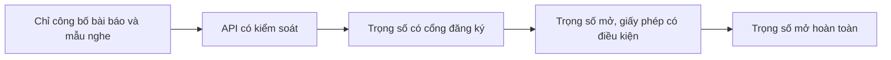

# Chương 40. Đạo đức, an toàn và pháp lý

!!! abstract "Mục tiêu học tập"
    Sau chương này, bạn có thể:

    - **Phân tích** các rủi ro (lừa đảo, mạo danh, thông tin sai lệch, quấy rối, vi phạm sự đồng ý) và lợi ích (hỗ trợ tiếp cận, lưu giữ giọng nói) của TTS và nhân bản giọng.
    - **Giải thích** các thành phần của một sự đồng ý có hiểu biết đối với giọng nói, và **thiết kế** quy trình xác minh sự đồng ý cho dịch vụ nhân bản giọng.
    - **Phân biệt** các loại giấy phép dữ liệu và mô hình (CC BY, CC BY-NC, chỉ dùng cho nghiên cứu, giấy phép mô hình có điều kiện sử dụng) và hệ quả của chúng với mô hình bạn huấn luyện.
    - **Suy ra** thống kê phát hiện của watermark trải phổ và **cài đặt** một bản đồ chơi kèm kiểm tra độ bền, đồng thời **chỉ ra** giới hạn của nó.
    - **Mô tả** các hướng phát hiện giọng tổng hợp (ASVspoof, AASIST) và nguồn gốc nội dung (C2PA), cùng giới hạn của từng hướng.
    - **Tóm lược** một cách thận trọng bối cảnh pháp lý tại Việt Nam, EU và Hoa Kỳ tính đến thời điểm biên soạn.
    - **Áp dụng** danh sách kiểm tra thực hành cho đội ngũ xây dựng TTS tiếng Việt.

!!! info "Kiến thức cần có"
    - [Chương 28 – Đa người nói và nhân bản giọng](../phan-7-e2e-bieu-cam/ch28-da-nguoi-noi-voice-cloning.md): embedding người nói, nhân bản zero-shot.
    - [Chương 36 – Xây dựng dữ liệu TTS](ch36-du-lieu-tts.md): nguồn dữ liệu, giấy phép, datasheet.
    - [Chương 1 – Toán nền tảng](../phan-1-nen-tang/ch01-toan-nen-tang.md): kỳ vọng, phương sai, định lý giới hạn trung tâm, kiểm định giả thuyết cơ bản.
    - [Chương 14 – Xử lý tín hiệu số](../phan-3-tin-hieu-ngu-am/ch14-xu-ly-tin-hieu-so.md): tương quan, nhiễu, SNR.

!!! warning "Đây không phải tư vấn pháp lý"
    Chương này cung cấp kiến thức nền để kỹ sư nhận diện vấn đề và đặt đúng câu hỏi. Phần pháp lý **có tính thời điểm** (cập nhật đến cuối năm 2026), được tóm lược từ hiểu biết của nhóm biên soạn và các nguồn thứ cấp, có thể chưa đầy đủ hoặc đã thay đổi khi bạn đọc. Luôn đối chiếu với văn bản chính thức và tham khảo luật sư cho tình huống cụ thể.

Khi một mô hình zero-shot có thể nhân bản giọng của bất kỳ ai từ vài giây âm thanh ([Chương 32](../phan-8-mo-hinh-lon/ch32-codec-language-model.md)–[Chương 34](../phan-8-mo-hinh-lon/ch34-he-thong-lai-hien-dai.md)), câu hỏi "có nên làm, và làm thế nào cho có trách nhiệm" không còn là câu hỏi của riêng luật sư hay nhà đạo đức học. Người kỹ sư là người quyết định dữ liệu nào được dùng, mô hình phát hành dưới dạng nào, có gắn watermark không, có xác minh sự đồng ý không. Những quyết định kỹ thuật đó định hình phần lớn rủi ro và lợi ích của sản phẩm.

## 40.1 Rủi ro và lợi ích

### 40.1.1 Bản đồ rủi ro

TTS là công nghệ **lưỡng dụng** (*dual-use*): cùng một khả năng phục vụ cả mục đích tốt lẫn xấu. Bảng dưới đây phân loại các rủi ro chính.

| Rủi ro | Mô tả | Ví dụ kịch bản |
|---|---|---|
| Lừa đảo, mạo danh | Giả giọng người quen, lãnh đạo, nhân viên ngân hàng để chiếm đoạt tài sản hoặc thông tin | Cuộc gọi giả giọng người thân cần tiền gấp; giả giọng giám đốc yêu cầu chuyển khoản |
| Vượt qua xác thực sinh trắc học giọng | Tấn công hệ thống xác minh người nói (ngân hàng, tổng đài) | Dùng giọng nhân bản để vượt qua bước "nói câu xác thực" |
| Thông tin sai lệch | Tạo phát ngôn giả của chính trị gia, người nổi tiếng, cơ quan chức năng | Đoạn ghi âm giả lan truyền trước bầu cử |
| Quấy rối, bôi nhọ | Tạo nội dung xúc phạm, nhạy cảm bằng giọng của một người cụ thể | Nội dung khiêu dâm hoặc thù ghét giả mạo giọng nạn nhân |
| Vi phạm sự đồng ý và quyền lợi | Dùng giọng người khác (kể cả diễn viên lồng tiếng) để huấn luyện hoặc thương mại hóa mà không có phép | Huấn luyện mô hình trên sách nói có bản quyền; "nhân bản" giọng diễn viên rồi thay thế họ |
| Riêng tư | Giọng nói tiết lộ danh tính, giới tính, tuổi, tình trạng sức khỏe; dữ liệu giọng bị rò rỉ | Kho dữ liệu huấn luyện bị lộ cùng thông tin cá nhân |
| Bất công về chất lượng | Hệ thống hoạt động kém hơn với một số nhóm (phương ngữ, giới tính, tuổi) | TTS tiếng Việt chỉ tốt với giọng Bắc; ASR dùng để lọc dữ liệu loại bỏ giọng miền Trung |

Đây không phải rủi ro giả định. Một ví dụ được báo chí quốc tế đưa tin rộng rãi: đầu năm 2024, các cuộc gọi tự động dùng giọng nói giả giống Tổng thống Hoa Kỳ khi đó đã kêu gọi cử tri bang New Hampshire không đi bầu sơ bộ; sự việc này góp phần dẫn đến việc Ủy ban Truyền thông Liên bang Hoa Kỳ (FCC) ra phán quyết về giọng nói do AI tạo ra trong cuộc gọi tự động (xem Mục 40.8). Tại Việt Nam, các cơ quan chức năng và báo chí nhiều lần cảnh báo về thủ đoạn lừa đảo dùng video và giọng nói giả mạo người quen.

### 40.1.2 Lợi ích

Cũng cần nhìn rõ phía lợi ích, vì chúng là lý do để làm công nghệ này một cách có trách nhiệm thay vì không làm:

- **Hỗ trợ tiếp cận**: trình đọc màn hình cho người khiếm thị, hỗ trợ người khó đọc, sách nói cho mọi người. Với tiếng Việt, một giọng đọc tự nhiên, đọc đúng số và viết tắt là nhu cầu thiết thực của cộng đồng người khiếm thị.
- **Lưu giữ giọng nói** (*voice banking*): người sắp mất giọng (do bệnh thần kinh vận động, phẫu thuật thanh quản) thu âm trước để sau này giao tiếp bằng giọng của chính mình.
- **Bảo tồn ngôn ngữ**: TTS cho các ngôn ngữ dân tộc thiểu số ít tài nguyên, phục vụ giáo dục và lưu giữ văn hóa.
- **Giáo dục, nội dung, bản địa hóa**: bài giảng, tin tức, lồng tiếng nhanh với chi phí thấp.

### 40.1.3 Một khung tư duy

Với mỗi tính năng, hãy hỏi: *ai* có thể lạm dụng, *khả năng* xảy ra bao nhiêu, *mức độ thiệt hại* ra sao, và *ở tầng nào* ta có thể giảm thiểu — dữ liệu (đồng ý, giấy phép), mô hình (watermark, giới hạn khả năng), phát hành (API có kiểm soát hay công bố trọng số), sản phẩm (xác minh, giới hạn tần suất, công bố là giọng AI), hệ sinh thái (bộ phát hiện, tiêu chuẩn nguồn gốc). Không tầng nào hoàn hảo; an toàn đến từ **phòng thủ nhiều lớp**.

## 40.2 Sự đồng ý và quyền đối với giọng nói

### 40.2.1 Giọng nói là gì về mặt pháp lý và đạo đức?

Giọng nói vừa là **dữ liệu cá nhân** (gắn với một người cụ thể), vừa có thể là **dữ liệu sinh trắc học** khi được dùng để nhận dạng người đó, vừa là một phần của **bản sắc và hình ảnh cá nhân**, và với diễn viên lồng tiếng, là **sinh kế**. Mỗi góc nhìn dẫn đến những nghĩa vụ khác nhau (Mục 40.8).

### 40.2.2 Thế nào là một sự đồng ý có ý nghĩa?

Một văn bản đồng ý tốt cho dữ liệu giọng nói nên đáp ứng các tiêu chí:

- **Có hiểu biết**: người nói hiểu dữ liệu được dùng để làm gì (huấn luyện mô hình tổng hợp *có thể nói những câu họ chưa từng nói*), ai dùng, lưu ở đâu, trong bao lâu. Viết bằng tiếng Việt dễ hiểu, không chỉ bằng thuật ngữ pháp lý.
- **Cụ thể**: tách bạch các mục đích — dùng cho nghiên cứu, dùng thương mại, tạo giọng tổng hợp mang tên họ, cho phép bên thứ ba dùng, dùng để tạo giọng "pha trộn" nhiều người.
- **Tự nguyện**: không ép buộc, không gắn với điều kiện bất lợi khác (ví dụ "phải đồng ý mới được nhận lương").
- **Có thể rút lại**, kèm mô tả rõ điều gì xảy ra khi rút lại. Đây là chỗ thiết kế kỹ thuật quan trọng: xóa dữ liệu thô thì dễ, nhưng "xóa" một người khỏi một mô hình đã huấn luyện thì khó (bài toán *machine unlearning* chưa có lời giải tổng quát). Các thiết kế giúp việc rút lại khả thi: giọng của từng người được biểu diễn bằng một **bộ chuyển đổi riêng** (adapter/LoRA, [Chương 37](ch37-huan-luyen-va-debug.md)) hoặc embedding riêng có thể xóa; hoặc cam kết huấn luyện lại mô hình chung theo chu kỳ không có dữ liệu của người đã rút.
- **Có lưu vết**: văn bản có phiên bản, chữ ký, ngày tháng; liên kết với dữ liệu qua datasheet ([Chương 36](ch36-du-lieu-tts.md)).
- **Thù lao công bằng** khi giọng được thương mại hóa.

Các trường hợp đặc biệt cần thận trọng hơn: **trẻ em** (cần người giám hộ đồng ý và cân nhắc lợi ích lâu dài của trẻ), **người đã mất** (quyền của gia đình, di nguyện), **người nổi tiếng và chính trị gia** (nguy cơ lạm dụng cao, thường nên chặn mặc định).

### 40.2.3 "Công khai trên Internet" không có nghĩa là "được phép"

Một sai lầm phổ biến là coi mọi âm thanh công khai (YouTube, podcast, sách nói) là nguyên liệu tự do. Thực tế, các bản ghi này thường được bảo hộ bởi quyền tác giả và quyền liên quan (quyền của người biểu diễn, nhà sản xuất bản ghi âm), bị ràng buộc bởi điều khoản dịch vụ của nền tảng, và chứa dữ liệu cá nhân của người nói. Một số hệ thống pháp luật có ngoại lệ cho khai thác văn bản và dữ liệu (*text and data mining*) hoặc cho huấn luyện AI (xem Mục 40.8), nhưng ngoại lệ thường đi kèm điều kiện, và **không** xóa bỏ các nghĩa vụ về dữ liệu cá nhân hay về việc sử dụng giọng của một người để mạo danh.

### 40.2.4 Xác minh sự đồng ý trong dịch vụ nhân bản giọng

Một dịch vụ cho phép người dùng tải lên giọng mẫu để nhân bản phải trả lời câu hỏi: làm sao biết người tải lên chính là chủ giọng, hoặc được chủ giọng cho phép? Một quy trình thường được các nhà cung cấp áp dụng (chi tiết khác nhau giữa các bên) gồm:

1. **Thử thách đọc câu ngẫu nhiên**: hệ thống sinh một câu ngẫu nhiên (ví dụ chứa một chuỗi số và từ ngẫu nhiên) và yêu cầu chủ giọng đọc trực tiếp. Vì câu không đoán trước được, kẻ gian không thể dùng bản ghi có sẵn của nạn nhân.
2. **Xác minh người nói**: so embedding người nói của bản ghi thử thách với giọng mẫu cần nhân bản ([Chương 28](../phan-7-e2e-bieu-cam/ch28-da-nguoi-noi-voice-cloning.md)); nếu độ tương đồng dưới ngưỡng, từ chối.
3. **Kiểm tra liveness và phát hiện giọng tổng hợp** trên bản ghi thử thách (Mục 40.5), để chặn việc dùng chính TTS để vượt qua bước 1.
4. **Kiểm tra danh sách chặn**: giọng mẫu không được quá giống giọng của các nhân vật công chúng trong danh sách chặn.
5. **Lưu vết**: lưu bản ghi đồng ý, kết quả kiểm tra, để phục vụ điều tra khi có khiếu nại.

Mỗi bước có tỉ lệ lỗi; ngưỡng phải được chọn để cân bằng giữa từ chối nhầm người dùng hợp lệ và chấp nhận nhầm kẻ gian.

!!! note "Góc tiếng Việt"
    Khi xây dựng bộ dữ liệu tiếng Việt, hãy chuẩn bị văn bản đồng ý bằng tiếng Việt rõ ràng, giải thích bằng ví dụ cụ thể ("mô hình sẽ có thể đọc bất kỳ văn bản nào bằng giọng của bạn, kể cả những câu bạn không đồng tình"). Với người đọc là cộng tác viên tự do, thỏa thuận cần nêu rõ phạm vi thương mại và thời hạn. Nếu dự án dự định dùng dữ liệu cho nhiều mục đích về sau (ví dụ chia sẻ cho cộng đồng nghiên cứu), hãy xin đồng ý cho các mục đích đó ngay từ đầu.

## 40.3 Giấy phép dữ liệu và mô hình

### 40.3.1 Giấy phép dữ liệu

| Giấy phép | Cho phép | Ràng buộc chính |
|---|---|---|
| Public domain / CC0 | Gần như mọi mục đích | Không (nhưng vẫn cần lưu ý dữ liệu cá nhân, quyền nhân thân) |
| CC BY | Mọi mục đích, kể cả thương mại | Ghi công |
| CC BY-SA | Mọi mục đích | Ghi công; sản phẩm phái sinh phải dùng cùng giấy phép |
| CC BY-NC | Phi thương mại | Ghi công; không dùng cho mục đích thương mại |
| CC BY-NC-SA | Phi thương mại | Như trên, cộng chia sẻ cùng giấy phép |
| CC BY-ND | Phân phối nguyên vẹn | Không được tạo sản phẩm phái sinh |
| Giấy phép tùy chỉnh "chỉ cho nghiên cứu" | Nghiên cứu (đôi khi cả giáo dục) | Thường cấm phân phối lại, cấm thương mại, yêu cầu đăng ký và trích dẫn |

Một câu hỏi pháp lý **chưa có lời đáp thống nhất** là: trọng số mô hình huấn luyện trên dữ liệu có giấy phép NC hay SA có phải "sản phẩm phái sinh" của dữ liệu đó không? Câu trả lời khác nhau giữa các hệ thống pháp luật và có thể thay đổi theo án lệ. Cách làm thận trọng trong kỹ thuật: **coi như ràng buộc lan truyền** — mô hình huấn luyện trên dữ liệu NC thì chỉ dùng phi thương mại, trừ khi có ý kiến pháp lý khác. Đây cũng là cách nhiều nhóm phát hành mô hình đang làm: ví dụ, tính đến thời điểm biên soạn, trang phát hành của F5-TTS ghi mã nguồn theo giấy phép MIT nhưng trọng số tiền huấn luyện theo CC BY-NC, với lý do dữ liệu huấn luyện Emilia có giấy phép phi thương mại.

### 40.3.2 Giấy phép mô hình

- **Giấy phép mã nguồn mở dễ dãi** (MIT, Apache 2.0) áp cho mã và đôi khi cho trọng số.
- **Giấy phép phi thương mại** cho trọng số (CC BY-NC, hoặc giấy phép riêng của nhà phát hành; ví dụ XTTS-v2 được phát hành theo giấy phép mô hình riêng của Coqui với điều khoản phi thương mại — hãy kiểm tra văn bản hiện hành).
- **Giấy phép có điều kiện sử dụng** (họ OpenRAIL/RAIL, Contractor và cộng sự, 2022): cho phép dùng rộng rãi nhưng *cấm một số hành vi* (ví dụ mạo danh, lừa đảo) và yêu cầu chuyển tiếp các điều kiện đó cho người dùng sau.
- **Giấy phép kế thừa từ mô hình nền**: các hệ TTS dựa trên LLM được tinh chỉnh từ một mô hình ngôn ngữ (ví dụ họ Llama hay Qwen) kế thừa giấy phép của mô hình nền đó.

Lưu ý ba lớp tách biệt: **giấy phép mã** ≠ **giấy phép trọng số** ≠ **giấy phép dữ liệu**. Một kho mã MIT có thể đi kèm trọng số chỉ dùng phi thương mại, huấn luyện trên dữ liệu chỉ dùng cho nghiên cứu.

### 40.3.3 Sổ cái giấy phép

Thực hành tốt là duy trì một **sổ cái giấy phép** (tương tự danh mục thành phần phần mềm, SBOM) cho mỗi mô hình bạn huấn luyện: liệt kê mọi bộ dữ liệu (kèm phiên bản, giấy phép, điều khoản bổ sung, ngày truy cập), mô hình nền, mã nguồn bên thứ ba, và kết luận về mục đích sử dụng được phép. Khi một bộ dữ liệu đổi giấy phép hoặc một người nói rút lại đồng ý, sổ cái cho biết mô hình nào bị ảnh hưởng.

## 40.4 Watermark âm thanh

### 40.4.1 Ý tưởng và các tính chất mong muốn

**Watermark** là tín hiệu ẩn được nhúng vào âm thanh *lúc sinh ra*, để sau này có thể phát hiện "âm thanh này do hệ thống X tạo". Đây là cách tiếp cận **chủ động**: nhà phát triển hệ thống tự gắn dấu, khác với phát hiện **thụ động** (Mục 40.5) phải đoán từ đặc điểm của tín hiệu. Một watermark tốt cần cân bằng nhiều tính chất mâu thuẫn nhau:

- **Không cảm nhận được** (*imperceptibility*): người nghe không nhận ra.
- **Bền vững** (*robustness*): còn phát hiện được sau nén (MP3, Opus), lấy mẫu lại, thêm nhiễu, đổi âm lượng, cắt ghép, đổi tốc độ, phát qua loa rồi thu lại.
- **Dung lượng** (*capacity*): số bit thông điệp mang theo (ví dụ mã của mô hình, phiên bản, người dùng).
- **An toàn** (*security*): khó xóa và khó giả mạo (gắn watermark giả vào âm thanh thật để vu khống) khi không có khóa.
- **Định vị** (*localization*): biết đoạn nào trong một tệp dài là tổng hợp.
- **Kiểm soát dương tính giả**: tỉ lệ báo nhầm âm thanh thật là có watermark phải cực thấp và *biết trước được*.

Các phương pháp cổ điển gồm trải phổ (*spread spectrum*, Cox và cộng sự, 1997), ẩn trong tiếng vọng (*echo hiding*), mã hóa pha, điều chế chỉ số lượng tử hóa. Các phương pháp nơ-ron học bộ nhúng và bộ phát hiện cùng lúc với các phép biến đổi tấn công trong vòng huấn luyện: WavMark (Chen và cộng sự, 2023) dùng mạng khả nghịch để nhúng thông điệp nhiều bit; AudioSeal (San Roman và cộng sự, 2024) huấn luyện đồng thời bộ sinh watermark và bộ phát hiện cho phép **định vị đến từng mẫu** và phát hiện nhanh. Một hướng khác là gắn watermark vào **dữ liệu huấn luyện** để mọi mô hình nhân bản học từ dữ liệu đó cũng tái tạo dấu hiệu (ví dụ Liu và cộng sự, 2024, với ý tưởng watermark theo âm sắc). Một số nhà cung cấp lớn cũng đã công bố công cụ watermark cho âm thanh do AI sinh ra; thông số cụ thể của các hệ thống thương mại thường không được công bố đầy đủ.

### 40.4.2 Watermark trải phổ: hình thức hóa

Ta xây dựng một watermark trải phổ đơn giản để hiểu *vì sao* nó phát hiện được và *khi nào* nó thất bại.

**Nhúng.** Từ khóa bí mật $k$, sinh chuỗi giả ngẫu nhiên $p[n] \in \{-1, +1\}$, $n = 0, \ldots, L-1$, các phần tử độc lập, đồng xác suất. Cộng vào tín hiệu $s[n]$ một tín hiệu nhỏ có biên độ theo **đường bao** $e[n] \ge 0$ của chính $s$ (để watermark gần như bằng 0 ở đoạn lặng, nơi tai người nhạy với nhiễu nhất):

$$
y[n] = s[n] + \alpha\, e[n]\, p[n],
$$

với $\alpha$ là cường độ (ví dụ $\alpha = 10^{-25/20}$ ứng với khoảng −25 dB so với đường bao).

**Thống kê phát hiện.** Với âm thanh cần kiểm tra $y$ và khóa $k$, tính

$$
z = \frac{\sum_{n} y[n]\, p[n]}{\sqrt{\sum_{n} y[n]^2}}.
$$

**Dưới giả thuyết $H_0$** (âm thanh không chứa watermark với khóa $k$), $y$ độc lập với $p$. Cố định $y$, tử số là tổng của các biến độc lập $y[n]p[n]$ có kỳ vọng $y[n]\,\mathbb{E}[p[n]] = 0$ và phương sai $y[n]^2\,\mathbb{E}[p[n]^2] = y[n]^2$. Do đó

$$
\mathbb{E}[z \mid H_0] = 0, \qquad \operatorname{Var}[z \mid H_0] = \frac{\sum_n y[n]^2}{\sum_n y[n]^2} = 1,
$$

và theo định lý giới hạn trung tâm (khi không có mẫu nào áp đảo tổng năng lượng), $z \approx \mathcal{N}(0, 1)$. Điều tuyệt vời là phân phối dưới $H_0$ **không phụ thuộc vào nội dung âm thanh**, nên ta đặt ngưỡng $\tau$ cho tỉ lệ dương tính giả mong muốn: $P_{\text{FA}} = 1 - \Phi(\tau)$. Ví dụ $\tau = 4{,}75$ cho $P_{\text{FA}} \approx 10^{-6}$.

**Dưới giả thuyết $H_1$** (có watermark), vì $p[n]^2 = 1$:

$$
\sum_n y[n]p[n] = \underbrace{\sum_n s[n]p[n]}_{\text{"nhiễu" từ chính tín hiệu}} + \alpha \sum_n e[n],
$$

nên

$$
\mathbb{E}[z \mid H_1] \approx \frac{\alpha \sum_n e[n]}{\sqrt{\sum_n y[n]^2}} \approx \alpha \sqrt{L}\, \frac{\overline{e}}{\operatorname{rms}(y)},
$$

với $\overline{e}$ là trung bình đường bao. Công thức này cho ba bài học:

1. **Độ dài là sức mạnh**: $z$ tăng theo $\sqrt{L}$. Một watermark yếu (không nghe thấy) vẫn phát hiện được nếu đoạn âm thanh đủ dài; ngược lại, đoạn rất ngắn khó phát hiện tin cậy.
2. **Bất biến với âm lượng**: nhân $y$ với hằng số $g > 0$ thì tử và mẫu cùng nhân $g$, $z$ không đổi.
3. **Nhiễu cộng chỉ làm giảm nhẹ**: thêm nhiễu $w$ độc lập với công suất bằng $1/\mathrm{SNR}$ lần công suất tín hiệu, mẫu số tăng khoảng $\sqrt{1 + 1/\mathrm{SNR}}$ lần; với SNR 5 dB, $z$ chỉ giảm khoảng 13%.

Nhưng nó cũng cho thấy **điểm yếu chí mạng**: phát hiện dựa vào việc $p[n]$ thẳng hàng *từng mẫu* với $y[n]$. Lệch chỉ một mẫu, $p[n-1]$ gần như độc lập với $p[n]$ (chuỗi trắng có tự tương quan xấp xỉ 0 ở độ trễ khác 0), và $z$ quay về phân phối $\mathcal{N}(0,1)$. Cắt bớt đầu tệp, đổi tốc độ, lấy mẫu lại đều gây mất đồng bộ.

### 40.4.3 Mã minh họa: watermark trải phổ đồ chơi

!!! warning "Đây là đồ chơi để học, không phải hệ thống bảo mật"
    Mã dưới đây minh họa nguyên lý. Nó không có mô hình cảm thụ âm thanh (watermark ở −25 dB có thể nghe thấy trên tín hiệu thật), không có cơ chế đồng bộ, không mang thông điệp, và chuỗi giả ngẫu nhiên không an toàn mật mã. Đừng dùng nó để bảo vệ bất cứ thứ gì.

```python
import numpy as np

def pn_sequence(key, n):
    """Chuỗi giả ngẫu nhiên ±1 sinh từ khóa bí mật (đồ chơi: KHÔNG an toàn mật mã)."""
    return np.random.default_rng(key).choice([-1.0, 1.0], size=n)

def envelope(s, win=480):
    """Đường bao RMS trượt: watermark mạnh ở chỗ có tiếng, gần 0 ở chỗ lặng."""
    k = np.ones(win) / win
    return np.sqrt(np.convolve(s ** 2, k, mode="same") + 1e-12)

def embed(s, key, strength_db=-25.0):
    """s_w[n] = s[n] + alpha * env[n] * p[n]  (trải phổ, biên độ theo đường bao)."""
    alpha = 10 ** (strength_db / 20)
    return s + alpha * envelope(s) * pn_sequence(key, len(s))

def detect(y, key):
    """Thống kê z = <y, p> / ||y||. Không có watermark: z ~ N(0, 1) (xấp xỉ)."""
    p = pn_sequence(key, len(y))
    return float(np.dot(y, p) / np.linalg.norm(y))

# Tín hiệu "giống tiếng nói": hài âm + điều biên âm tiết (4 Hz) + đoạn lặng
sr = 16000
t = np.arange(3 * sr) / sr
syll = np.clip(np.sin(2 * np.pi * 4 * t), 0, None)                    # bao âm tiết
s = 0.3 * syll * sum(np.sin(2 * np.pi * 150 * k * t) / k for k in range(1, 15))
s[int(1.2 * sr):int(1.6 * sr)] = 0.0                                  # một khoảng lặng
key, wrong_key = 1234, 9999
y = embed(s, key)
wsr = 10 * np.log10(np.sum((y - s) ** 2) / np.sum(s ** 2))
print(f"tỉ số watermark/tín hiệu: {wsr:.1f} dB")

rng = np.random.default_rng(0)
def awgn(x, snr_db):
    return x + rng.standard_normal(len(x)) * np.sqrt(np.mean(x ** 2) / 10 ** (snr_db / 10))

tests = {
    "không watermark": detect(s, key),
    "có watermark": detect(y, key),
    "sai khóa": detect(y, wrong_key),
    "nhiễu SNR 20 dB": detect(awgn(y, 20), key),
    "nhiễu SNR 5 dB": detect(awgn(y, 5), key),
    "giảm âm lượng x0.3": detect(0.3 * y, key),
    "lệch 1 mẫu": detect(np.concatenate([[0.0], y[:-1]]), key),
}
threshold = 4.75                              # P(z > 4.75 | H0) ≈ 1e-6 (một phía)
for name, z in tests.items():
    print(f"{name:20s} z = {z:7.2f} -> {'PHÁT HIỆN' if z > threshold else 'không'}")

# Kiểm chứng phân phối dưới H0: 300 khóa ngẫu nhiên trên tín hiệu không watermark
z0 = np.array([detect(awgn(s, 30), k) for k in range(300)])
print(f"H0: trung bình {z0.mean():.2f}, độ lệch chuẩn {z0.std():.2f}")
assert tests["có watermark"] > threshold and tests["nhiễu SNR 20 dB"] > threshold
assert abs(tests["sai khóa"]) < threshold and abs(tests["lệch 1 mẫu"]) < threshold
assert abs(z0.mean()) < 0.3 and 0.7 < z0.std() < 1.3
```

Kết quả khớp với phân tích: không có watermark, sai khóa, hoặc lệch một mẫu đều cho $z$ nằm trong vùng $\mathcal{N}(0,1)$; có watermark cho $z$ quanh 7, gần như không đổi khi giảm âm lượng hay thêm nhiễu đến SNR 5 dB. Kiểm tra trên 300 khóa ngẫu nhiên xác nhận phân phối dưới $H_0$ có trung bình xấp xỉ 0 và độ lệch chuẩn xấp xỉ 1.

### 40.4.4 Giới hạn và tấn công

Hệ thống thật khắc phục các điểm yếu trên bằng: định hình phổ watermark theo ngưỡng che lấp của tai (*psychoacoustic masking*); nhúng trong miền tần số hoặc miền đặc trưng bền với nén; thêm tín hiệu đồng bộ hoặc huấn luyện bộ phát hiện bất biến với dịch thời gian (như cách tiếp cận định vị của AudioSeal); mã sửa lỗi cho thông điệp nhiều bit; kỹ thuật như *improved spread spectrum* (Malvar và Florêncio, 2003) để giảm nhiễu do chính tín hiệu gốc gây ra. Dù vậy, cần hiểu rõ các giới hạn mang tính cấu trúc:

- **Tái tổng hợp** (*regeneration*): cho âm thanh có watermark đi qua một codec nơ-ron, vocoder, hoặc mô hình chuyển đổi giọng có thể "giặt sạch" watermark mà vẫn giữ nội dung và giọng.
- **Mất đồng bộ**: cắt, ghép, đổi tốc độ, chèn im lặng.
- **Giả mạo**: kẻ có nhiều mẫu có watermark có thể ước lượng tín hiệu watermark và cộng nó vào âm thanh thật, khiến âm thanh thật bị coi là tổng hợp.
- **Phụ thuộc vào thiện chí**: watermark chỉ có ở hệ thống *chọn* gắn nó. Mô hình mã nguồn mở có thể bị gỡ bỏ bước gắn watermark trong vài dòng mã.

Kết luận thực tế: watermark là **một lớp** trong phòng thủ nhiều lớp, hữu ích để nhà cung cấp truy vết đầu ra của chính mình và hỗ trợ điều tra, nhưng **không phải bằng chứng tuyệt đối** — cả khi phát hiện được lẫn khi không phát hiện được.

## 40.5 Phát hiện giọng nói tổng hợp

Phát hiện thụ động (*anti-spoofing*, *deepfake detection*) là bài toán phân loại: cho một đoạn âm thanh, quyết định là tiếng nói thật (*bona fide*) hay giả mạo (*spoof*), không cần hợp tác của hệ thống sinh.

**Chuỗi thử thách ASVspoof** là trung tâm của lĩnh vực này: từ phiên bản 2015 (Wu và cộng sự, 2015) qua 2017 (tấn công phát lại), 2019 (truy cập logic với TTS/chuyển đổi giọng và truy cập vật lý, Todisco và cộng sự, 2019), 2021 (thêm hạng mục deepfake trên âm thanh đã nén), đến ASVspoof 5 (Wang và cộng sự, 2024) với dữ liệu quy mô lớn hơn và tấn công đối kháng. Các chỉ số chính:

- **EER** (*equal error rate*): tỉ lệ lỗi tại ngưỡng mà tỉ lệ chấp nhận nhầm bằng tỉ lệ từ chối nhầm.
- **t-DCF** (Kinnunen và cộng sự, 2018): hàm chi phí phát hiện xét đồng thời bộ chống giả mạo và hệ thống xác minh người nói đứng sau nó — phản ánh đúng hơn bối cảnh triển khai.

**Các mô hình tiêu biểu** gồm: các hệ cơ sở dùng đặc trưng cepstral (LFCC) với GMM, RawNet2 làm việc trực tiếp trên dạng sóng (Tak và cộng sự, 2021), AASIST dùng attention trên đồ thị phổ–thời gian (Jung và cộng sự, 2022), và các hệ dùng biểu diễn tự giám sát như wav2vec 2.0/XLS-R làm bộ trích đặc trưng (Tak và cộng sự, 2022).

**Vấn đề lớn nhất là tổng quát hóa.** Bộ phát hiện học các "vết" đặc trưng của những hệ thống sinh có trong dữ liệu huấn luyện, và thường giảm mạnh độ chính xác với hệ thống sinh mới, âm thanh qua điện thoại, nén mạnh, hay thu "ngoài đời thực" (Müller và cộng sự, 2022). Mỗi thế hệ TTS mới (codec LM, flow matching) lại tạo ra kiểu vết khác. Đây là cuộc chạy đua không có điểm kết thúc.

**Hàm ý cho người làm TTS tiếng Việt:** theo hiểu biết của chúng tôi, dữ liệu chống giả mạo cho tiếng Việt còn rất hạn chế. Một đóng góp có trách nhiệm là **chia sẻ mẫu đầu ra** của hệ thống bạn (có kiểm soát, với điều khoản phù hợp) cho các nhóm nghiên cứu phát hiện, và đánh giá bộ phát hiện hiện có trên đầu ra của chính bạn.

## 40.6 Nguồn gốc nội dung: C2PA

Watermark và phát hiện thụ động đều cố trả lời "âm thanh này có phải do AI tạo không?". Cách tiếp cận **nguồn gốc** (*provenance*) đặt câu hỏi ngược lại: "âm thanh này đến từ đâu, đã qua những bước nào?" và trả lời bằng chữ ký số.

Đặc tả của **C2PA** (*Coalition for Content Provenance and Authenticity*) định nghĩa một **manifest** gắn kèm tệp media, gồm các khẳng định (*assertions*) như "được tạo bởi công cụ X", "đã qua chỉnh sửa Y", được ký số bằng chứng thư của bên tạo. Hai cơ chế gắn manifest với nội dung:

- **Gắn cứng** (*hard binding*): mã băm mật mã của nội dung; mọi thay đổi nội dung làm chữ ký mất hiệu lực.
- **Gắn mềm** (*soft binding*): watermark hoặc dấu vân tay nội dung, để tìm lại manifest khi siêu dữ liệu bị gỡ (điều thường xảy ra khi tải lên mạng xã hội).

Ưu điểm: thông tin phong phú, kiểm chứng được bằng mật mã, và có thể chứng minh *tính xác thực* của nội dung thật (ví dụ bản ghi của cơ quan báo chí), không chỉ đánh dấu nội dung giả. Giới hạn: phụ thuộc vào việc nền tảng giữ lại siêu dữ liệu và hiển thị cho người dùng; vắng manifest không chứng minh nội dung là giả; quản lý khóa ký là bài toán vận hành nghiêm túc. Đặc tả hỗ trợ nhiều định dạng media phổ biến, trong đó có âm thanh; hãy kiểm tra phiên bản đặc tả hiện hành cho định dạng cụ thể bạn dùng.

## 40.7 Phát hành có trách nhiệm

### 40.7.1 Phổ các mức phát hành

Phát hành một mô hình TTS không phải lựa chọn nhị phân "công bố hay không":



Mức càng mở thì cộng đồng càng hưởng lợi (tái lập, nghiên cứu, ứng dụng hỗ trợ tiếp cận) nhưng khả năng kiểm soát lạm dụng càng giảm. Một số nhóm nghiên cứu lớn đã chọn không công bố mô hình nhân bản giọng mạnh của họ vì lo ngại lạm dụng — ví dụ VALL-E (Wang và cộng sự, 2023) và Voicebox (Le và cộng sự, 2023) được công bố dưới dạng bài báo và mẫu nghe, không kèm trọng số công khai; trong khi nhiều mô hình zero-shot khác được phát hành mở. Không có câu trả lời đúng duy nhất; điều quan trọng là quyết định được đưa ra **có cân nhắc và có ghi lại lý do**.

### 40.7.2 Các biện pháp thực hành

- **Thẻ mô hình** (*model card*, Mitchell và cộng sự, 2019): mục đích dự kiến, mục đích không được phép, dữ liệu huấn luyện, đánh giá theo nhóm (phương ngữ, giới tính), hạn chế đã biết, biện pháp an toàn.
- **Chính sách sử dụng**: cấm rõ ràng mạo danh không có đồng ý, nội dung lừa đảo, deepfake chính trị; quy trình xử lý vi phạm.
- **Xác minh sự đồng ý** cho tính năng nhân bản giọng (Mục 40.2.4).
- **Watermark mặc định** cho mọi đầu ra của API, kèm công cụ phát hiện cho đối tác điều tra.
- **Danh sách chặn giọng** người nổi tiếng/chính trị gia dựa trên embedding người nói, với ngưỡng được hiệu chỉnh (hiểu rằng nó có thể chặn nhầm người có giọng giống, và có thể bị né).
- **Công bố là giọng AI** với người nghe trong sản phẩm (ví dụ tổng đài, trợ lý ảo): "Bạn đang nghe giọng nói được tạo bởi AI".
- **Giới hạn tần suất, ghi nhật ký** và giám sát lạm dụng — cân bằng với quyền riêng tư của người dùng hợp lệ.
- **Đánh giá đỏ** (*red teaming*): giao cho một nhóm thử lạm dụng hệ thống trước khi phát hành.
- **Quy trình ứng phó sự cố**: kênh nhận khiếu nại ("có người dùng giọng tôi"), thời hạn phản hồi, khả năng gỡ giọng (adapter riêng), phối hợp với cơ quan chức năng.

## 40.8 Bối cảnh pháp lý

!!! warning "Tính thời điểm và mức độ chắc chắn"
    Mục này tóm lược các văn bản mà nhóm biên soạn biết đến tính đến cuối năm 2026, dựa trên hiểu biết chung và các nguồn thứ cấp (báo chí, trang tư vấn pháp lý). Tên và số hiệu văn bản được nêu khi chúng tôi tương đối chắc chắn; nội dung chi tiết chỉ được mô tả ở mức khái quát. Văn bản hướng dẫn thi hành có thể đã được ban hành hoặc sửa đổi. **Hãy tra cứu văn bản gốc** trên các nguồn chính thức (Công báo, Cổng thông tin điện tử Chính phủ, EUR-Lex, trang của cơ quan Hoa Kỳ liên quan) trước khi dựa vào bất kỳ điều gì dưới đây.

### 40.8.1 Việt Nam

- **Dữ liệu cá nhân.** Nghị định 13/2023/NĐ-CP về bảo vệ dữ liệu cá nhân (có hiệu lực từ 01/7/2023) là văn bản toàn diện đầu tiên trong lĩnh vực này, phân biệt dữ liệu cá nhân cơ bản và nhạy cảm (theo hiểu biết của chúng tôi, thông tin về đặc điểm sinh học riêng của cá nhân — tức loại dữ liệu kiểu sinh trắc học — thuộc nhóm nhạy cảm). Sau đó, **Luật Bảo vệ dữ liệu cá nhân số 91/2025/QH15** được Quốc hội thông qua ngày 26/6/2025, có hiệu lực từ 01/01/2026, cùng nghị định hướng dẫn (theo các nguồn thứ cấp chúng tôi tham khảo là Nghị định 356/2025/NĐ-CP, thay thế Nghị định 13/2023/NĐ-CP). Với TTS, hệ quả thực tế là: bản ghi giọng nói của một người là dữ liệu cá nhân; khi được dùng để nhận dạng người đó, nó có thể được xếp vào dữ liệu sinh trắc học với yêu cầu bảo vệ cao hơn; việc thu thập và xử lý cần căn cứ pháp lý (thường là sự đồng ý), thông báo rõ mục đích, biện pháp bảo mật, và có thể có nghĩa vụ đánh giá tác động hay nghĩa vụ khi chuyển dữ liệu ra nước ngoài (ví dụ gửi dữ liệu lên hạ tầng đám mây nước ngoài để huấn luyện). Cách luật áp dụng cụ thể cho giọng nói nên được xác nhận với chuyên gia pháp lý.
- **Trí tuệ nhân tạo.** **Luật Trí tuệ nhân tạo số 134/2025/QH15** được thông qua ngày 10/12/2025, có hiệu lực từ 01/3/2026 (theo các nguồn thứ cấp). Theo mô tả của các nguồn này, luật đặt ra nghĩa vụ minh bạch, trong đó có việc gắn nhãn nội dung do AI tạo ra hoặc chỉnh sửa có thể gây nhầm lẫn, bao gồm nội dung mô phỏng giọng nói, hình ảnh của người thật; và cấm một số hành vi lạm dụng AI để lừa dối, thao túng. Chi tiết kỹ thuật (hình thức nhãn, nhãn máy đọc được hay không) phụ thuộc văn bản hướng dẫn.
- **Sở hữu trí tuệ.** **Luật sửa đổi, bổ sung một số điều của Luật Sở hữu trí tuệ số 131/2025/QH15** (thông qua ngày 10/12/2025, hiệu lực từ 01/4/2026 theo các nguồn thứ cấp) được mô tả là có quy định cho phép sử dụng văn bản và dữ liệu đã công bố hợp pháp, công chúng được tiếp cận, cho nghiên cứu, huấn luyện và phát triển hệ thống AI, với điều kiện không ảnh hưởng bất hợp lý đến quyền và lợi ích hợp pháp của tác giả, và với đối tượng được bảo hộ quyền tác giả, quyền liên quan thì còn theo quy định của Chính phủ. Quy định này không thay thế nghĩa vụ về dữ liệu cá nhân, và các tiêu chí cụ thể còn cần được hướng dẫn.
- **An ninh mạng.** Luật An ninh mạng số 24/2018/QH14 được thay thế bởi **Luật An ninh mạng số 116/2025/QH15** (thông qua ngày 10/12/2025, hiệu lực từ 01/7/2026, theo các nguồn thứ cấp), hợp nhất cả Luật An toàn thông tin mạng 2015. Các quy định về nội dung bị cấm trên không gian mạng (thông tin sai sự thật, xúc phạm danh dự, lừa đảo) áp dụng bất kể nội dung được tạo bằng công cụ gì.
- **Dân sự và hình sự.** Bộ luật Dân sự 2015 bảo vệ các quyền nhân thân, trong đó có quyền của cá nhân đối với hình ảnh (Điều 32); theo hiểu biết của chúng tôi, giọng nói không được nêu đích danh trong điều này, và cách bảo vệ giọng nói qua các quyền nhân thân khác là câu hỏi cho chuyên gia pháp lý. Hành vi dùng giọng giả để chiếm đoạt tài sản có thể cấu thành tội lừa đảo chiếm đoạt tài sản theo Bộ luật Hình sự (Điều 174), bất kể công cụ.

### 40.8.2 Liên minh châu Âu

- **Đạo luật AI** (*AI Act*, Quy định (EU) 2024/1689) tiếp cận theo mức độ rủi ro. Liên quan trực tiếp đến TTS là **Điều 50 về nghĩa vụ minh bạch**: nhà cung cấp hệ thống AI sinh âm thanh tổng hợp phải bảo đảm đầu ra được **đánh dấu ở định dạng máy đọc được** và phát hiện được là do AI tạo ra (trong phạm vi khả thi về kỹ thuật); bên triển khai tạo ra nội dung *deepfake* (bao gồm âm thanh giống người thật) phải **công khai** rằng nội dung là nhân tạo, với một số ngoại lệ. Theo lộ trình gốc, các nghĩa vụ này áp dụng từ 02/8/2026. Trong năm 2026, gói sửa đổi "Digital Omnibus" được cho là đã điều chỉnh thời hạn cho một số nghĩa vụ (theo các nguồn thứ cấp, có thời gian chuyển tiếp cho nghĩa vụ đánh dấu với hệ thống đã có trên thị trường), và Ủy ban châu Âu đã xây dựng bộ quy tắc thực hành (*code of practice*) về minh bạch nội dung do AI tạo ra. Hãy kiểm tra văn bản hợp nhất mới nhất. Đáng chú ý là yêu cầu "đánh dấu máy đọc được" khiến watermark và nguồn gốc (Mục 40.4, 40.6) trở thành vấn đề *tuân thủ*, không chỉ là thực hành tốt.
- **GDPR** (Quy định (EU) 2016/679): giọng nói là dữ liệu cá nhân; dữ liệu sinh trắc học được xử lý *nhằm nhận dạng duy nhất* một người thuộc nhóm dữ liệu đặc biệt (Điều 9), với điều kiện xử lý chặt hơn.
- **Ngoại lệ khai thác văn bản và dữ liệu** trong Chỉ thị (EU) 2019/790 về bản quyền trên thị trường số (Điều 3 và 4), trong đó chủ sở hữu quyền có thể từ chối (*opt-out*) đối với ngoại lệ chung ở Điều 4.

### 40.8.3 Hoa Kỳ

- **Chưa có luật liên bang toàn diện về AI hay về giọng nói nhân tạo** tính đến thời điểm biên soạn, theo hiểu biết của chúng tôi. Dự luật liên bang NO FAKES (về bản sao kỹ thuật số giọng nói và hình ảnh) đã được đề xuất nhiều lần nhưng, theo các nguồn chúng tôi kiểm tra, chưa trở thành luật.
- **FCC** (2024) ra phán quyết rằng giọng nói do AI tạo ra trong cuộc gọi tự động thuộc phạm vi "giọng nhân tạo" theo luật bảo vệ người tiêu dùng qua điện thoại (TCPA), nên cuộc gọi như vậy cần sự đồng ý trước của người nhận.
- **Luật cấp bang**: Tennessee ban hành ELVIS Act (2024) bảo vệ giọng nói khỏi bị mô phỏng trái phép; California có các luật năm 2024 về bản sao kỹ thuật số của người biểu diễn; nhiều bang có quyền nhân thân về hình ảnh, danh tính (*right of publicity*) với phạm vi khác nhau; luật về thông tin sinh trắc học của Illinois (BIPA) liệt kê rõ *voiceprint* là một dạng định danh sinh trắc học. Bối cảnh này thay đổi nhanh và khác nhau giữa các bang.

### 40.8.4 Nơi khác

Một số khu vực khác cũng có quy định riêng, ví dụ Trung Quốc có quy định về "tổng hợp sâu" (*deep synthesis*) và quy định gắn nhãn nội dung do AI tạo ra. Nếu sản phẩm phục vụ người dùng ở nhiều quốc gia, cần rà soát theo từng thị trường.

**Điểm chung của các khung pháp lý** đáng để kỹ sư ghi nhớ: (1) sự đồng ý và căn cứ pháp lý khi dùng giọng của người khác; (2) minh bạch với người nghe rằng giọng là nhân tạo; (3) khả năng đánh dấu và truy vết đầu ra; (4) trách nhiệm khi công cụ bị dùng để lừa đảo. Thiết kế hệ thống đáp ứng bốn điểm này từ đầu sẽ rẻ hơn nhiều so với sửa sau.

## 40.9 Danh sách kiểm tra cho đội ngũ TTS tiếng Việt

**Dữ liệu**

- [ ] Mỗi tệp dữ liệu có nguồn, giấy phép, điều khoản bổ sung, ngày thu thập ([Chương 36](ch36-du-lieu-tts.md)).
- [ ] Có văn bản đồng ý (tiếng Việt, cụ thể, có thể rút lại) cho mọi giọng thu âm; văn bản có phiên bản và liên kết với datasheet.
- [ ] Đã xác định căn cứ pháp lý cho xử lý dữ liệu giọng nói; đã đánh giá tác động xử lý dữ liệu cá nhân và nghĩa vụ chuyển dữ liệu ra nước ngoài (nếu có) cùng chuyên gia pháp lý.
- [ ] Dữ liệu cá nhân được bảo mật (phân quyền truy cập, mã hóa, xóa khi hết mục đích).
- [ ] Đã kiểm tra thiên lệch: phân phối phương ngữ, giới tính, độ tuổi trước và sau lọc.

**Mô hình**

- [ ] Có sổ cái giấy phép: dữ liệu, mô hình nền, mã bên thứ ba → mục đích sử dụng được phép.
- [ ] Thiết kế cho phép gỡ một giọng (adapter/embedding riêng hoặc quy trình huấn luyện lại).
- [ ] Đánh giá chất lượng theo nhóm (phương ngữ, giới tính) và ghi vào thẻ mô hình ([Chương 38](ch38-danh-gia-tts.md)).

**Phát hành và sản phẩm**

- [ ] Đã quyết định mức phát hành và ghi lại lý do.
- [ ] Thẻ mô hình và chính sách sử dụng đã công bố.
- [ ] Watermark mặc định cho đầu ra; có công cụ phát hiện cho bên điều tra; cân nhắc C2PA.
- [ ] Nhân bản giọng: xác minh đồng ý bằng câu thử thách ngẫu nhiên + xác minh người nói + phát hiện giọng tổng hợp; danh sách chặn giọng nhân vật công chúng.
- [ ] Công bố với người nghe rằng giọng là AI, phù hợp yêu cầu gắn nhãn của các thị trường liên quan.
- [ ] Giới hạn tần suất, nhật ký, giám sát lạm dụng; kênh khiếu nại và quy trình ứng phó sự cố.
- [ ] Đánh giá đỏ trước khi phát hành; định kỳ rà soát lại các quy định pháp luật mới.

## Lỗi thường gặp và mẹo thực hành

- **Coi dữ liệu công khai là dữ liệu được phép dùng.** Kiểm tra giấy phép, điều khoản nền tảng, quyền của người biểu diễn và nghĩa vụ về dữ liệu cá nhân.
- **Văn bản đồng ý mơ hồ** ("dùng cho mục đích nghiên cứu và phát triển sản phẩm") không nói rõ việc tạo giọng tổng hợp có thể nói bất kỳ điều gì. Viết cụ thể, kèm ví dụ.
- **Không tính đến việc rút lại đồng ý** khi thiết kế kiến trúc: một mô hình nguyên khối không có cách gỡ một giọng ngoài huấn luyện lại.
- **Nhầm giấy phép mã với giấy phép trọng số.** Kho mã MIT không có nghĩa trọng số được dùng thương mại.
- **Tin watermark là bằng chứng tuyệt đối.** Nó có thể bị xóa, bị giả mạo, và chỉ tồn tại ở hệ thống chọn gắn nó; vắng watermark không chứng minh âm thanh là thật.
- **Đánh giá bộ phát hiện giọng giả trên đúng dữ liệu nó được huấn luyện** và kết luận nó "hoạt động". Hãy thử trên đầu ra của hệ thống mới, âm thanh nén, qua điện thoại.
- **Đặt ngưỡng phát hiện mà không kiểm soát dương tính giả.** Báo nhầm âm thanh thật của một người là giả cũng gây hại nghiêm trọng.
- **Dựa vào một bản tóm tắt pháp lý cũ** (kể cả chương sách này). Quy định về AI thay đổi theo tháng; rà soát định kỳ cùng chuyên gia.
- **Bỏ qua công bằng**: hệ thống chỉ tốt với một phương ngữ là một vấn đề đạo đức, không chỉ là vấn đề chất lượng.

## Tóm tắt

- TTS là công nghệ lưỡng dụng: rủi ro gồm lừa đảo, mạo danh, vượt xác thực giọng, thông tin sai lệch, quấy rối, vi phạm đồng ý, riêng tư, bất công về chất lượng; lợi ích gồm hỗ trợ tiếp cận, lưu giữ giọng, bảo tồn ngôn ngữ.
- An toàn đến từ phòng thủ nhiều lớp: dữ liệu, mô hình, phát hành, sản phẩm, hệ sinh thái.
- Sự đồng ý có ý nghĩa phải có hiểu biết, cụ thể, tự nguyện, có thể rút lại, có lưu vết; kiến trúc nên hỗ trợ gỡ giọng (adapter/embedding riêng). Dịch vụ nhân bản giọng nên xác minh bằng câu thử thách ngẫu nhiên và xác minh người nói.
- Giấy phép mã, trọng số và dữ liệu là ba lớp riêng; ràng buộc NC/SA của dữ liệu nên được coi như lan truyền sang mô hình khi chưa có ý kiến pháp lý khác. Duy trì sổ cái giấy phép.
- Watermark trải phổ: thống kê $z$ có phân phối $\mathcal{N}(0,1)$ dưới $H_0$ bất kể nội dung, nên kiểm soát được dương tính giả; độ mạnh tăng theo $\sqrt{L}$; bền với âm lượng và nhiễu nhưng thất bại khi mất đồng bộ. Watermark nơ-ron (WavMark, AudioSeal) khắc phục một phần nhưng vẫn có thể bị tái tổng hợp, giả mạo.
- Phát hiện thụ động (ASVspoof, AASIST, mô hình SSL) gặp khó khăn lớn về tổng quát hóa sang hệ thống sinh mới và điều kiện thực tế.
- C2PA ký số nguồn gốc nội dung; bổ sung cho watermark và phát hiện, nhưng phụ thuộc nền tảng giữ siêu dữ liệu.
- Pháp lý (tính đến 2026, cần kiểm tra lại): Việt Nam có Luật Bảo vệ dữ liệu cá nhân 2025, Luật Trí tuệ nhân tạo 2025 với nghĩa vụ gắn nhãn, Luật Sở hữu trí tuệ sửa đổi 2025, Luật An ninh mạng 2025; EU có Điều 50 Đạo luật AI về đánh dấu và công khai deepfake cùng GDPR; Hoa Kỳ chủ yếu dựa vào phán quyết của FCC và luật cấp bang.

## Bài tập

**Bài 1 [Cơ bản].** Một ứng dụng đọc sách cho người khiếm thị muốn cho phép người dùng "đọc sách bằng giọng của người thân" bằng cách tải lên một đoạn ghi âm. Liệt kê ba rủi ro và ba biện pháp giảm thiểu cụ thể.

??? success "Lời giải"
    Rủi ro: (1) người dùng tải lên giọng của người khác không đồng ý, rồi tạo nội dung giả để lừa đảo người thân; (2) dữ liệu giọng nói (có thể là sinh trắc học) bị rò rỉ; (3) đầu ra bị trích xuất và phát tán ngoài ứng dụng. Biện pháp: (1) xác minh đồng ý bằng câu thử thách ngẫu nhiên do chính chủ giọng đọc, kèm xác minh người nói; (2) chỉ dùng giọng trong phạm vi ứng dụng, mã hóa dữ liệu, cho phép xóa giọng bất kỳ lúc nào; (3) gắn watermark vào mọi đầu ra, giới hạn độ dài và tần suất tổng hợp, chặn giọng nhân vật công chúng.

**Bài 2 [Cơ bản].** Một nhóm sinh viên huấn luyện mô hình TTS trên viVoice (CC BY-NC-SA 4.0, chỉ cho nghiên cứu) và muốn đưa mô hình vào một ứng dụng thu phí. Phân tích các vấn đề và đề xuất hướng đi.

??? success "Lời giải"
    Điều khoản phi thương mại và "chỉ cho nghiên cứu" của bộ dữ liệu không cho phép dùng thương mại; dù tính chất pháp lý của trọng số mô hình còn tranh cãi, cách tiếp cận thận trọng là coi ràng buộc lan truyền sang mô hình. Ngoài ra, dữ liệu từ YouTube còn liên quan đến quyền của người nói và người sở hữu nội dung gốc. Hướng đi: dùng mô hình đó chỉ cho nghiên cứu; với sản phẩm, tự thu âm dữ liệu có đồng ý và giấy phép thương mại, hoặc mua/ký thỏa thuận với chủ sở hữu dữ liệu; tham khảo ý kiến pháp lý.

**Bài 3 [Nâng cao].** Với watermark ở Mục 40.4.2, giả sử $\overline{e}/\operatorname{rms}(y) \approx 0{,}6$, tần số lấy mẫu 16 kHz. Muốn kỳ vọng $z$ đạt ít nhất 6 với đoạn âm thanh dài 2 giây, cường độ $\alpha$ tối thiểu là bao nhiêu (theo dB)? Nếu chỉ có đoạn 0,5 giây thì sao? Bình luận về sự đánh đổi.

??? success "Lời giải"
    $\mathbb{E}[z] \approx \alpha \sqrt{L} \times 0{,}6$. Với $L = 32\,000$, $\sqrt{L} \approx 178{,}9$, cần $\alpha \ge 6/(178{,}9 \times 0{,}6) \approx 0{,}056$, tức khoảng $-25$ dB. Với 0,5 giây, $L = 8\,000$, $\sqrt{L} \approx 89{,}4$, cần $\alpha \approx 0{,}112$, khoảng $-19$ dB — mạnh hơn 6 dB, dễ nghe thấy hơn. Đoạn ngắn hơn 4 lần đòi hỏi biên độ lớn gấp đôi: đánh đổi giữa khả năng phát hiện trên đoạn ngắn và tính không cảm nhận được; các hệ thống thật dùng định hình phổ theo cảm thụ để tăng năng lượng watermark mà không tăng mức nghe thấy.

**Bài 4 [Nâng cao].** Giải thích vì sao một hệ thống phát hiện deepfake đạt EER 1% trên tập kiểm tra của một thử thách có thể cho EER trên 30% với âm thanh ngoài đời thực. Thiết kế một quy trình đánh giá trung thực hơn cho bộ phát hiện dùng ở Việt Nam.

??? success "Lời giải"
    Tập kiểm tra của thử thách thường dùng cùng điều kiện thu, cùng họ hệ thống sinh (hoặc họ gần) và cùng ngôn ngữ với tập huấn luyện; bộ phát hiện học các vết đặc thù đó. Ngoài đời, âm thanh qua nén, điện thoại, nhiễu, do hệ thống sinh mới tạo ra, bằng ngôn ngữ khác. Quy trình: tập kiểm tra gồm tiếng Việt thật đa dạng (phương ngữ, thiết bị, kênh điện thoại) và tiếng Việt tổng hợp từ *nhiều* hệ thống khác nhau, giữ riêng một số hệ thống sinh không có trong huấn luyện; đánh giá sau các biến đổi thực tế (nén Opus/MP3, lấy mẫu 8 kHz, nhiễu); báo cáo EER theo từng điều kiện và tỉ lệ báo nhầm trên tiếng nói thật.

**Bài 5 [Lập trình].** Mở rộng mã watermark ở Mục 40.4.3 để chống mất đồng bộ đơn giản: bộ phát hiện thử mọi độ lệch $\delta \in \{-D, \ldots, D\}$ mẫu và lấy $\max_\delta z_\delta$. (a) Kiểm tra rằng watermark lệch 100 mẫu được phát hiện lại. (b) Với $2D+1$ phép thử, phân phối của $\max_\delta z_\delta$ dưới $H_0$ không còn là $\mathcal{N}(0,1)$: ước lượng bằng mô phỏng và điều chỉnh ngưỡng để giữ tỉ lệ dương tính giả.

??? tip "Gợi ý"
    Với các $z_\delta$ xấp xỉ độc lập, $P(\max_\delta z_\delta > \tau) \approx 1 - \Phi(\tau)^{2D+1} \approx (2D+1)(1-\Phi(\tau))$. Đây chính là bài toán so sánh bội ở [Chương 38](ch38-danh-gia-tts.md).

**Bài 6 [Lập trình].** Thêm vào mã watermark một thông điệp 8 bit: chia tín hiệu thành 8 đoạn, đoạn thứ $i$ nhúng $b_i\, p[n]$ với $b_i \in \{-1, +1\}$, và giải mã bằng dấu của thống kê tương quan trên từng đoạn. Đo tỉ lệ lỗi bit theo SNR của nhiễu cộng.

**Bài 7 [Lập trình].** Viết hàm `consent_check(challenge_emb, reference_emb, spoof_score, sim_threshold, spoof_threshold)` trả về quyết định chấp nhận/từ chối kèm lý do, rồi mô phỏng bằng embedding ngẫu nhiên để vẽ đường đánh đổi giữa tỉ lệ từ chối nhầm người hợp lệ và tỉ lệ chấp nhận nhầm kẻ gian khi thay đổi `sim_threshold`.

## Tài liệu tham khảo

1. Chen, G. và cộng sự (2023). *WavMark: Watermarking for Audio Generation*. arXiv preprint.
2. Contractor, D. và cộng sự (2022). *Behavioral Use Licensing for Responsible AI*. ACM FAccT.
3. Coalition for Content Provenance and Authenticity (C2PA). *C2PA Technical Specification* (các phiên bản từ 2022). c2pa.org.
4. Cox, I. J., Kilian, J., Leighton, F. T. và Shamoon, T. (1997). *Secure Spread Spectrum Watermarking for Multimedia*. IEEE Transactions on Image Processing.
5. Jung, J.-w. và cộng sự (2022). *AASIST: Audio Anti-Spoofing Using Integrated Spectro-Temporal Graph Attention Networks*. ICASSP.
6. Kinnunen, T. và cộng sự (2018). *t-DCF: A Detection Cost Function for the Tandem Assessment of Spoofing Countermeasures and Automatic Speaker Verification*. Odyssey.
7. Le, M. và cộng sự (2023). *Voicebox: Text-Guided Multilingual Universal Speech Generation at Scale*. NeurIPS.
8. Liu, C. và cộng sự (2024). *Detecting Voice Cloning Attacks via Timbre Watermarking*. NDSS.
9. Malvar, H. S. và Florêncio, D. A. F. (2003). *Improved Spread Spectrum: A New Modulation Technique for Robust Watermarking*. IEEE Transactions on Signal Processing.
10. Mitchell, M. và cộng sự (2019). *Model Cards for Model Reporting*. ACM FAT\*.
11. Müller, N. M. và cộng sự (2022). *Does Audio Deepfake Detection Generalize?* Interspeech.
12. San Roman, R. và cộng sự (2024). *Proactive Detection of Voice Cloning with Localized Watermarking*. ICML.
13. Tak, H. và cộng sự (2021). *End-to-End Anti-Spoofing with RawNet2*. ICASSP.
14. Tak, H. và cộng sự (2022). *Automatic Speaker Verification Spoofing and Deepfake Detection Using wav2vec 2.0 and Data Augmentation*. Odyssey.
15. Todisco, M. và cộng sự (2019). *ASVspoof 2019: Future Horizons in Spoofed and Fake Audio Detection*. Interspeech.
16. Wang, C. và cộng sự (2023). *Neural Codec Language Models are Zero-Shot Text to Speech Synthesizers*. arXiv preprint (VALL-E).
17. Wang, X. và cộng sự (2024). *ASVspoof 5: Crowdsourced Speech Data, Deepfakes, and Adversarial Attacks at Scale*. ASVspoof Workshop.
18. Wu, Z. và cộng sự (2015). *ASVspoof 2015: The First Automatic Speaker Verification Spoofing and Countermeasures Challenge*. Interspeech.
19. Liên minh châu Âu (2024). *Quy định (EU) 2024/1689 về trí tuệ nhân tạo (AI Act)*. Official Journal of the European Union.
20. Liên minh châu Âu (2016). *Quy định (EU) 2016/679 về bảo vệ dữ liệu (GDPR)*. Official Journal of the European Union.
21. Liên minh châu Âu (2019). *Chỉ thị (EU) 2019/790 về quyền tác giả và quyền liên quan trên thị trường số*. Official Journal of the European Union.
22. Chính phủ Việt Nam (2023). *Nghị định 13/2023/NĐ-CP về bảo vệ dữ liệu cá nhân*.
23. Quốc hội Việt Nam (2025). *Luật Bảo vệ dữ liệu cá nhân, số 91/2025/QH15*.
24. Quốc hội Việt Nam (2025). *Luật Trí tuệ nhân tạo, số 134/2025/QH15*.
25. Quốc hội Việt Nam (2025). *Luật sửa đổi, bổ sung một số điều của Luật Sở hữu trí tuệ, số 131/2025/QH15*.
26. Quốc hội Việt Nam (2025). *Luật An ninh mạng, số 116/2025/QH15*.
27. Quốc hội Việt Nam (2015). *Bộ luật Dân sự, số 91/2015/QH13*.
